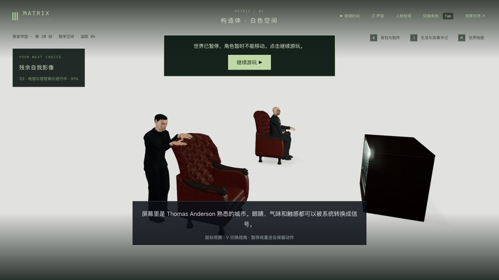
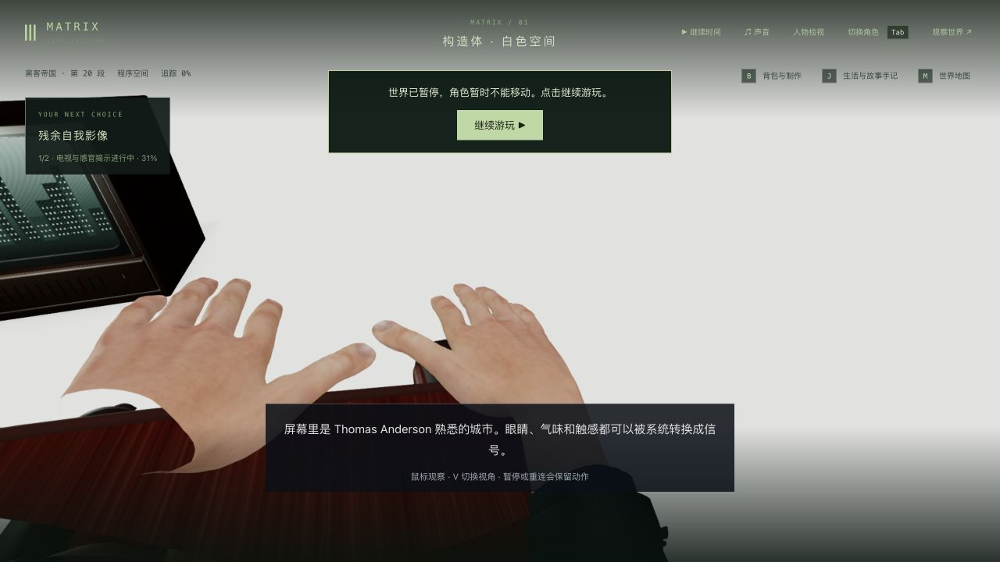

# 构造体：触摸皮椅与握持遥控器

2026-10-23，基线 `f92a2eb`。固定试玩入口 <http://localhost:5173/> 已实际加载 `index-BGtVPsBS.js`。本轮是手臂、手掌和道具接触修正，三部曲电影质量仍为 **0/42**，没有全游戏稳定60帧声明。

## 画面依据与实际修改

在 Warner Bros. Entertainment 官方[构造体与真实荒漠片段](https://www.youtube.com/watch?v=V9smIfYLX4Y)实际抽看54、60、84、87、105秒：Neo在椅后，双手放在弧形椅冠/外翼上；Morpheus身穿深色西装与绿色领带，站立与落座讲解。等待缓冲后才记录观察，早先仍停在旧画面的跳转不算依据。没有看完整三部曲；没有下载电影或把电影截图贴进游戏。片段不足以确定遥控器壳体尺寸，保留原道具几何。

原站位让左肩到接触点距离超过实际两段手臂长度，单纯扭腕不能修好。将玩家提示和站位一同移到右侧皮椅后方，保留家具、引路路线、剧情顺序和11秒动作长度。两只手沿连续曲线抬到椅冠，肘部平面连续旋转；先保留自然局部腕姿，再落到实际皮革法线，腕部60°限制。掌面偏移从交付GLB取值，指骨方向只求一次并缓存，释放沿同一路径退出。身体稍前倾，绕开衣服和椅背。

Morpheus以原遥控器壳体与按钮拟合拇指/食指和三个支撑指，缓存固定15指节；抬臂以肩、肘、腕的连续局部姿态混合完成。显式故事握持不改变普通手部的默认行为，没有引入逐帧手顶点变形、新模型、纹理或依赖。沙漠中原有左手/脚部处理保留，但后续整体坐姿不算本轮完成。

## 先复现再验证

相同九项新回归在原版 **1过/8失败**，最终 **9/9**。原版Neo最大腕偏折约128.63°；最终两人各1,101个10ms姿态，Neo最大49.398°、Morpheus67.213°，原70°测试门槛未放宽；相邻关节最大位移分别0.026273和0.009996，原.05门槛未放宽。

- 16个时刻检查Neo两只完整手与实际家具三角形、手自交；9个时刻检查手/腕皮肤、衣物、身体与对侧手，没有检出相交。5个保持姿态的实际掌面至皮革间隙在原−.003至.04范围，掌法线向下。
- 8个Morpheus姿态检查完整手自交、壳体内部顶点、壳体与按钮三角形，未检出相交；五个真实指尖皮肤补片都在壳体.04范围内。没有声称其全身在任意时刻都无穿模。
- 661帧按60Hz输入推进完整11秒，再抽查9个实际动态表面姿态；这是动画采样，**不是浏览器60fps**。乱序/冷加载及先经历引路的Morpheus均可重建手臂和指节，误差小于1e−6弧度。
- 身体姿态、触点与遥控器的中间候选多次失败，包含手穿皮革、袖口相交、肘部翻转和按钮穿手。原始失败日志、扫描参数、被拒源码和两次测试夹具ReferenceError修正均保留，未靠放宽容差通过。

最终13个相关文件 **475/486通过，11项仍失败**，与修改前477项中的11个失败名称、错误正文和错误码相同，没有新增失败。包括镜面/救援/枕头、旧控制台、公寓电话、Neo与Morpheus骨骼完整性、船损服装恢复，以及三项既有伏击/整条路线检查。不能称整套测试全过。部署 **75/75**、类型及三包生产构建通过；1,181份冻结输入保持，原版1,177份Git内容重新核对。

## 原生游玩、冷读档与性能边界

从上一轮真实版本1 `m1_construct/step0/tick7399` 检查点继续，没有写入世界字段。最初W沿存档方向斜走，随后实际鼠标转向、两次W走到新椅背入口，记录位置的两段水平路径下界为 **7.3875世界单位**，不含更早W、脚本站位调整或跨场景移动。

实际G触椅后暂停于 **3.456秒/tick7415**，关闭网页，真正停止84689并启动2793；完整API响应逐字相同，7份记忆字节不变。冷加载新生产JS，再检查第三/第一人称、V与鼠标。正常继续电视讲解，选择“即使城市是模拟，里面的人也会痛苦。”，实际记录 `care`，进入 **m1_desert/step0/tick7477**，暂停、生命100。开发与生产页均0 warning/error。没有本轮新视频、完整三部曲或全部失败分支实机证明。

此前为更新共享站位主动重启74545→84689时，完整响应比较因**提示文案一处变化**未通过；诊断确认其余字段及7份记忆相同。该次是代码更新，不混作同版本冷恢复证明。报告区分两次重启。停止QA脚本的第一次拷贝路径错误发生在执行前，未停止进程；修正后5200/5201均确认终止。

固定3.456秒姿态的离线完整人物动画/矩阵CPU A/B/B/A各240帧：Neo两次中位旧0.136/0.130→新0.130/0.127ms，Morpheus旧0.105/0.106→新0.107/0.106ms，量级接近。预热后计时，实际渲染、GPU、浏览器和世界模拟不在范围内，**不能据此宣称提帧、稳定60帧或最低内存要求**。完整结果见 `animation-cpu.json`；更广帧率问题见[同机诊断](../frame-bottleneck-2026-10-23/performance-audit.json)。

## 本地同步与剩余事项

711份运行包匹配已验证候选，10份本轮源码/测试同步。只更新共享构造体JS/映射及两份关联声明，**既有 awakening.js/.map 编译差异和其他共享产物全部保留**；280份后端实现字节不变。为加载共享站位有意将主服务82166→9294，保留本地数据备份；完整主世界响应及85份记忆在发布/重启/侧栏原生刷新后相同，tick3757/暂停。旧JS与CSS保留，11份未完成实验未改动。侧栏仍用同一标签页：一次观察超时后补齐DOM记录与保留标记，没有为此重启或另开服务。Render未接回。

人物脸型、发型与电影服装仍粗糙，Neo服装与原片也不一致；坐姿、椅子材质/比例、电影构图、全身任意帧接触及稳定帧率均未完成，不能将几何检查当作电影质量验收。下一段继续检查进入真实荒漠后的坐姿、双手/道具与环境。

实际画面：

