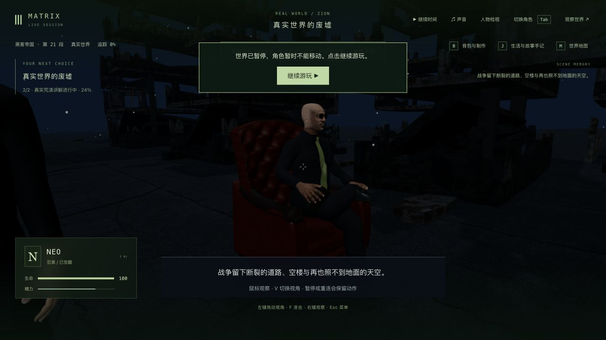
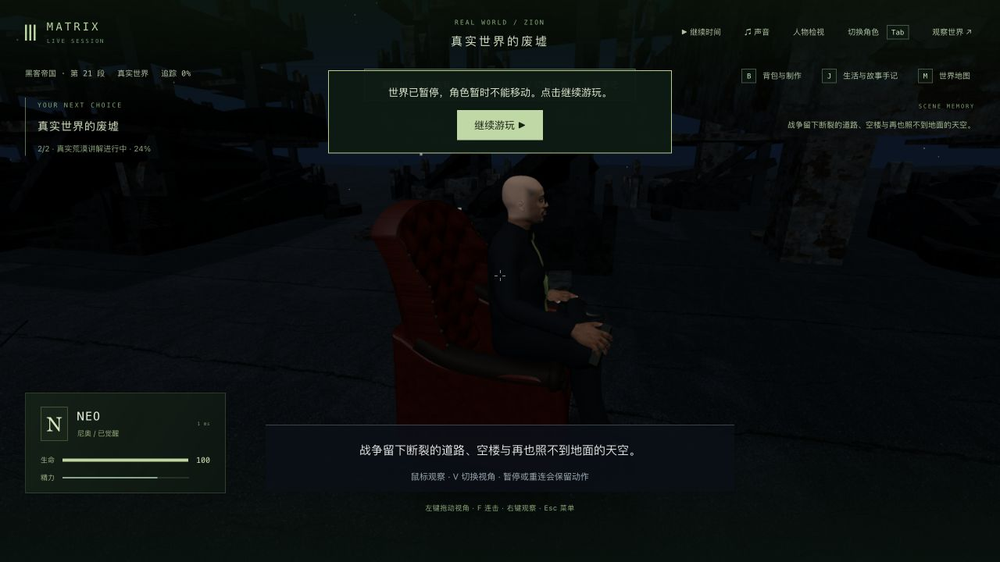
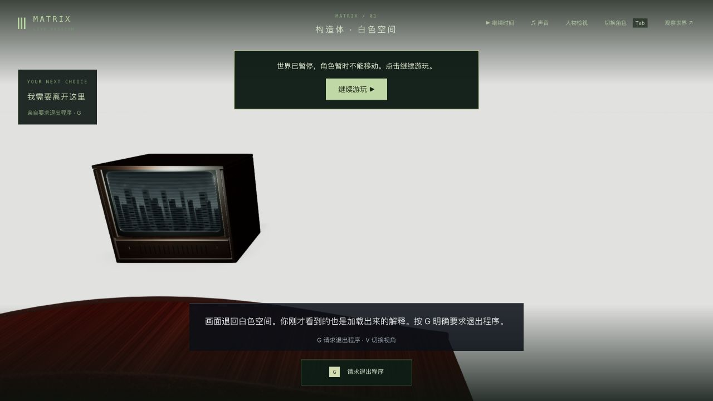

# 真实荒漠：墨菲斯坐姿、扶手与遥控器接触

2026-10-23，基线 `bab847b`。本轮修正 `m1_desert` 的13秒讲解动作。固定试玩入口 <http://localhost:5173/> 已实际加载 `index-C4YiT0v1.js`。三部曲电影质量继续 **0/42**。

## 依据与修改

实际抽看 Warner Bros. Entertainment 官方[构造体与真实荒漠片段](https://www.youtube.com/watch?v=V9smIfYLX4Y)的55、75、91、101、108秒：两张红色高背皮椅、柜式电视、墨菲斯深色西装/绿色领带，以及冷蓝色废墟/阴天。75秒确认最终解码的城市画面后才记录，115秒片尾标识不算场景依据。没有观看完整三部曲、下载电影或导入电影截图。**片段没有建立准确的手脚位置与遥控器尺寸；本轮交叉腿/扶手姿势是游戏演绎，不能称原片动作复刻。** 详细边界见 `film-reference.json`。

左手沿用构造体实际掌面/指节贴合方法，以当前真实扶手顶面和向下法线支撑，肘部外移，避免袖管扭入身体。原构造体站立动作的默认肘平面保持。右手自由握持遥控器，按肩肘求解并保持自然局部腕姿；只让手臂在讲解时稍抬，不再同时叠加第二套大幅抬臂。壳体、按钮和既有五指握持几何不变。

坐姿骨盆前移.15，抬起的右小腿在左腿上方；左鞋移出椅子前裙并保持落地。使用实际骨长解两段腿，未修改身体模型、蒙皮、面部或服装素材，没有逐帧手顶点变形、新资产或依赖。改动只涉及3份客户端源码和2份新增测试/夹具，后端及共享规则不变。

## 复现与有限几何验证

相同最终9项新测试在原版 **2过/7失败**。原左腕约83.75–84.13°，完整手与家具检出908处相交，实际掌面位于扶手内约.0506；原脚部检出78处双鞋、212处右鞋/左裤腿、8处左鞋/右裤腿和288处裤腿间相交。这些是有限样本的几何计数，不代表独立可见缺陷的数量。

最终新增 **9/9**：

- 1,301个10ms骨骼时刻最大腕偏折约47.923°，相邻关节最大位移.0014142；原70°与.05门槛未放宽。
- 15个时刻检查两只完整手的自交/实际家具；13个时刻检查完整手与所有可见皮肤、腕、服装及对侧手，未检出相交。左掌距真实扶手约.03383，法线向下。
- 5个时刻检查鞋/裤腿彼此及完整椅面，未检出相交；左鞋底距地面约.02074，169个实际小腿顶点至支撑裤腿的最小间隙约.02786–.02914。
- 8个时刻检查完整手、壳体/按钮与五个实际指尖皮肤补片；8个时刻检查遥控器对所有可见皮肤、服装和椅子；5个时刻检查左右1262/1290个实际袖管面与自己的上衣、内衫和家具，没有检出相交。
- 781帧按60Hz时间步推进13秒，比较冷加载/第一人称重建的12个肢体关节和30个指节，并抽查动态接触。**这不是浏览器60fps或任意帧全身无穿模证明。**

单独修正手掌后仍有手/袖口相交；把固定掌向扭转推给肘部又造成右袖严重自交；低位自然腕虽清除衣服，却让手和遥控器穿椅。脚部目标单独修改也留下鞋/裤腿穿椅。最后前移骨盆后，完整9项还检出左袖3处自交；扩大肘部外展后才通过。这些失败、夹具错误与有限参数扫描均保留，未跳过身体或放宽相交容差。

最终7个相邻测试文件 **441/452通过，11项仍失败**；名称、错误正文和错误码与原版452项相同，没有新增失败。包括镜面/救援/枕头、旧核心插头、公寓电话、Neo/Morpheus骨骼预算、船损服装恢复，以及三项伏击/整条路线失败。不能称整套测试全过。部署 **75/75**、类型及三包生产构建通过；1,183份冻结输入未变，原版1,181份Git内容重新核对。全部共享编译产物与候选基线相同，280份后端字节未变。Vite的大包提示仍在。

## 原生游玩与发布

从上一轮真实 `m1_desert/step0/tick7477`、版本1检查点复制隔离存档。使用普通W/鼠标/G走到墨菲斯并开始讲解，已记录两次纯步行之间的水平路径下界16.8199世界单位；不计脚本站位、跨场景移动或未保存轨迹的更早走动。

实际暂停在讲解3.149秒/tick7521，关闭页面后将隔离后端24579真正停止并启动68803；完整API字节相同、7份记忆不变，`desert-cold-checkpoint-restart.json`记录原始响应摘要。其后补充的awakening元数据取自同一对已保存响应，没有重新执行重启。

新生产页确认加载最终JS，并在同一3.149秒/tick7521的实际Neo玩家页面检查第三/第一人称、V与鼠标侧看。普通点击继续后完成剩余讲解，进入 **m1_truth_exit/step0/ready/tick7652**，暂停、生命100。未按G退出程序，下一段撤接头/眩晕动作尚未重验。开发、生产与固定试玩页均0 warning/error；没有使用HTTP写入、引擎注入或改写世界字段来推进本轮剧情。

单人固定姿态的离线完整动画/矩阵CPU A/B/B/A各240帧，预热后中位旧.158/.143→新.138/.134ms；不包含浏览器、渲染、GPU或世界模拟，不能据此宣称提帧、稳定60fps或最低内存要求。完整报告为 `animation-cpu.json`。

711份运行包与已验证候选一致，3份客户端源码和2份新增测试复制到工作区；只新增JS并原子替换网页入口，旧JS/CSS保留。**没有复制共享编译产物或重启主服务9294**，包括既有awakening.js/.map差异在内的所有共享运行产物保持。280份后端、发布/原生刷新前后的完整主世界响应和85份记忆、tick3757/暂停及11份原有实验均核对保持。固定5173同一标签页实际读取新构建并保留为交付入口，QA5200/5201已停止，Render未接回。

原始测试日志压缩保存，失败候选与扫描在 `rejected-candidates-and-probes.tar.gz`，原文哈希在 `evidence-manifest.json`。隔离发布目录、node_modules、dist、存档/数据库、原始世界响应均不入库。

## 剩余质量

人物脸型、头发、服装和肢体仍粗糙；真实荒漠环境过于重复、暗淡，椅子与原片比例/材质和构图不够一致。本轮没有精确原片手脚演出、全身任意帧接触、真实表演/声音、新视频、稳定60帧、最低硬件或整组三部曲完成声明。观察者模式在本轮远端电影布景没有显示场景，不能充当近景验收；最终需以实际Neo玩家页面检查。

实际画面：

