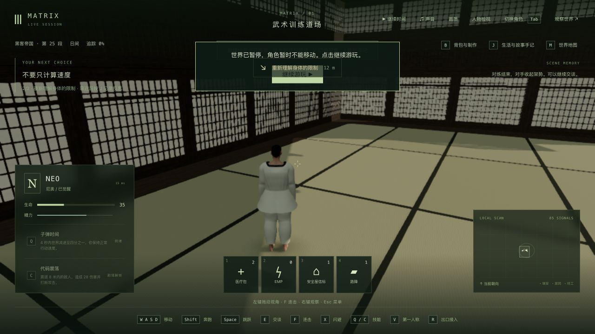
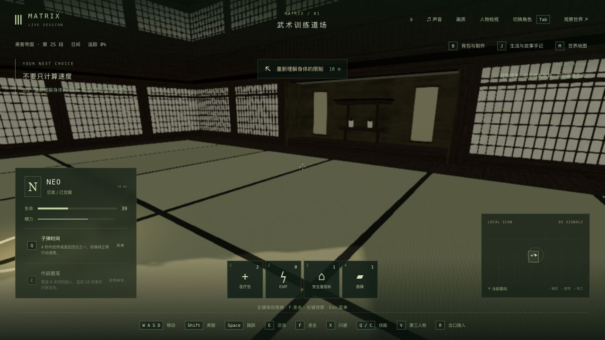
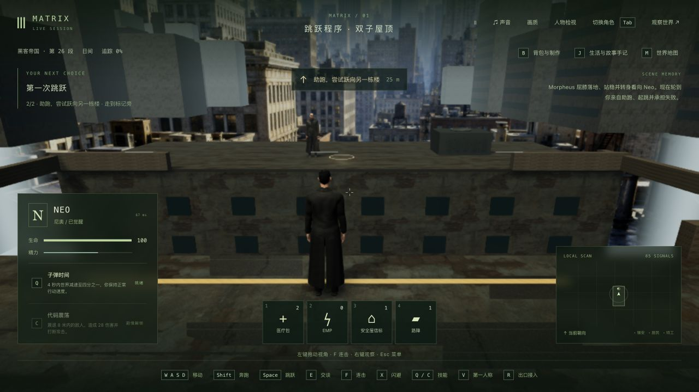
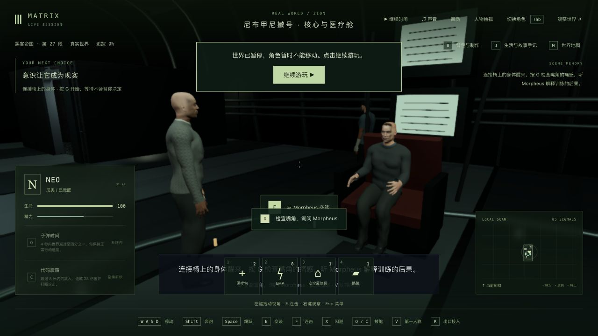
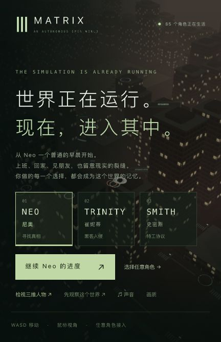

# 道场骨骼计算预算与 60 帧边界

日期：2026-10-24。基线：`59a21b5`。本轮属于性能与连续性进展，42 组电影质量验收仍为 0；没有证明稳定 60fps，也没有证明本轮提高了整场浏览器 FPS。

## 实际修改

只修改 `HeroModel.ts` 的道场完整脚底接地计算。Three 的 `SkinnedMesh.getVertexPosition` 会为每个顶点的每个有效权重，重复计算同一个骨骼世界矩阵与逆绑定矩阵的乘积。本轮每角色每帧计算一次骨骼矩阵表，随后完整遍历原有 Neo 8,988 / Morpheus 8,936 个脚底顶点；保留基础/形变顶点读取、权重累加顺序、绑定变换及骨盆落脚校正。

没有抽样脚底、减少模型、关闭阴影或改动手部/衣物算法。没有新依赖、资产或画质默认值变化。每个训练角色多保存一组骨骼矩阵，换取减少逐顶点重复乘法；没有逐帧新建矩阵。正式 JS 增加 537 字节，CSS、人物资产、280 份后端产物和全部共享产物保持。

## 失败与验证

- 修改前相关基线 31/31。
- 新增两项行为回归先失败：两个人物分别重复计算 10,586 / 10,482 次骨骼矩阵。测试保留完整脚底，并在静止、行走、奔跑与旋转放置时限制同一矩阵的重复次数。
- 第一版仍保留一次多余的 `skeleton.update`，新增两项继续失败；没有放宽次数限制，去掉重复更新后通过。
- 最终相关 33/33、客户端类型检查与 Vite 生产构建通过。已有大包提示保留；未跑全仓及后端测试。
- 两个人物各 36 个姿态，包括待机、行走、刺拳、交叉拳、踢腿和闪避，在平移/旋转/非均匀缩放父级下，对可见网格的位置、法线、权重、骨骼及绑定/世界矩阵做摘要。72/72 与原版完全相同。这是有限姿态的数据等价，不是 GPU 像素对照或全部动作无穿模证明。
- 1,213 个冻结输入核对一致。临时浏览器 A/B 开关和旧版副本已从正式候选移除。

原始失败及成功见 `skinning-before.log`、`skinning-after-first.log`、`related-final.log`、`validation.json` 和 `pose-verification.json`。文本日志只去除行尾空白，`.raw.gz` 保留原始字节。

## 性能测量及限制

机器实际配置：M3 MacBook Air，8 核 CPU、10 核 GPU、24GB 统一内存。以下离线测量不包含浏览器、渲染、GPU 或帧率。

| 两人离线动画 CPU | 原版 | 优化版 |
| --- | ---: | ---: |
| 平均 | 3.625ms | 2.341ms |
| P95 | 4.612ms | 2.807ms |

平均耗时减少约 35.4%。原始 Node CPU 采样、汇总和复现脚本均保存；不能将这个百分比写成全游戏 FPS 增幅。

浏览器同一页面、同一镜头、实际 1920×1080、像素比 1、暂停道场，不录像、不做 GPU 查询，每次预热 3 秒后采样 15 秒。按原版/优化/优化/原版顺序：

| 版本 | FPS | P95 帧间隔 | 角色 CPU | render 调用 CPU | 绘制次数 |
| --- | ---: | ---: | ---: | ---: | ---: |
| 原版 A | 32.72 | 48.1ms | 14.55ms | 11.06ms | 149 |
| 优化 A | 28.60 | 83.5ms | 14.30ms | 13.85ms | 149 |
| 优化 B | 33.64 | 49.2ms | 12.36ms | 11.00ms | 151 |
| 原版 B | 33.56 | 46.1ms | 13.21ms | 10.93ms | 151 |

**没有建立整场 FPS 提升。** 后台负载未隔离，前后两组相差两次绘制；保留低分样本，不能只选择较好的一次。`render` 是 CPU 侧调用耗时，不能当作 GPU 时间。四份原始报告在 `browser-profiles.json.gz`，对照在 `browser-comparison.json`。

机器整体在采样后已有约 4.5GB 交换空间，后续读数更高；这不能证明全部由游戏造成，也不能单凭已有交换空间判断当前仍在频繁换页。未给出最低硬件配置或升级建议。

60fps 的每帧预算约 16.7ms。下一步必须分别限制角色/世界更新、绘制提交与 GPU 开销，并覆盖正常城市、室内和多人战斗的长时间帧间隔；硬盘容量不是持续帧率指标，内存和显存需要依据实际驻留量、压力和换页测量。现有均衡/流畅设置可以降低像素预算，但不是本轮新功能，也不保证所有场景 60fps。

## 正式构建与原生游玩

正式包为 `index-D5QCoRp5.js`，SHA256 `3cc63c099997af7eb378da2ef42fd78197f56ccb6d5009ddcf8d1b379b278d80`。

隔离 QA 真正重启后端，旧 PID 60999 结束、新 PID 78224 启动；重启前后完整世界相同，7 份记忆相同，tick 10702 保持。正式生产页冷读档后，原生键盘验证移动、跳跃及 V 双视角；本轮继承已完成的道场对练，没有新打一场完整对练。

随后正常行走接近反思点，选择“先观察重心和距离，再尝试突破”，按 G 进入屋顶；Shift+W 走到起跳线，按 G 观察 Morpheus 示范，Shift+W+Space 触发 Neo 首跳失败，按 G 返回飞船。最终 `m1_jump_return / step 0`、`jump_return` 尚未开始，生命 100、tick 12193，已暂停；尚未检查嘴角和完成本段反思。没有改写存档或调用推进剧情的测试接口。

采样记录是服务端状态，不能拿来计算渲染 FPS。有一小段重复只读采样同时运行，发现后两者均停止，再只开一份；最后所有采样任务终态已确认。生产页 0 warning/error。QA PID 61000 / 78224 均已停止，5200/5201 已关闭。

## 本机发布

固定入口 <http://localhost:5173/> 已实际重载新包；控制台 0 warning/error。主服务 PID 43571 未重启、280 份后端文件与全部共享产物保持，721 份正式包文件匹配候选，11 份其他实验逐字节保持。

主世界仍在运行，发布前后 tick 8848 → 8857，因此完整世界快照不相同，不能声称冻结存档完全一致。此次发布没有写入/恢复存档，85 份记忆摘要一致；只更新本轮源文件、新测试、新 JS 和入口，保留旧 JS/CSS。Render 没有接回。

人物相似度、服装自然度、屋顶环境精度、完整攻防编排以及稳定 60fps 继续未完成；本轮结果不改变电影质量验收数量。
