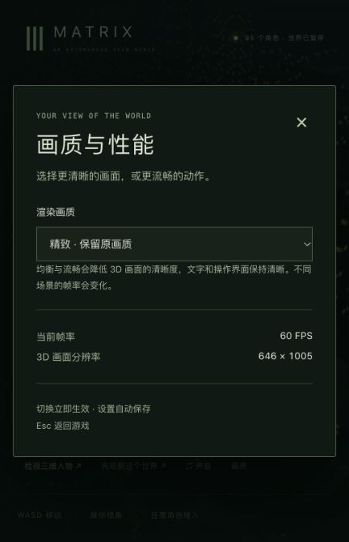
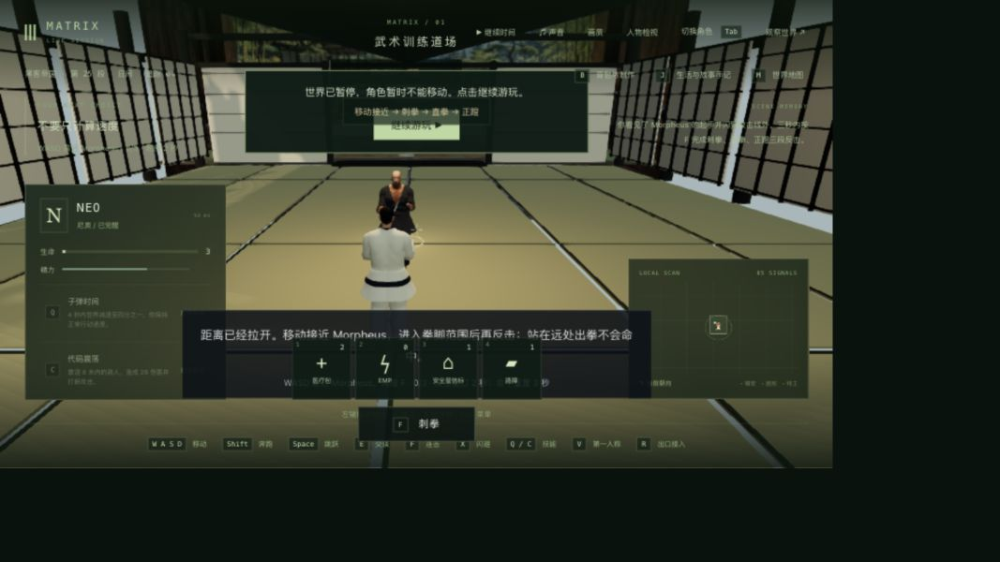
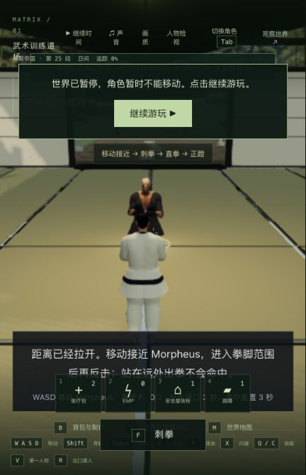
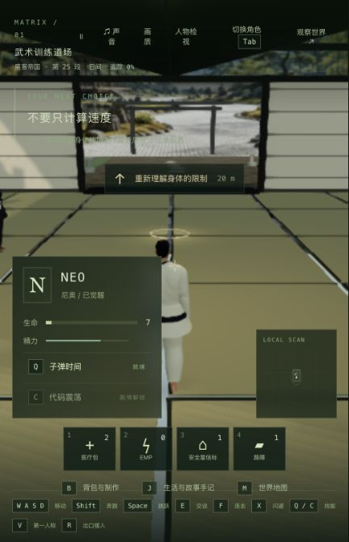

# 道场输入追踪与反击距离引导

2026-10-24，基线 `3604a31`。本轮只修改客户端道场提示，增加两项行为验证；不改变攻击距离、伤害、闪避位移、敌人时序或角色资产。正式本机入口为 <http://localhost:5173/>，客户端 `index-CqeofKx_.js`。Render 未重新接入。

## 真实发现

上一轮不能确认 X 是否到达服务器。本轮在隔离后端暂时记录输入：tick10170 的一次 X 落在受击硬直中，未触发闪避；tick10638 的 X 在 Morpheus 起手结束前被接受，产生 .22 秒闪避、.8 秒冷却和三秒反击窗口。后续两次同样接受，不能再把键盘 X 一概描述为失效。见 [原始输入追踪](input-trace.log.txt)。临时客户端和后端追踪已移除，生产产物没有这些日志。

无方向输入时，X 后撤 16×.22=3.52 个世界单位。敌人接近到约2.7单位，后撤后距离约6.22，超出刺拳的3单位范围。实机按 X 后直接 F 未命中；按 X、W 接近约1150毫秒、F/F/F 可以完成。旧测试会在每次出拳前重摆角色位置，掩盖了引导缺失。

新的 HUD 使用与服务端相同的拳脚范围和遮挡检查。距离不合适时提示 WASD 接近，进入范围后显示“距离合适 · F 连击”；刺拳、直拳和正蹬使用各自范围。操作仍由玩家执行，不自动移动或放宽命中判定。

## 验证

- 基线相关12/12；新增 HUD 回归先因缺少接近提示失败，再通过。自然控制器回归从正常起手开始，验证后撤空拳、反击超时、下一次起手、正常步行接近和三段命中，不在战斗中改写双方坐标。
- 最终相关13/13、界面46/46、部署75/75、类型检查和生产构建通过。全仓测试没有重跑，此前7项人物失败没有在本轮复核；既有大 JS 块提示仍在。
- 全量构建使两份既有 awakening 编译文件产生与主试玩不同的内容。本轮恢复这两份运行产物到原发布基线，重新构建客户端并再跑部署回归；全部516份共享编译文件和280份后端产物保持与原试玩一致。没有把这项无关差异发布。
- 生产页显示接近提示；暂停于tick10332，反击截止tick10335。关闭页面、真正停止并重启后端后，完整世界逐字段相同、7份记忆一致；接管后仍显示剩余2秒。
- 恢复后实际观察反击超时，随后再次 X、W、F/F/F 完成对练，终点 `m1_dojo/step1/tick10502`，`combo=3/hits=3/complete=true`，暂停，生命6.4，页面0 warning/error。没有用存档编辑代替过关。

见 [测试结果](validation.json)、[原生验证](native-verification.json)、[真正重启核对](restart-verification.json)与[压缩原始世界](raw-worlds.json.gz)。

## 保留的未完成项

两次生产页屏幕闪避点击未打开反击窗口；键盘操作成功。该窗口约一秒，自动化还出现过匹配到可用按钮却返回等待超时的情况，尚未确定屏幕点击失败是游戏事件处理还是自动化时序，不声明该问题修复。首轮生产验证因此失败，记录保留。

窄侧栏里的提示和快捷栏重叠，训练结束后第三人称上身看起来被裁切，需分别复现修正。截图是有限玩法证据，不是电影级人物、动作、手部接触或无穿模验收。没有新增长视频或战斗 FPS 测量；42组电影质量通过数仍为0。

本轮使用前一轮真实失败存档建立独立 QA 分支。诊断分支和生产分支分别保存，未覆盖正式玩家进度。QA5200/5201已停止；本机主PID43571、完整暂停世界tick3757、85份记忆和11份既有实验均保留。只同步一份产品源码、两份测试和客户端产物，旧JS/CSS继续保留。见[发布核对](local-update-verification.json)。

## 帧率问题

此前同一静止床边场景在M3、24GB上测得：1920×1080约28fps、1280×720约48fps、960×540约59fps。降低像素数有明显收益，不能由此声称同画质优化或全程稳定60fps。完整采样条件与P95见[性能报告](../skinned-bounds-budget-2026-10-24/README.md)。

本轮系统快照报告24GB内存、51%空闲，只是当时状态，不是游戏峰值内存基准。达到稳定60fps需要持续把每帧工作控制在约16.7毫秒以内，仍须检查移动、战斗和重场景。硬盘容量、服务器存储和内存容量不能单独保证帧率。画质设置截图上的瞬时60fps也不代表战斗基准。

