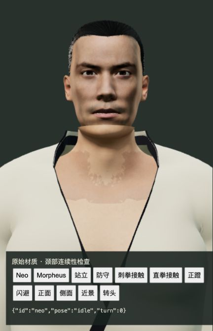
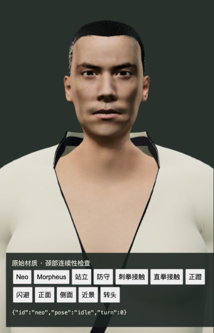
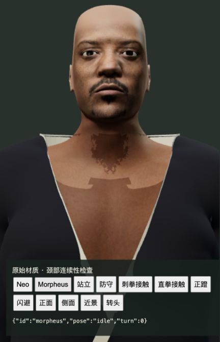
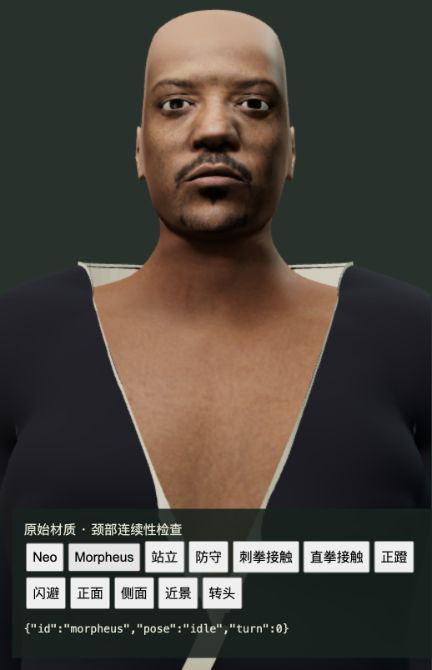
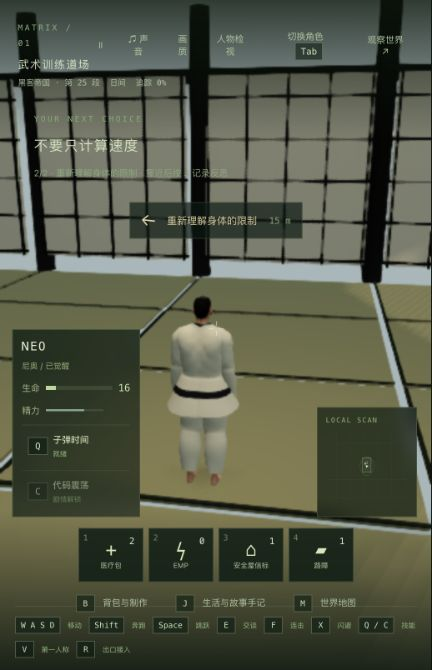

# 道场颈部连续性修正

2026-10-24，基线 `1c5591f`。修正 Neo / Morpheus 在训练服中下巴附近的重复皮肤、脖子接缝和胸口色差。人物相似度、头部原贴图、衣领形状及完整电影攻防编排仍未验收；42 组电影质量完成数保持 0。

## 实际问题与修改

成品头部已经包含完整脖子，旧 `dojo-skin` 又从胸口延伸到 y=3.9，产生重叠和锯齿边缘。新构建脚本读取原先固定版本的 MakeHuman CC0 基础体、各角色形变和 46 根骨骼，在细分前取头部源多边形的补集。胸口与 Neo 的 120 条、Morpheus 的 124 条颈部边界相接；边界位置、权重和法线直接匹配成品头部。

旧脚部保留原位置、法线、UV、权重、索引和材质，只缩短原 accessor 到脚部实际范围。所有原有二进制字节、既有 mesh/node/material、贴图和骨架均保持；没有重做脸和手。新胸口独立绑定同一骨架，每个可见角色每个绘制 pass 增加一次提交，同时分别少绘制 5404 / 3044 个重复三角面。为了保留可核对的原二进制，GLB 文件分别增加约 357KB / 401KB；这不是文件体积优化。

第一候选几何接缝消失，但实际画面仍显示明显色差。读取现有头部和身体 PNG 的线性颜色，在真实接缝 UV 上测量增益，加载时应用到该角色自己的胸口材质。没有改写或新增位图，也不添加逐帧接缝求解。最终两个角色接缝各颜色通道的平均相对差约 1.06% / 1.40%，最大约 6.88% / 10.98%；剩余局部差异包含原贴图纹理细节，不能声称像素完全相同。

生成脚本是 [build-dojo-neck.py](../../../scripts/build-dojo-neck.py)。输入需为该基线的原始 GLB、与其同目录的头部及全身 PNG，以及哈希匹配的 CC0 源文件；输出要求新文件，不覆盖输入。见 [资产保持核对](asset-preservation.json)、[Neo 构建](authoring-neo-final.log)、[Morpheus 构建](authoring-morpheus-final.log)及[源码审计](source-audit.json)。

## 验证

- 既有基线 15/15。新增几何回归先 4/4 失败，真实贴图色差回归先 2/2 失败；最终新增 8/8，相关 33/33，道场服装 2/2。客户端 TypeScript 与 Vite 构建成功，保留既有大 JS 块提示。未重跑全仓，不宣称此前全部人物测试已通过。
- 两人各 33 个实际转头、出拳和闪避姿势，颈部匹配点的位置间距和法线夹角均为 0；检查覆盖 UV 重复点。缓存角色不会累计颜色增益，重复动画不会重建胸口法线；退出道场隐藏新皮肤，共享几何只释放一次。
- 原生浏览器检查了实际贴图的正面、侧面、转头、防守、直拳和闪避。独立模型检查页仅用于近景审查，不冒充游戏画面。
- 正式构建从既有真实道场存档进入，原生 X、W、F/F/F 实际完成闪避和三次命中，进入反思步骤；没有修改角色或剧情存档来制造成功。
- 关闭页面并真正停止/重启隔离后端，重启前后完整世界响应解码后完全一致，7 份记忆哈希一致。冷加载后 V、W、D、V 通过，实际位移 1.558 单位，停在 `m1_dojo / step1 / tick10199`；未进入后续剧情。
- 首次在模型尚未就绪时按 V 没有切换，等待加载后再次按 V 才生效，已如实记录。游戏顶部与快捷栏在窄视口仍拥挤；本轮未修这些问题。
- 模型检查页、正式构建重启前后、本机主入口均 0 warning/error。没有新录屏。

见 [测试汇总](validation.json)、[正式游玩](native-verification.json)、[真正重启核对](restart-verification.json)。 原始失败日志的提交副本仅去除了行尾空白，完整原始日志留在本地。

## 性能边界

没有新增 GPU 或浏览器 FPS 测量。第一次分开导入两个候选运行时的离线计时波动较大，原结果保留在 [初次计时](animation-cost-initial.json)。随后用同一 HeroModels/THREE 运行时加载新旧 GLB，对完整 `animate` 调用交替采样：

| 角色 | 修改前进程 CPU / 次 | 修改后进程 CPU / 次 | 修改前墙钟 / 次 | 修改后墙钟 / 次 |
| --- | ---: | ---: | ---: | ---: |
| Neo | 6.072ms | 6.299ms | 6.345ms | 7.292ms |
| Morpheus | 6.172ms | 5.942ms | 6.315ms | 6.560ms |

进程 CPU 变化方向不一致，墙钟也有明显波动。这个结果只能说明本次有限采样，不证明游戏提速、零额外开销或稳定 60 帧。见 [完整对照](animation-cost.json)与[计时脚本](measure-animation-cost.mts)。

本轮回答帧率问题时，硬件检查为 Apple M3 / 24GiB；检查时内存压力报告空闲比例 59%，磁盘可用约 48GiB，没有证明内存容量是帧率瓶颈。已有同镜头暂停床边测试：1080p 约 28fps、720p 约 48fps、540p 约 58–60fps；这些是此前有限测试，不能代替战斗帧率或最低配置。见 [此前实测](../skinned-bounds-budget-2026-10-24/README.md)与[本次问题核对](fps-question-context.json)。

## 本机交付

[试玩入口](http://localhost:5173/) 已原生加载 `index-TukPf1bu.js`，进入按钮可用；两份更新 GLB 的实际 HTTP 内容与候选哈希相同。共发布 5 份源资产/代码/脚本/测试及客户端产物。主 PID 43571、280 份后端编译文件、所有共享编译产物、tick3757 暂停世界、85 份主记忆及 11 份既有实验保持。QA 5200/5201 已停止，Render 没有重新接入。见 [本机发布核对](local-update-verification.json)。

模型检查前后均使用同一相机、灯光和原始贴图：

| Neo 修改前 | Neo 修改后 |
| --- | --- |
|  |  |

| Morpheus 修改前 | Morpheus 修改后 |
| --- | --- |
|  |  |

