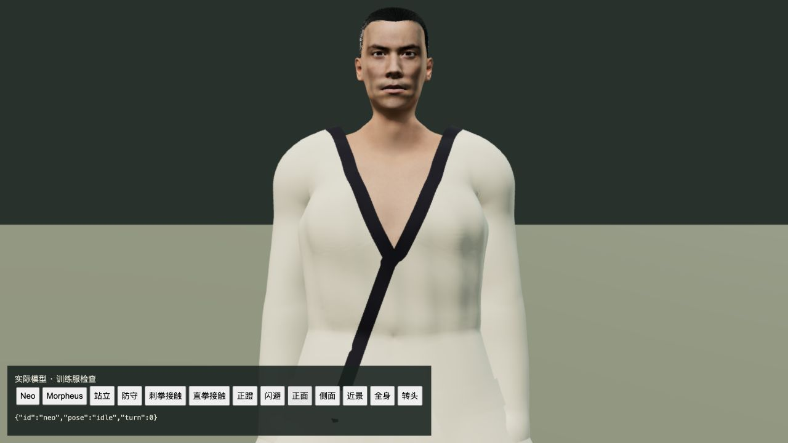
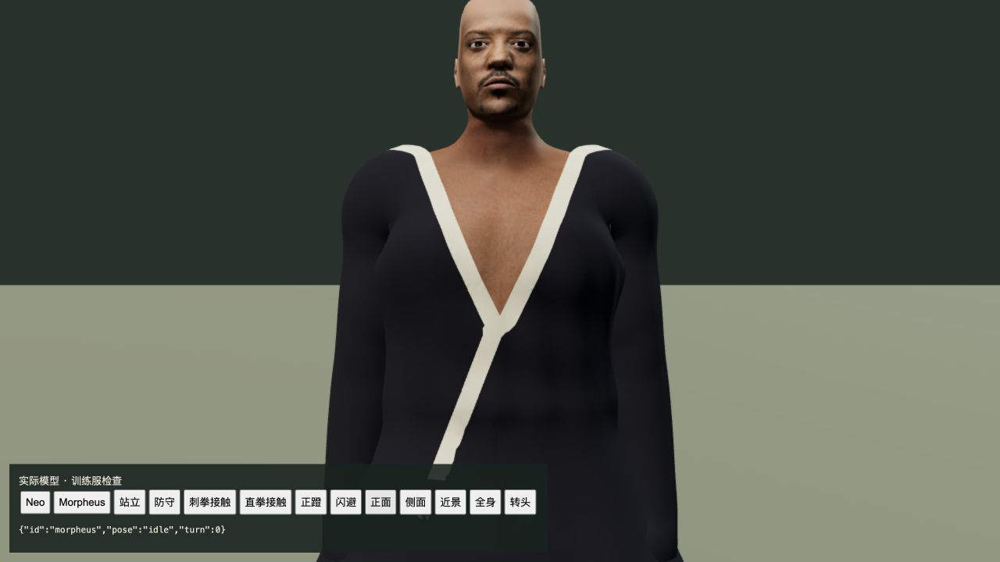

# 道场训练服领口与垂坠

2026-10-24，基线 `8bbee61`。本轮只重制 Neo、Morpheus 已有 GLB 中的训练服上衣/包边，并把 Neo 的黑腰带改为与浅色训练服一致。没有运行时代码、贴图或依赖变更；客户端仍为 `index-TukPf1bu.js`。这是局部资产修正，42 组电影质量完成数仍为 0。

## 参考与修正

实际抽看 Warner Bros. Entertainment 的 [官方训练片段](https://www.youtube.com/watch?v=ozS_6vqnJ8w)：0:08 道场全景、0:13 Neo 浅色训练服和同色腰带、0:26 Morpheus 深蓝训练服与浅色领缘、0:39 交叠衣襟。没有观看或下载整部电影。官方镜头是封闭的双层室内道场；当前游戏的开放庭院空间仍不符，不能因本次改衣服将场景记为完成。

旧包边由独立条带构成，重合点法线相互冲突，最低点积约 Neo −0.776、Morpheus −0.799；衣领继承头部蒙皮，转头会拉出竖起的薄片。离线脚本将上衣头部权重转交胸部，保留手臂权重，并从同一衣面分割衣身和领缘，共享接缝位置、法线与蒙皮。降低后领，保留肩部；胸前用平滑横截面跨过人体肌肉凹槽，再加入小幅张力褶皱。

第一版虽然通过最初五项检查，但实机显示肩部被截平，已拒绝；增加肩峰保护断言并修正领口轮廓，之后继续修整 Morpheus 领口台阶。初次脚本在输出后打印报告时误用 `st_size()`，修正后重新生成的同阶段资产字节一致。构建时临时检视页被移除造成开发页回到游戏首页，其截图另存为本地诊断，没有作为模型完成证据。

## 验证范围

- 修改前道场资产 2/2、颈部 8/8；首批新增五项在原版 0/5。最终新增九项，相关 24/24、实际道场资产 2/2、客户端类型检查和生产构建通过，既有大 JS 块警告保持。没有重跑全仓测试。
- 两人各 33 个实际出拳、闪避和转头姿态：Neo 373 对、Morpheus 379 对衣身/领缘接缝最大间距和法线夹角为 0；检查上颈口区域完整三角面的皮肤接触。两人各 73 个攻防阶段检查完整外露双手与新领缘；原有拳架检查同时覆盖手与上衣。
- 这些是有限姿态及限定颈部区域的接触检查，不证明所有衣物、所有姿势永不穿模。旧颈部连续性仍通过；脸部相似度、皮肤贴图、衣料厚度、袖口/衣摆和连续攻防编排仍待制作。
- 使用此前自然到达道场的独立存档，生产页面按 X 闪避、W 接近及四次 F 操作取得三次命中，进入 `m1_dojo/step1`。真正停止并重启隔离后端，接管前完整世界响应逐字段相等，七份记忆相同，tick10138 保持。
- 新开生产页面恢复存档，V 第一人称，继续后 W/D 各 300ms，再 V 回第三人称并暂停；实际位移约 1.670 单位，转角改变，最终 tick10141、对练完成状态保持，控制台 0 warning/error。没有改写存档、位置或命中结果来通过验收。

见 [测试汇总](validation.json)、[实际输入记录](native-verification.json)、[真正重启核对](restart-verification.json)、[回归日志](related-final.log)。

## 资源与性能边界

| 项目 | Neo | Morpheus |
| --- | ---: | ---: |
| 上衣与领缘三角形，原版 → 当前 | 21,988 → 21,521 | 21,670 → 21,494 |
| GLB 字节增量 | 917,460 | 918,856 |
| 资产网格部件数，前后相同 | 20 | 15 |

保留原始二进制前缀，以保护脸、手、脚和其他服装；替换的旧上衣数据仍在文件内，所以磁盘文件变大。其他网格、骨架、贴图、绑定数据逐项相同，新贴图数为 0。没有新增绘制部件或逐帧求解器，不能据此声称 FPS 提升。详见 [资产核对](asset-preservation.json)。

当前电脑为 M3／24GB。此前同一暂停床边镜头在实际 1080p 下约 28fps、720p 下约 46–48fps、540p 下约 58–60fps，证明减少像素工作有明显作用；该实验没有验证战斗或全程稳定 60fps。见 [原始性能范围](../skinned-bounds-budget-2026-10-24/README.md)。本轮未做新的 FPS 基准。

## 本机交付

已更新 [本机试玩](http://localhost:5173/) 的两份人物资产并原生重载；JS/CSS/入口 HTML 完全相同。721 份运行包文件与候选一致，主 PID43571、280 份后端产物、全部共享产物、tick3757 暂停世界和 85 份记忆保持，11 份既有实验未动；QA5200/5201 已停止。Render 未重新接入。

[发布及主存档核对](local-update-verification.json)。[画质入口截图](local-graphics-settings.png) 中的 60fps 是首页菜单瞬时数值，不是战斗性能验收。原始完整世界、记忆、候选运行目录与临时制作资产仅在本地保留，不加入本次提交。

