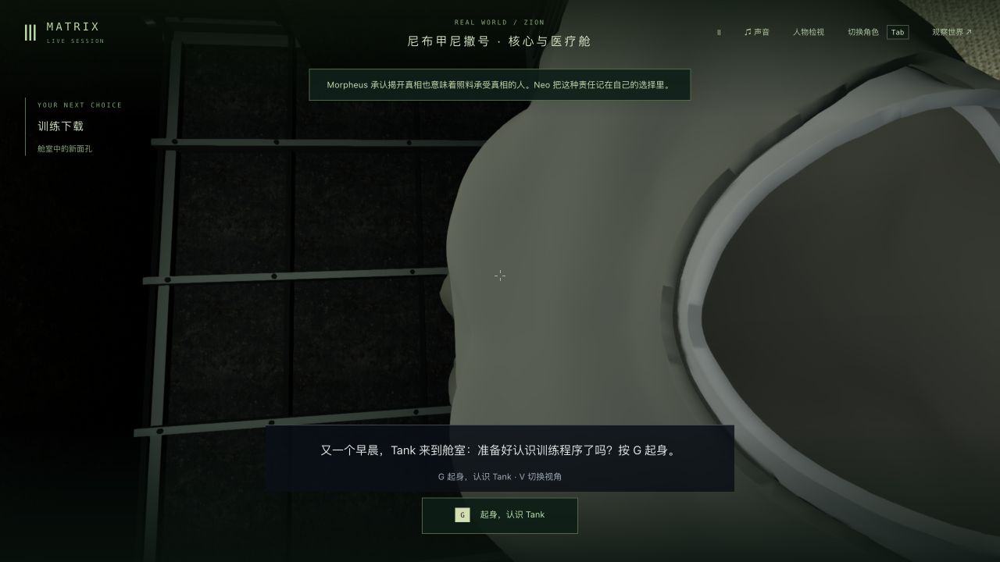
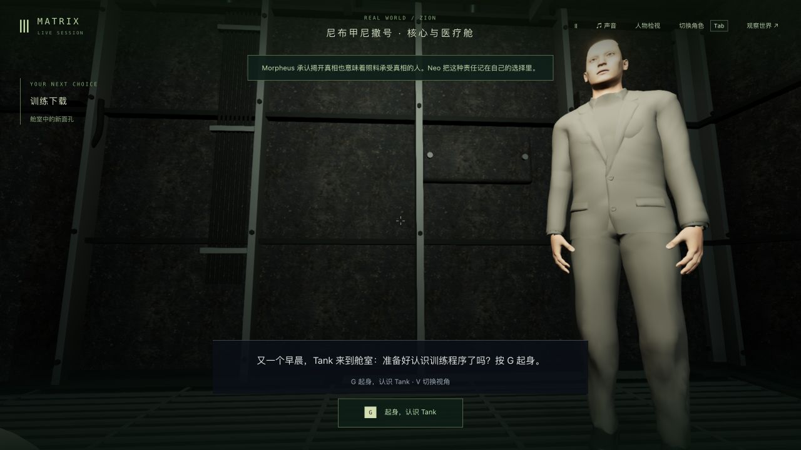
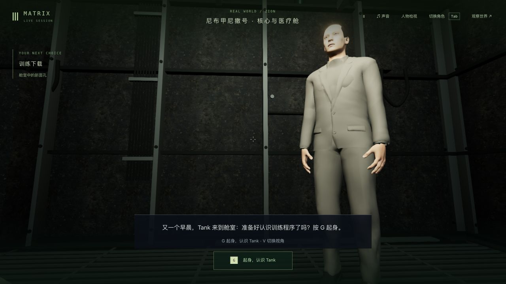
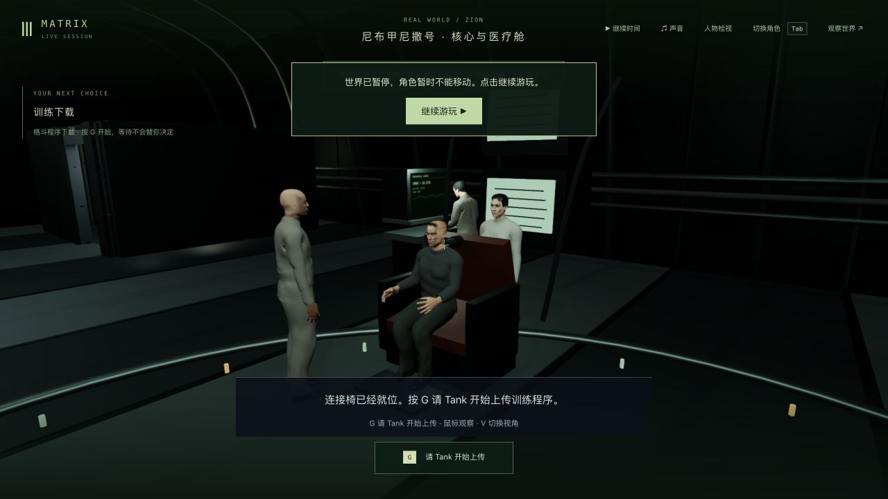
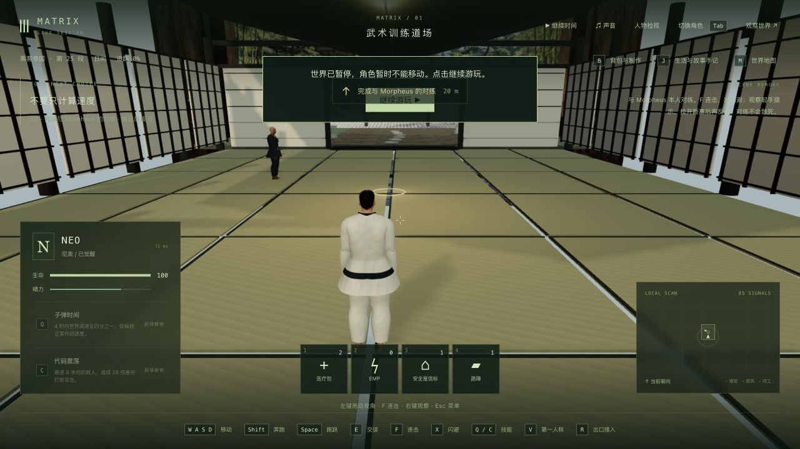

# 床边回答到训练起身的第一人称视角

2026-10-23。基线 `f909ccc577d7889e8a02b9860ffa96a498f6799f`；正式入口 <http://localhost:5173/> 已更新到 `index-sQG1bG1d.js`，Render 未重新接入。这是局部镜头修复，42 组电影质量完成数仍为 0。

## 原因与改动

`m1_truth_return` 床边回答使用世界坐标观察角；`m1_download` 问候和起身使用已经倾斜的头部局部坐标。直接沿用角度会让镜头转约 86.5 度，落到自己的衣领。现在保存过渡前实际镜头四元数，等新头部动画完成后再换算观察方向及水平线；水平线补偿随坐起结束，V 往返仍保留。没有隐藏第一人称身体或衣物，也没有增加素材文件、包依赖或服务器逻辑。

唯一运行时代码为 `packages/client/src/player/PlayerControls.ts`，新增行为回归 `tests/download-wake-view.test.mts`。相关资产、骨骼动画和旧存档格式不变。

## 自动验证

| 检查 | 基线 | 最终 |
| --- | --- | --- |
| 既有相关测试 | 236/236 | 与新测试合计 242/242 |
| 新增镜头行为 | 1 通过、5 失败 | 6/6 |
| 部署回归 | — | 75/75 |
| 三包类型检查、生产构建 | — | 退出码均为 0 |

使用实际交付 GLB、头部眼点和正常“控制器更新→人物姿态→镜头同步”顺序：四种床边鼠标观察，过渡的方向/完整四元数、身体和针织衣可见性、每组九条近景射线、暂停稳定、V 往返、鼠标继续控制、241 个起身时刻、释放到行走以及四个冷接管时刻。最终初始转角为 0，起身每 50ms 最大完整转角约 0.15091rad，释放约 0.07349rad；这是有限样本，不是任意角度或全身无穿模证明。

早期方向测试通过仍遗漏约 1.44–1.46rad 的水平线倾斜；加强完整四元数断言后失败。增加水平线补偿后，V 重置补偿又被新增断言捕获，最后保留补偿才通过。原失败日志保留，最终同一测试在未改基线上重新确认 1 通过、5 失败。

`validation.json` 记录最终门槛；`source-audit.json` 限定 1 份源码和 1 份新测试，1,189 份构建/测试输入在验证后保持。日志中的 Node 无网页 URL 环境下资产回退提示与浏览器控制台分开；不能把相关测试当作全仓库测试，也未清理其他分支既有失败。构建保留原大包警告。

复测新行为可在同一已构建依赖环境运行：

```sh
node --import tsx --test tests/download-wake-view.test.mts
npm run test:deploy
npm run typecheck
npm run build
```

## 原生生产页游玩与读档

从之前实际游玩到达的 `tick7802 / m1_truth_return / question` 独立复制验收档重放，记录见 `native-production-replay.json`，没有编辑世界 JSON 制造进度。生产包页面实际执行：接管 Neo → V/鼠标观察 → care 回答 → V 切换两种视角 → G 起身 → W/A/D 与鼠标穿过门口及走廊 → 走近连接椅并同意接入 → 开始上传 → G 进入道场。

在 `tick8738 / downloadSetup.ready` 真正停止并重启验收后端；浏览器完整重新加载、接管 Neo 后，世界响应逐字节相同，7 份记忆文件也相同。原计划在连接中暂停，实际已到 ready，因此只验收就绪检查点，不称连接动画中途读档已通过。继续完成训练下载，最终 `m1_dojo / step0 / tick9192` 暂停，生命 100；尚未进行道场对练。生产页捕获的 warning/error 为 0。

另一次开发页在起身 1.020 秒真正重启，接管后完整响应相同；首个审计脚本错把 agents 字典当数组，修正验证器时没有再次重启。该次缺少重启前记忆哈希，不能声称记忆比对通过。开发页后续走路被共享产物构建触发 HMR 打断，最终生产包重放与该段分开，不称连续无中断游玩。见 `wake-view-checkpoint-restart.json`、`chair-ready-checkpoint-restart.json`、`native-verification.json`。

| 原先过渡遮挡 | 修正后问候 |
| --- | --- |
|  |  |







## 本机交付及限制

发布和侧栏原生刷新均确认新 JS。只复制本单元两份源码/测试及新客户端 JS/入口，保留旧 JS 与 CSS；712 份运行包匹配候选，280 份后端及所有共享编译产物不变，主 PID 9294 没有重启。发布及原生刷新后完整主世界、85 份记忆、tick3757/暂停相同，11 份未完成实验保持；验收服务 5200/5201 已停止。见 `local-update-verification.json`、`local-native-page.json`、`qa-stop.json`。

Tank 仍是通用灰色西装，船员站位、手/衣物与椅子的接触和人物精度仍不符合电影目标。冷加载使用当前头部默认观察，不保存此前鼠标偏好。本轮没有新录像、FPS 基准、稳定 60 帧或整场电影质量完成声明；截图中网络延迟毫秒数不是每帧耗时。原始世界与记忆、隔离副本留在本机，未纳入本次提交。
