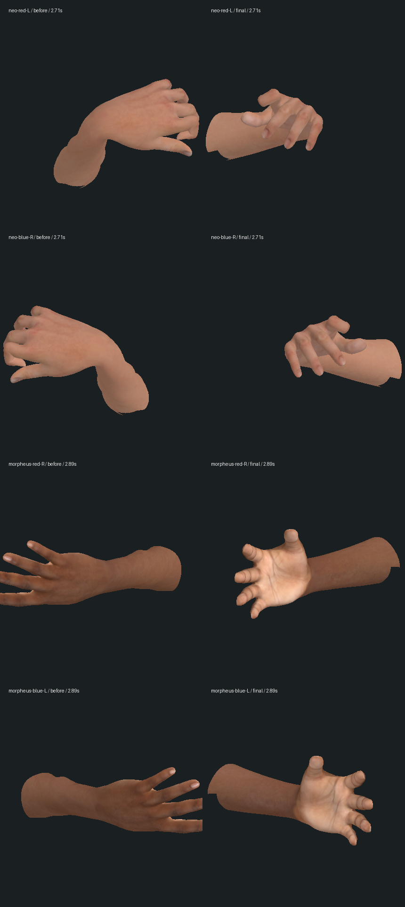
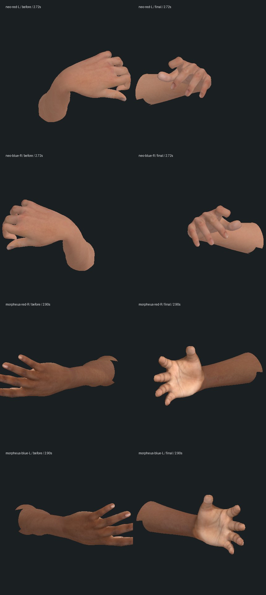

# 取药、递药与接勺子的手臂连续性 — 2026-10-14

起始提交：`b5a2bdf`。本轮按每 10 ms 的实际保存动作时间采样握电话、红/蓝药丸、墨菲斯递药、四名主角持枪、Neo 接勺子和 Smith 同化，共 **4,072 个姿势/版本**。原版在 Neo 取药约 2.72 秒、墨菲斯递药约 2.90 秒出现前臂辅助骨约 121° 的一帧翻转，手掌本身只转约 2°（`scan-summary.json`）。

原因是两个药丸动作都使用恰好 180° 的四元数插值，选中的路径让手腕转掌超过 π，再被前臂的角度分支切回另一侧。`PillPerformance.ts` 现在按左右手明确选择翻掌方向；动作仍由保存时间计算，原药片接触点和最终掌向保持。没有累积上一帧的转角或新增存档字段，避免顺着播放与直接冷读选择不同转角。

接勺子的另一问题是“目标稍动便完整切换到 IK 肘姿势”。`SpoonPerformance.ts` 随接触权重混合原肩肘与解算结果，修复 Neo 和男孩的起止跳变。男孩在交出勺子的同一帧还会因持有物消失而弹开手指；修肩肘后这一失败仍存在，最终用保存的收手权重渐进松指。

| 实际回归范围 | 原最大辅助骨/肘部转角 | 最终转角 | 原皮肤单步位移 | 最终位移 |
| --- | ---: | ---: | ---: | ---: |
| Neo 红药，0–4.35 秒 | 约 121° | 5.50° | 0.173278 | 0.049821 |
| Neo 蓝药，0–4.35 秒 | 约 121° | 5.40° | 0.173278 | 0.049821 |
| 墨菲斯递药/收手，双臂 | 约 121° | 2.12° | 0.174884 | 0.015723 |
| Neo 接勺子，0–2.4 秒 | 29.24° | 1.44° | 0.183562 | 0.025980 |
| 男孩示范/交出，0–3.4 / 0–2.4 秒 | 22.52° | 1.35° | 0.113728 | 0.026640 |

位移单位沿用游戏，采样间隔 10 ms；这些是有限动作的连续性检查，不是自然演出或帧率评分。原日志为 `reproduced-pills.log`、`reproduced-spoon.log`、`reproduced-boy.log`；肩肘修复后男孩仍跳指的失败保留于 `boy-still-fails.log`。




这两张是实际网格/骨骼、法线和原颜色贴图的离线模型对照，隐藏衣袖以检查腕部。原版通过原提交的 `PillPerformance` 重新计算；两列使用相同且未修改的资产。没有游戏 PBR、法线贴图、阴影或玩家相机，**不是原生游戏截图或高质量场景验收**。

验证与范围：

- 既有腕部/转掌基线 16/16、药丸/勺子接触基线 19/19。新增五项行为回归均先失败，修复后相关 **82/82**。正式较广结果见 `final-tests.log`。
- 最后校正新皮肤探针的完整帧矩阵刷新，腕部 9/9；男孩加上示范、交出、松指时的冷模型重建，勺子 7/7（`forearm-final.log`、`spoon-cold-final.log`）。这些是较广 82 项的子集，不另加到数量中。取药还检查了暂停/新建模型和等价四元数符号。
- 既有回归继续检查实际指尖与胶囊、杯子、勺子、电话、枪、先知上衣的有限接触；本轮没有修复或验收所有身体/衣物穿模。
- 对送药入口的两种选择，各检查 13 个时刻、每三顶点一个手部样本；在实际 31,982 个纯头部三角面的投影里，最终 3,835 个命中点无穿入（`head-contact-result.json`）。这不覆盖头发/眼镜、颈部、手指三角形边交叉或所有时刻。初次探针没有刷新蒙皮绑定逆矩阵，零命中结果未采用；最终与渲染一样调用 `updateMatrixWorld` 后才计算，见 `head-contact.mts` / `check-head.py`。
- 三包类型检查和生产构建通过；已有客户端大包警告保留，没有新 FPS 或 GPU 资源测量（`typecheck.log`、`build.log`）。
- 隔离复制真实红药中途档，保存动作为 `taking / 6.604s`、tick 5232。真正停/重启服务后，八组公开世界状态、七份记忆保持（`restart-result.json`）。没有修改或推进正式 Neo 连续存档。
- 225 个保护文件中 224 个不变，仅资产说明有意更新；全部角色 GLB、贴图、正式存档和源药丸检查点保持（`protected-result.json`）。没有新增运行资源、依赖或剧情节点。
- 侧边栏的隔离游戏 URL HTTP 可取到世界状态；原生导航约 20 秒超时，随后 tab 28 清单为“无法访问此站点”的网络错误页。本轮无新的原生截图、录像、完整人工游玩或实机性能验收（`native-attempt.json`）。

重跑相关验证：

```sh
node --import tsx --test tests/wrist-skin.test.mts tests/forearm-twist.test.mts tests/hand-pose.test.mts tests/oracle-absorption-contact.test.mts tests/office-phone-grip.test.mts tests/pistol-grip.test.mts tests/spoon-grip.test.mts tests/cookie-grip.test.mts tests/mirror-contact.test.mts tests/pill-view.test.mts
npm run typecheck
npm run build
```

离线对照的原模块可从 `b5a2bdf:packages/client/src/agents/PillPerformance.ts` 恢复到本目录 `original/PillPerformance.mts`，供 `inspect.mts` / `head-contact.mts` 的 `before` 模式使用。再运行同一脚本的 `final` 模式和 `render.py` / `check-head.py`。大体积原/最终姿态 JSON、重复源备份和运行存档留在本地忽略目录。

```sh
mkdir -p output/characters/forearm-continuity-2026-10-14/original
git show b5a2bdf:packages/client/src/agents/PillPerformance.ts > output/characters/forearm-continuity-2026-10-14/original/PillPerformance.mts
node --import tsx output/characters/forearm-continuity-2026-10-14/inspect.mts before
node --import tsx output/characters/forearm-continuity-2026-10-14/inspect.mts final
python3 output/characters/forearm-continuity-2026-10-14/render.py
```

人物外形、自然手指/布料/表情、完整身体与道具接触、药丸房间/先知家的电影美术、声音和稳定性能仍未完成。这里修复的是已复现的几处动作突跳；三部曲完整目标与逐段实机验收继续保留，连续 Neo 副本仍在 `m1_sentinels` 入口 / tick 9134。
