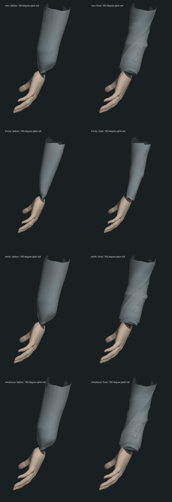
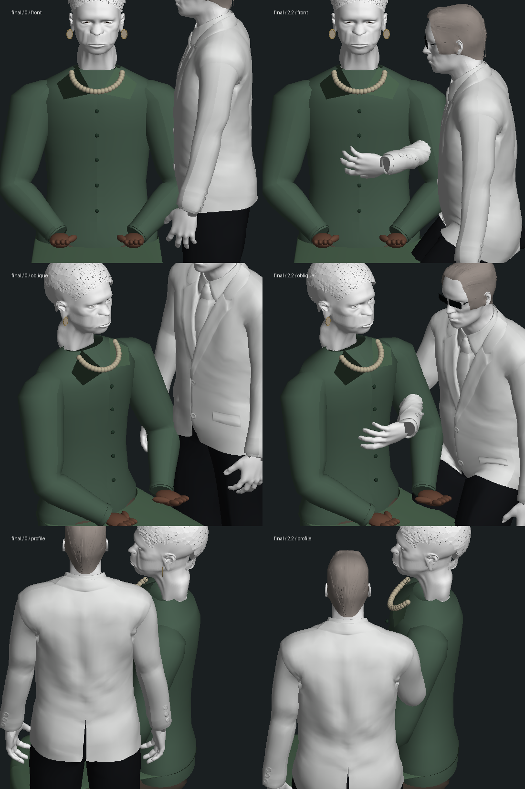

# 四名主要人物：前臂转掌与袖口蒙皮

2026-10-14，起始提交 `838222484f464663bd065d88d3ca2a814d8e1992`。本轮修复 Neo、Trinity、Smith、Morpheus 共用的转掌挤压，没有新增剧情完成项。连续 Neo 验收副本仍在 `m1_sentinels` 第 0 步 ready / tick 9134；42 组及三部曲保持未完成。

## 原因与改动

原骨架将前臂全部归到肘骨，手掌归到腕骨。转掌时，两者直接线性混合，造成皮肤和袖口向旋转轴塌缩。真实 GLB 的左右手、普通衣物和替换衣物均复现：在 ±1.4、±2.8 弧度转掌采样中，最差半径约为原来的 17%–24%。失败证据见 `red-volume.log`。

新增 `ForearmTwist.ts`：每侧三个辅助骨分担前臂旋转，只重新分配原肘骨权重；原手腕、指骨、动作终点、骨长与 GLB 文件保持。权重按来源几何缓存，辅助骨参加原有蒙皮、镜面覆盖、视锥裁剪与资源释放。腕部接触求解后直接更新手腕时，辅助骨也会在同一帧更新；姿势不依赖上一次动作。换装骨骼和休息位置表同步加入这些辅助骨。

跳跃落地的躯干筛选需要识别新增前臂骨。同样，道场腰带测试原来把新前臂误认作躯干；只补充袖子分类，没有改变射线、接触阈值或断言。

## 实际几何检查

下图由实际模型蒙皮计算得到，**是无游戏贴图、无游戏灯光的离线正交几何图，不是实机截图**。颜色仅区分皮肤/衣袖，局部图人为截取前臂，顶部缺口不表示游戏中断臂。左为原版，右为修复后，同一 2.8 弧度（约 160°）转掌。



Smith 同化先知段，使用已有真实人物模型及当前接触函数，检查放松与 2.2 秒接触、三个方向：




袖口收尖减轻，但袖内皮肤衔接、袖口厚度、自然布料褶皱及人物外形仍需继续制作。有限角度和接触时刻的检查不代表所有动作、完整身体和家具均无穿模；接近/越过 180° 的连续转掌及更多实机动作仍需检查。

## 验证与未通过项

- 原有握拳/同化接触基线 **16/16**，见 `baseline.log`。
- 新增四人截面检查先在原代码 **0/4**，加入分段旋转后 **4/4**。先前腕部后置修正曾只更新手掌、留下上一帧袖子；新增测试先失败，修正辅助骨更新关系后通过。`red-late-contact-summary.log` 是失败摘要，完整网格数组差异保留在本地原日志。
- 最终专项 **6/6**，检查真实皮肤与袖子、中立表面、原骨骼目标、动作切换、两个独立人物、保存姿势重建，以及后置接触更新。四人两侧分别覆盖 6773 / 3986 / 1203 / 3712 个前臂顶点，最差采样半径约 **89.3%**；并不声称体积完全不变。
- 最终较广回归 **143/147**；追加决战/Logos/告别 **28/28**、医疗舱/握杯 **2/2**。共 **173/177** 个不同测试，未跑全库。命令见下方，原始结果见相应日志。
- 四项未通过均在起始版 `HeroModel.ts` 复现：救援垫对象缺失、枕头对象缺失、Neo 和 Morpheus 原 GLB 的几何预算断言。原版九项定向检查为 **5/9**，见 `character-baseline-failures.log`；没有放宽或删掉这些断言。临时旧源码仅修正相对导入，未提交。
- `npm run typecheck`、`npm run build` 三包通过。客户端仍有既有大包警告，见 `typecheck-final.log`、`build-final.log`。

提交的日志仅清理行末空白与末尾空行，未改变结果；对应 `.raw.log` 保留本地。`inspect.mts before` 应在起始提交执行，当前代码重跑应使用 `final`；四人局部对比的 `arms.mts before` 则会在独立进程中明确禁用新增蒙皮处理。

```sh
node --import tsx --test tests/forearm-twist.test.mts tests/character-asset.test.mts tests/character-detail.test.mts tests/hand-pose.test.mts tests/oracle-absorption-contact.test.mts tests/office-phone-grip.test.mts tests/pistol-grip.test.mts tests/spoon-grip.test.mts tests/cookie-grip.test.mts tests/mobil-refusal-model.test.mts tests/smith-ending.test.mts tests/mirror-contact.test.mts
node --import tsx --test tests/smith-crater.test.mts tests/logos-bane-model.test.mts tests/farewell-renderer.test.mts
node --import tsx --test tests/hammer-medical-model.test.mts tests/pill-glass.test.mts
```

## 开销、保存与实机边界

每人物新增六个辅助骨，另有加载时的权重处理和几何缓存，未增加依赖。`bench.mts` 对同一 Smith/先知动作预热 40 次、采样 300 次；baseline 仅在该独立进程禁用新增骨架处理，其余代码相同。顺序测量结果为：

| 双人模型与接触 | 原版中位数 / p95 | 当前中位数 / p95 |
| --- | --- | --- |
| 冻结姿势 | 0.901 / 1.050 ms | 0.925 / 1.125 ms |
| 变化姿势 | 0.757 / 0.913 ms | 0.782 / 0.951 ms |

中位数约增加 0.024 ms。这是 **Node CPU 模型计算**，不包含完整世界、GPU、加载开销或浏览器帧率，不是性能验收。

完整复制原同化 `coating-final-state` 至本轮隔离 `runtime-state`，使用 3191/5391 端口、暂停 tick 7883。首次前端启动参数被 npm 吞掉，停止该进程后使用直接 Vite 命令；子目录 Node 路径错误也保留在记录中。最终后台及页面 HTTP 200；原生同一标签导航和聚焦各 20 秒超时，**没有新游戏截图、录像或原生冷读验收**，见 `native-attempt.json`。

隔离服务器实际退出再启动，八项 API 快照分组和 15 份记忆完全一致，见 `restart-result.json`。这仅证明后台保存恢复，不能替代实机观察。213 个主存档、原始参考存档和人物资产保护文件未改，见 `protected-result.json`。原始几何 JSON、完整运行存档、临时旧代码和中间诊断保留本地；本轮结束停止自建服务。

仍未完成：演员相似度、自然衣物/手部表演、袖内皮肤与完整接触、真实浏览器双视角/动作连续性、声音、稳定帧率和三部曲全程人工验收。
