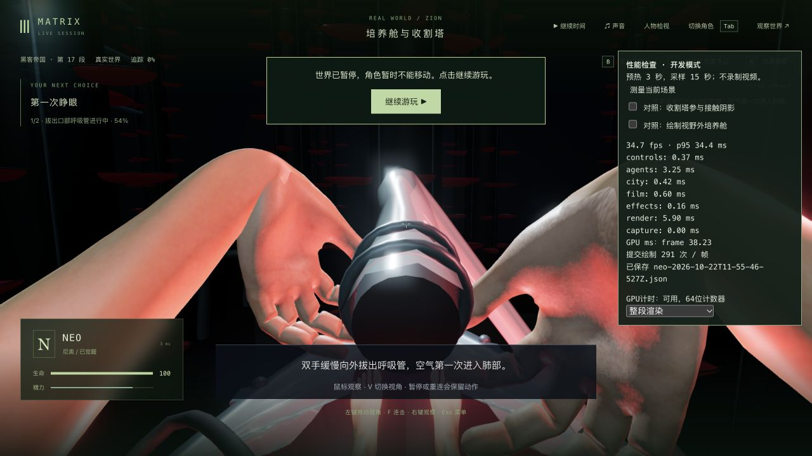

# GPU与绘制开销诊断（2026-10-22）

新增开发模式的异步GPU计时与对照工具，明确下一项应优先检查接触阴影/绘制路径。**本轮没有游戏帧率提升或电影质量完成声明。** 正常游戏效果保持，固定入口 <http://localhost:5173/> 的生产JS与上一版逐字一致，仍为 `index-ByDoGF_7.js`。

## 实际测量

使用前轮真实拔管2.943秒/tick5941的历史存档，没有修改位置或剧情。第三人称、M3、1280×720 CSS、DPR1.5，同页同镜头，单一游戏页，无录制或并行测试/构建，各预热3秒、采样15秒。这里不是之前第一人称约37帧的那一组视角。

| 模式 | FPS | p95帧间隔 | 绘制/帧 | GPU查询返回值均值 |
| --- | --- | --- | --- | --- |
| 完整渲染 | 35.05 | 33.8ms | 291 | 34.50ms |
| 空GPU区间，继续正常绘制 | 34.52 | 34.7ms | 291 | 0ms |
| 对照：冻结3D绘制 | 60.00 | 18.2ms | 0 | 0ms |
| 对照：跳过接触阴影 | 47.27 | 25.7ms | 202 | 24.07ms |
| 再次完整渲染 | 34.71 | 34.4ms | 291 | 38.23ms |

冻结时仍执行人物/世界客户端更新，但屏幕不产生新的3D画面。**冻结的60帧不是可游玩60帧，也没有发布这种设置。** 跳过接触阴影会改变画质，只用于隔离开销；测量结束恢复完整渲染，原生再按V后可看见正常第一人称画面。仅有一个去阴影样本，不宣称全场景稳定收益。五份校准后报告的GL错误均0、disjoint丢弃均0；相机最大分量差8.88e-16。见[原始数据与准确范围](measurement-verification.json)。

## GPU数字的边界

第一份分阶段查询约11.04/16.55/16.75/14.09/14.74ms，相加约73ms，浏览器帧间隔却约28ms。没有把这些数字相加后宣称某阶段占据多少独占GPU时间。随后改为单区间整体测量并加入空区间校准；空区间为0，但整体查询值仍可能超过浏览器帧间隔。这里保留查询原始返回值，**不将其当作可以与CPU耗时直接相加的独占GPU工作量**。

[WebGL扩展规范](https://registry.khronos.org/webgl/extensions/EXT_disjoint_timer_query_webgl2/)要求延后读取已就绪结果、检查disjoint并释放查询对象。公开[ANGLE Metal查询实现](https://chromium.googlesource.com/angle/angle/+/8ce63479cbe11d0e9c94cfe884b5e80f2800a729/src/libANGLE/renderer/metal/QueryMtl.mm)会在计时边界提交命令缓冲，[命令队列实现](https://chromium.googlesource.com/angle/angle/+/4a77b0f5237515960673b9bd1bc5a229f0eeaa95/src/libANGLE/renderer/metal/mtl_command_buffer.mm)累计Metal命令缓冲的起止耗时。因此查询可能改变提交方式，缓冲时间也不宜视为可直接相加的互斥着色器时间；这是解释线索，本机安装的ANGLE确切提交未核定。绘制冻结/去阴影/完整恢复的FPS对照是本轮更直接的因果证据。

## 代码与验证

- 新GpuTimer保留64位数值后再从纳秒转毫秒，后续帧只读取已就绪结果；disjoint时清除样本，待完成查询最多64个，停止时释放。没有等待GPU完成的循环。
- 开发面板区分CPU与GPU数据，记录计时范围、样本数、待完成数量、disjoint及GL错误。可选择整段、分阶段、空区间、跳过接触阴影或冻结绘制；测量中锁定选择，结束后恢复原绘制函数。
- 新增GPU异步/64位/时钟失效/不支持驱动/有界查询/清理检查4/4，连同既有培养舱与后期检查共23/23；三包类型与生产构建通过。部署检查与发布核对见[验证记录](validation.json)。
- 生产JS和入口HTML与原版本完全一致，诊断模块没有进入正常游戏。没有修改人物模型、动作、素材、依赖、服务器或存档格式。

原生全过程保持m1_pod/step0、拔管2.943秒/tick5941暂停；没有跑新剧情、重启后端或新增录像。本轮不是保存/失败/整条P0或三部曲验收。正式试玩原世界tick3757/暂停保持，Render未接回；11份未完成脱衣工作原样保留。705份包文件与候选一致，见[源码审计](source-audit.json)及[本机同步](local-update-verification.json)。42组电影质量完成数仍为0。

下一项应在保留人物与场景质量的前提下优化接触阴影/绘制通道，再测实际渲染中的帧率。人物腕口、皮肤和整体电影质感仍待制作。

