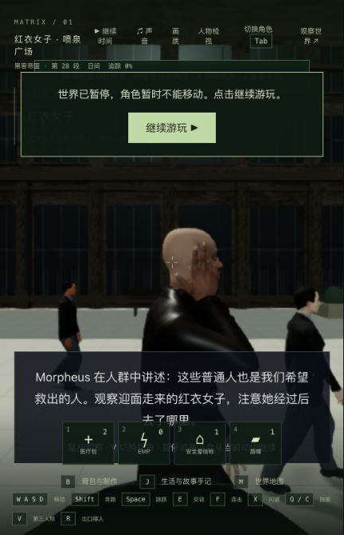
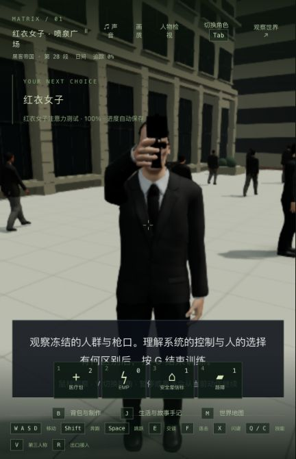
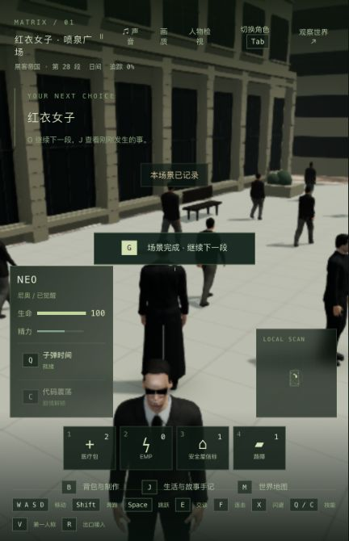

# 活动手部法线计算与实机验证

2026-10-24，基于 `3ab0499`。本机入口 http://localhost:5173/ 已更新为 `index-DTIDupUE.js`；Render 保持撤下。本次简化手部法线长度计算，没有增加缓存、素材或依赖，保留全部皮肤、关节与接触计算。42 组电影质量完成数不变，整体人物质量与稳定 60 帧仍未验收。

## 问题与改动

上一轮腕部表面缓存对本次普通行走和奔跑没有额外命中，已经撤回。本轮改为直接分析活动手部的计算路径：Neo 按游戏实际速度 3.4 / 8.4 依次行走、奔跑、减速、停止，每轮 318 帧。带 CPU 采样器的诊断中，人物动画均值 4.616 ms，其中手部更新 2.710 ms，约占 59%；这只是离线诊断，不包括 GPU 或浏览器帧率。

`FightingHands.deform` 原本为每个顶点调用通用的三参数 `Math.hypot`。改为使用与 Three.js `Vector3.length` 相同的平方和开方形式，零向量处理保持原样。没有改变顶点、权重、骨骼、三角形累加顺序或动作参数。

## 计时

不启用 CPU 采样器的独立运行按旧 / 新 / 新 / 旧交替，每次 7 轮，舍弃前两轮，每个样本组计 1,590 帧。计时期间不构建或运行测试；后台其他负载未完全隔离。

| 版本 | 整个人物动画均值 | P95 |
| --- | ---: | ---: |
| 旧版 1 | 4.635 ms | 8.776 ms |
| 新版 1 | 4.326 ms | 7.838 ms |
| 新版 2 | 4.165 ms | 7.294 ms |
| 旧版 2 | 4.370 ms | 7.684 ms |

两次均值合计 4.502→4.245 ms，约减少 **5.71%**。单次结果仍有波动，P95 区间重叠。该数字不是整场游戏 FPS 提升，也没有证明稳定 60 帧。分阶段数据见 [benchmark.jsonl](benchmark.jsonl)，脚本见 [benchmark-active.mts](benchmark-active.mts)。

## 数值与测试

使用实际四位主角模型，对照 256 个姿态，包括开合手、持枪、腕部转动、墨菲斯完整讲解、Neo 红蓝药丸、触镜与飞船接头。新旧输出的整张头/手皮肤 position、normal、skinIndex、skinWeight、骨骼矩阵、皮肤世界矩阵与全部手部世界坐标，采样最大差值均为 **0**。这是一组明确的采样，不代表穷尽所有姿态。

旧路径同时记录 1,714,961 次法线长度求值：平方长度范围约 2.47e-11 到 2.28e-5，没有零向量、溢出或下溢；两种长度计算在 Float64 下最大相对差约 4.40e-16，写入 Float32 后上述采样法线一致。见 [normal-range.json](normal-range.json)、[pose-comparison.json](pose-comparison.json) 和 [compare-surfaces.mts](compare-surfaces.mts)。压缩的数值参考数组只保留在本机本目录，未提交。

修改前原相关测试 5/5；修改后手部缓存、计算预算、患者与腕部光照连续性共 14/14；部署回归 75/75，类型检查与构建通过。没有增加只检查这一行写法的测试，也没有运行全仓测试。构建仍有原先的大包提示；正式 QA 浏览器采集到的 warning/error 为空。

## 实际游玩与恢复

使用先前真实游玩留下的红衣女子训练 1.927 秒暂停检查点的独立副本，浏览器访问正式生产构建，未改写剧情字段或通过脚本代替玩家输入。

- 从原生入口接回 Neo，切换第三/第一人称，转向墨菲斯检查头侧手势和腕部光照。
- 停止独立 QA 后端并确认进程终止，重新启动、重新加载浏览器、再次原生接回 Neo。完整世界响应与 7 份记忆哈希相同，见 [restart-verification.json](restart-verification.json)。
- 继续时间，实际漏看红衣女子；按 G 重试并观察，再转身面对 Smith，触发冻结，按 G 主动完成。检查点记录 misses=1、noticed=true、phase=done。
- 完成后原生按 W 和 Shift+W，分别移动 2.645 与 9.586 世界单位，验证行走、加速、停止可以继续。见 [gameplay-verification.json](gameplay-verification.json)。本次没有宣称完成战斗、切场或 1080p 帧率验收。

## 交付与未完成项

1,247 份候选输入中只有 `FightingHands.ts` 改动；11 份原有工作区实验、800 份共享/后端编译产物哈希保持。只替换正式客户端入口及新增 JS，保留旧包，主 PID 83388 保持，主世界自然运行，主存档未写入；85 份主记忆文件保留，不声称其内容停止变化。JS 增加 7 字节，CSS 相同。HTTP 内容与构建产物、侧栏实际 script 路径都已核对。见 [source-verification.json](source-verification.json) 与 [publication.json](publication.json)。

5200/5201 独立服务已按 PID、命令和工作目录核对后停止，测试标签页已关闭。实际完成后暂停的独立存档保留在本机 `qa-checkpoint-free-roam`，用于后续连续游玩基准；未用它覆盖主存档。下一步仍需测实际浏览器中的连续移动、战斗、场景切换和更大视口，并继续处理整体人物、服装及电影场景质量，不能用本次局部计算优化替代这些目标。
