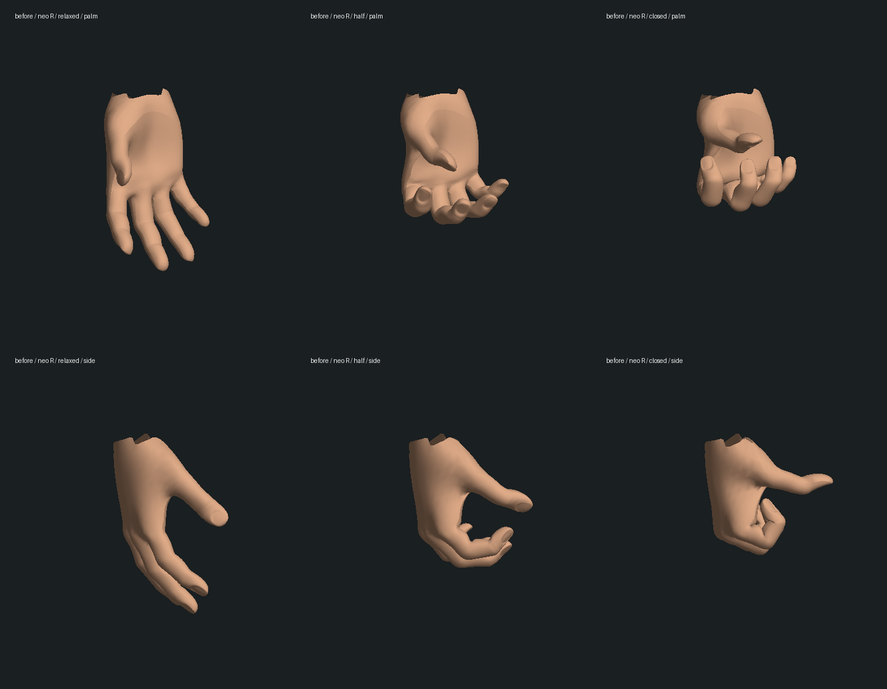
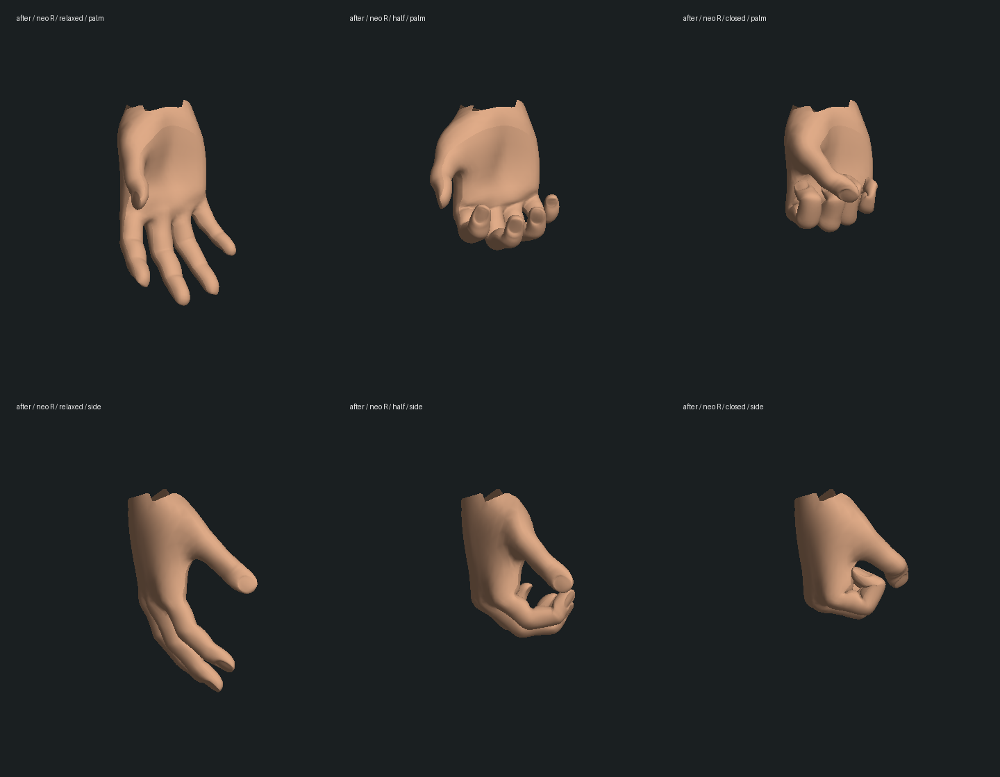

# 共用握拳修复：实际蒙皮几何检查

2026-10-13。原版基线 `cb25ad850f6fe5c1ee0bd75f3bf157e51a506c91`。这是人物手指动作的一项局部修复；三部曲、人物质量与完整实机验收仍未完成。本轮没有推进游戏剧情，也没有重建或替换 GLB/纹理。

## 问题与修改

原骨架的绑定轴是世界方向，但模型的指头本身已有弯曲与外张。给每根指骨增加相同方向的旋转，会让拇指越握越向外伸，四指也无法并拢。现在按实际关节位置和指尖蒙皮推导方向，在手腕空间建立握拳姿势；四指先收拢，拇指沿弧线绕过食指，再落在拳外。目标仅在首次握紧时计算，后续插值复用；无新依赖。

最初的方向修正虽然让静态拳型改善，仍在 75% 收拢时出现指尖相穿，记录在 `contact-check.log`。最终拇指路径经过四名主要人物的双手密集采样检查。完全放松时仍用原姿势，八只手的导出顶点与原版差值均为零，见 `preservation.json`。

## 实际几何图

以下由游戏的同一 `HeroModels` 求解器、实际 GLB 顶点及蒙皮权重导出，以相同相机和中性光离线绘制。它们不是生成的概念图，也不是浏览器游戏截图；不证明游戏材质、光照、全身动作或帧率通过验收。每图左到右为放松、半握、握紧，上下为掌侧和侧面。

修改前 Neo：

修改后 Neo：

其余实际模型：[Trinity](after-trinity-R-geometry.png)、[Smith](after-smith-R-geometry.png)、[Morpheus](after-morpheus-R-geometry.png)。

复现导出：`node --import tsx scripts/export-hand-poses.mts <输出目录>`。本目录 `render-surfaces.py` 使用已有 NumPy/Pillow，以 `<输出目录> after neo R` 等参数绘制；渲染不使用贴图，法线由变形后的三角面重建。

## 验证结果与边界

- `head-reproduction.log`：当前四项闭拳回归在原版全部失败；同时复现已有服装恢复失败。原版的完整人物基线为 83/87，见 `baseline.log`。
- `final-hand-check.log`：9/9。Neo、Trinity、Smith、Morpheus 的双手，各采样 21 个握紧程度；另检查冷建姿势、松手恢复和重复握紧一致性。
- 相穿检查使用实际变形后的三角面，从每五个顶点中选取指尖强权重样本，以四方向射线检查其他手指内部深度，阈值为 0.006 手腕局部单位。闭拳另检查拇指指腹到食指/中指表面距离及四指横向张开量。有限采样不能替代所有顶点、所有时间或手指与掌心/道具/他人的接触验收。
- `final-character-regression.log`：14 个既有测试文件，151/156。药丸、镜面、床边、签收等相关检查通过；五项既有失败为救援垫对象引用、枕头对象引用、Neo/Morpheus 几何预算、Neo 道场服装恢复。前四项在 `baseline.log` 复现，第五项在 `head-reproduction.log` 复现。没有修改这些检查或宣称全库通过。
- `final-typecheck.log` / `final-build.log`：三包类型检查及生产构建通过；构建仍提示客户端包体较大。
- `preservation.json` / `protected-before.json`：正式 `data/` 与人物资产共 196 份文件哈希保持；完全放松的八只手顶点/拓扑保持。

本轮原生浏览器打开已运行的本地客户端发生导航超时，两次页面均为无法访问；服务本身通过本地 HTTP 返回 200。没有通过其他浏览器自动化或修改游戏状态来替代实机检查。本轮无新实机录像、真实存档续玩或性能基准。

仍需优化人物脸部与比例、手腕在各专用演出中的姿态、关节皮肤挤压、掌心/道具接触与自然动作，并在浏览器恢复后检查本次握拳的实际效果。只修共用收拢路径，不表示所有手部扭曲均已解决。
