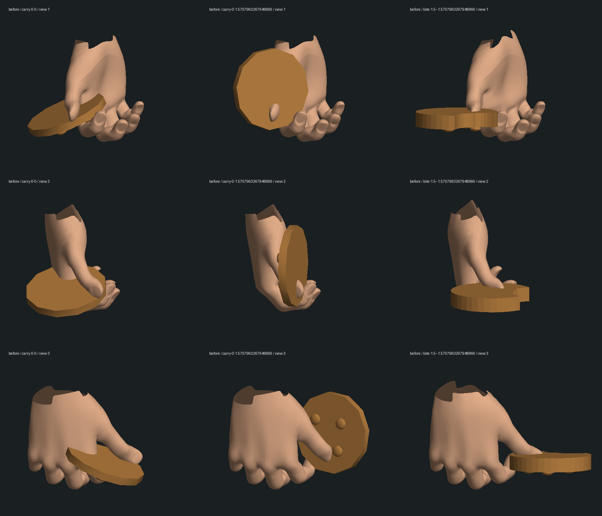
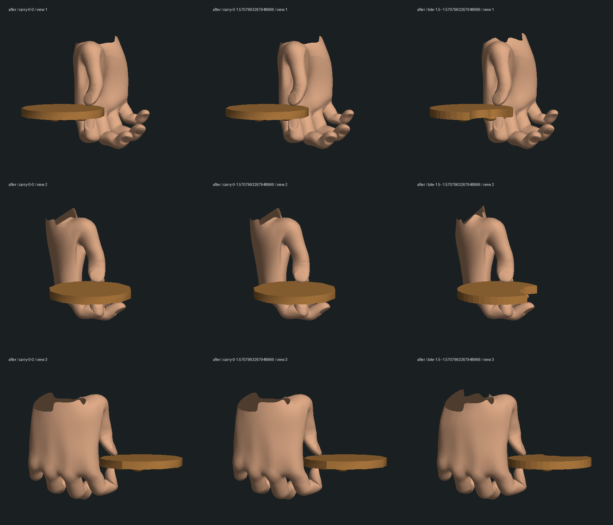
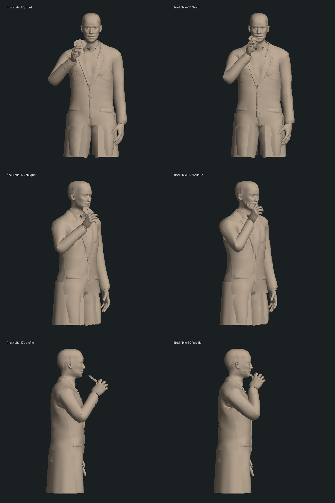

# Neo 接饼干、转身与咬食：局部人物修复

日期：2026-10-14。基线：`f1061693284a6e90a6cbd9e755ad72b313a15495`。本轮修复第一部先知拜访的手部动作；没有新增剧情完成项，也没有把整组或三部曲标为完成。

## 改动

- 饼干固定在真实手腕的夹持坐标内，跟随 Neo 转身、抬手与放下，消除原来锁在世界方向而从指间滑动的问题。
- 拇指与食指按 GLB 的实际末节皮肤求解，相对两面夹住饼干；保持原指骨长度，接手前逐渐收拢。其余三指沿用基础握姿。
- 咬食从当前持物朝向连续过渡，调整倾角和手持边缘的位置，保持既有嘴边目标与咬食时刻；修正手腕过折。中间版本发现的手掌穿颈已另加回归并修复。
- Neo 的先知动作恢复站姿，避免暂停或切换动作后遗留取药时的坐姿。
- 咬过与完整饼干使用相同厚度，巧克力碎块接触表面。保留唯一持有者、原交接时刻、咬痕保存和离场隐藏。
- 原 Oracle 房间测试用世界 X 方向估计握持边缘；现在改为读取饼干自身边缘的位置，使断言在道具随手旋转后仍检查真实接触。

## 验证

| 检查 | 结果与范围 |
| --- | --- |
| 修改前房间/离场渲染 | [10/10](baseline.log) |
| 新增复现 | [转身滑动、指腹位置、厚度/碎块](red-cookie-grip.log)；[指腹悬空、恢复姿势、手腕过折](red-contact-wrist.log)；[中间版本手掌穿颈](red-neck-contact.log)，均先失败后修复 |
| 最终模型/动作回归 | [48/48](final-model.log)：cookie-grip、oracle-room、oracle-departure-render、motion、spoon-grip |
| 离场剧情流程 | [5/5](final-departure.log)：普通控制输入、暂停/释放/恢复、占用保护、老档衔接 |
| 较广 Oracle 剧情/视角检查 | [15/16](final-story-camera.log)。公园尾声 4:3 镜头裁掉建筑师；在原提交隔离源码中[复现相同错误](baseline-park-camera.log)，保留为既有缺口 |
| 类型与生产构建 | [类型检查](typecheck.log)及[共享、服务器、客户端构建](build.log)通过；保留现有大包警告；未跑全库 |
| 源资产与存档保护 | [228 份文件不变](protected-result.json)，清单含 data、人物资产及先知离场原始记录 |

新增测试覆盖 30 种转身/咬食组合、四种实际指腹接触姿态、五种输入的模型层恢复，以及接手和咬食合计 122 个腕部时刻。咬食诊断的 61 个腕部采样中，前臂与手掌方向点积最低为 0.7023；测试门槛为 0.6。

[真实皮肤与道具测量](contact-metrics.json)中，四份导出的持物姿态在指定握持区域内穿入饼干的末节顶点归零；指腹到道具表面的最近距离约为 0.00214 / 0.00292 模型单位。另有五个头颈回归时刻和[七个诊断采样](head-contact-final.log)，未发现检查范围内深于 0.003 单位的手部穿入。有限顶点与时刻采样不能证明任意动作、衣物和整个场景均无穿模。

## 实际几何对照

这些图由真实 GLB 蒙皮及程序道具导出后离线投影，使用简化颜色和光照，**不是浏览器实机截图**。上半身图仅用于核对手腕、道具与头颈位置，不能作为人物相似度、电影服装、材质或最终游戏画面的验收。

修复前，转身时饼干相对手掌改变朝向，部分指尖穿进饼干：

最终夹持，分别为两个携带方向及咬食后形状：

最终上半身的抬手中段与咬食姿态：

导出与测量脚本为 `inspect-cookie.mts`、`inspect-body.mts`、`measure-cookie.mts`、`measure-head-contact.mts`；投影脚本为 `render-cookie.py`、`render-body.py`。大型中间网格和隔离的基线源码留在忽略目录，不加入版本库。

## 实机限制与未完成项

本次工作开始时的[最小静态页诊断](../../diagnostics/sidebar-loading-2026-10-14/README.md)也发生导航超时：浏览器未访问本地 HTTP 服务。后续只核对了测试标签页已清理；没有新实机画面、实际服务器重启/存档冷读、正常连续通关或性能验收。自动剧情测试与模型姿势恢复不替代这些检查。

先知的程序人物、Neo 外形与服装、面部/张口咀嚼、自然全身表演、袖口与任意帧接触、厨房/公寓美术、声音、连续人工试玩和稳定性能仍需制作。公园镜头的既有失败也未在本次手部修复中处理。三部曲完整制作目标继续保留。
