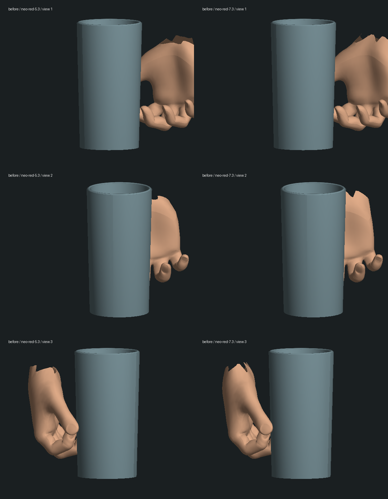
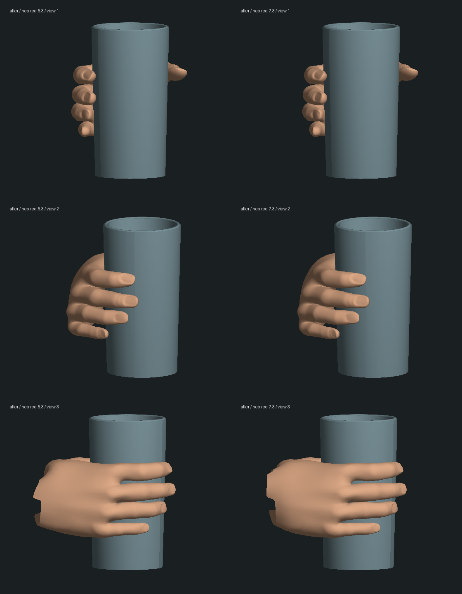
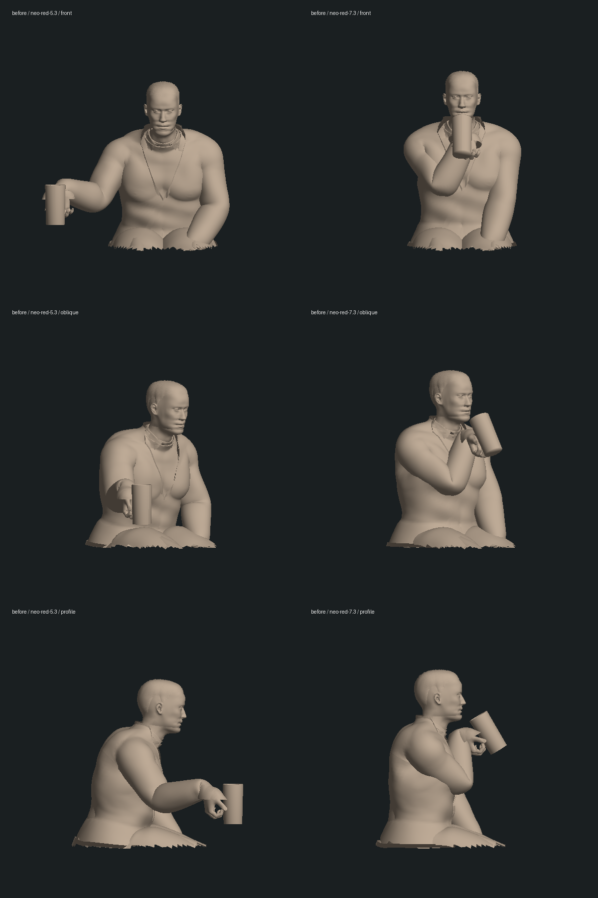
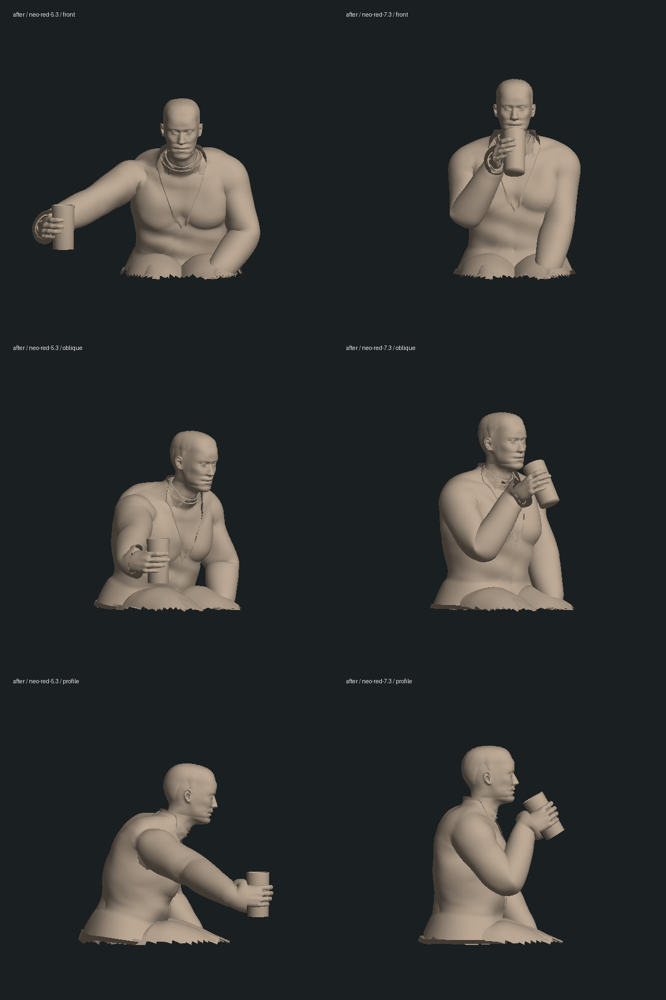

# Neo 握杯、抬杯与放回

基线 `2e7b500`。本次只改善红蓝药丸场景的喝水动作，不增加剧情完成项，三部曲仍未完成。

## 具体修改

- 原杯轴与手掌方向不匹配，四指挤在近似同一高度，像捏着杯壁。现将杯轴对齐四个指根的排列方向，使用真实 GLB 指尖蒙皮和指骨长度建立环握；拇指从另一侧支撑，短小指使用较近的接触弧，不拉长指骨。
- 新握法需要不同的腕部位置。增加取杯/放回时的身体前倾，使手真实够到原桌面目标；倾杯在靠近嘴唇途中开始，到嘴前已形成饮水角度，避免手腕先硬折过去。吞服、取杯、放回和剧情结算时刻不变；旧存档的画面会使用改进后的动作。
- 手指随伸手程度逐渐环握，离杯后恢复；在两种选择、第一/第三人称以及其它手势之后按保存时间重建。

## 验证与证据

- 修改前相关四文件 25/25。新增[环握测试先失败](red-glass-wrap.log)；首次调整之后的[腕部测试](red-drinking-wrist.log)发现倾杯过晚，修正后连同整段采样通过。
- 最终[药丸/视角/玻璃/房间 28/28](final-regression.log) + [实际 Neo/Morpheus 交接与水杯接触 1/1](final-transfer.log)，共 **29 项**。[类型检查](typecheck.log)及[三包生产构建](build.log)通过。未跑全库；构建仍有客户端大包提示，不能当作性能通过。
- 新检查包含红/蓝两种选择下的五指杯壁接触、四指高度顺序和拇指支撑；取杯到放回每隔 0.05 秒的 67 个时刻检查腕部方向；抓握/释放连续，八个持杯姿势在其它选择的取药手势和视角切换后恢复，指骨位置/长度不变。现有胶囊交接、桌面/杯口接触、视角、剧情暂停和保存恢复回归继续通过。
- 四个离线蒙皮样本中，指根排列方向与杯轴点积由约 -0.13 改为 0.95，食指至小指高度差约 0.175 模型单位；皮肤顶点到杯壁最小间隙约 0.0021，没有进入杯壁。实际模型腕部角度样本约 48–51°。这是有限姿态和顶点检查，不是全场景、所有三角面与身体/服装接触的完整碰撞验收，见[量化结果](validation.json)。
- 正式数据、人物资产、原完整存档来源共 204 个文件哈希不变。只启动独立暂停副本 tick 5232，本地 5197 返回 HTTP 200，原生浏览器导航和复查聚焦均超时。临时 3180/5197 服务已停止；本轮没有新增实机画面、人工剧情推进、实际重启/冷接管或性能验收。

## 画面对照

以下为直接运行项目 `HeroModels` 后导出的真实手部蒙皮、道具及原始人物上半身几何。使用诊断光照和不透明杯身观察接触，未应用游戏的完整材质、透明折射与服装变体选择；不是原生浏览器画面。左列取杯，右列饮水，各有三个方向。实际 `AgentRenderer` / `PlayerControls` 路径另由上述视角与动作测试覆盖。

本目录 `inspect-glass.mts` 从项目根目录通过 `node --import tsx` 执行，参数为导出目录；`render-glass.py` / `render-body.py` 使用带 NumPy、Pillow 的 Python，参数为导出目录和图片前缀。中间 JSON、独立世界副本与完整哈希保留本地，仓库保留脚本、轻量对照图及验证记录。

## 后续缺口

需要恢复原生实机检查，进一步制作手腕/袖口/头部与家具接触、连续表演、液体与杯材质、准确人物外形和房间。其它场景中的特殊抓握仍需逐段检查。没有将本次环握修复作为药丸整段、第一部或三部曲完成的依据。
