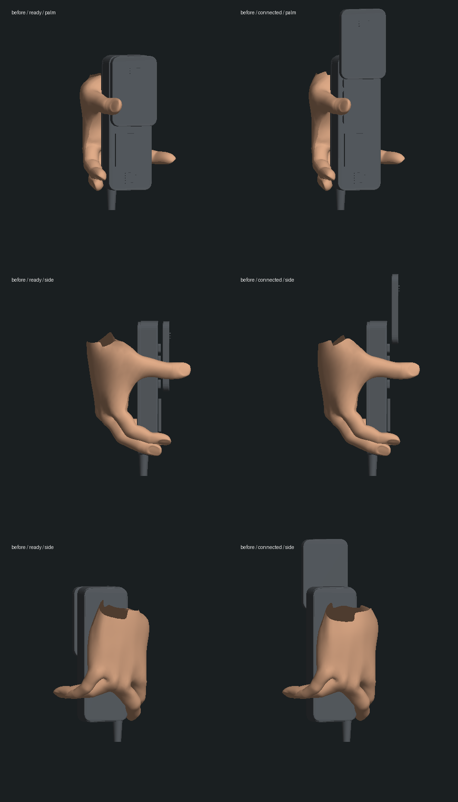
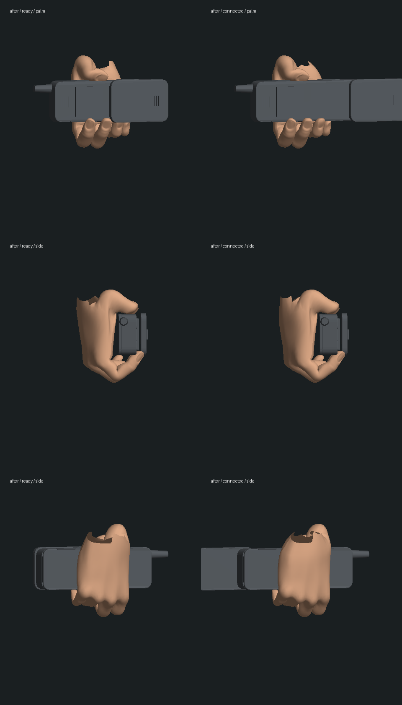

# Neo 办公室握手机：局部手部修复

2026-10-13 开始，2026-10-14 整理验证。基线 `65ac3cb43bfd700e5ba0ae064be8dc8241247bfe`。本轮只改 Neo 办公室手机的握持、附着和相关检查，没有推进剧情、替换人物 GLB 或改写正式存档。三部曲仍处于玩法补齐、画面制作与实机验收并行阶段。

## 修改与依据

旧手机沿四指的长度方向放置，随后又把中指、无名指向相反方向掰开；统一的指骨旋转无法形成正常抓握。现在把手机长轴沿四指指根排列，四指包住一侧，拇指抵住另一侧。目标由实际关节长度和指尖蒙皮求解，保留原关节位置，首次计算后复用。

重新计算手腕位置与方向以保留手机的位置和朝向。`preservation.json` 中 ready / connected 两个实际导出姿势的手机中心与原版差异小于 `8e-16`；这只证明这两个静态样本，不代表整段轨迹和动作已经验收。座机仍沿用原握持路径。

## 实际几何图

以下由正常角色工厂、真实 GLB 蒙皮和同一手机模型导出，再用中性光离线绘制。不是概念图，也不是游戏截图；材质、头发、光照、动态过渡及帧率没有通过这些图验收。

修改前：



修改后：



完整上半身的三个方向：[修改前](before-arm-geometry.png)、[修改后](after-arm-geometry.png)。握持已改善，袖口/关节变形、人物外形和自然表演仍需继续制作。

`inspect-phone.mts` 导出真实顶点，`render-phone.py` / `render-arm.py` 使用已有 NumPy/Pillow 绘图。复现当前版本：

```sh
node --import tsx output/characters/hand-phone-2026-10-13/inspect-phone.mts output/characters/hand-phone-2026-10-13/after
python3 output/characters/hand-phone-2026-10-13/render-phone.py output/characters/hand-phone-2026-10-13/after after
python3 output/characters/hand-phone-2026-10-13/render-arm.py output/characters/hand-phone-2026-10-13/after after
```

导出的中间 JSON 未纳入 Git；原版图来自上述基线。导出过程仅创建内存世界和模型，不连接正式运行服务。

## 检查与未完成项

- 原有手机/相机基线 `phone-baseline.log` 为 5/5；增强检查在原版失败，见 `final-tests-on-head.log`。失败首先指出手机长轴与四指排列不一致。
- `phone-edge-grip.log` 为接触修改后的 5/5；`phone-final-targeted-corrected.log` 为最后 8/8，包含手机位置、左手开窗、座机保留、V 自由视角和增强手部检查。
- 接触检查覆盖取出、就绪、接听、蹲行及翻窗共 17 个时刻：检查实际手掌/手指蒙皮是否进入保守机壳内部、五个强权重指腹质心距实体道具表面是否小于 `.04` 模型单位，以及指骨不横向折开、不被拉长。另检查冻结时不累计旋转、新建模型重建同一握姿和收起后不残留握姿。有限采样不是所有表面、所有帧无穿模的证明。
- 初次相关回归 `related-regression.log` 为 125/131：四处既有失败，另两处旧测试把手腕中心当作手机中心。后两项已改为检查手机的实际附着点，保持原公差；原、新实际手机中心另有独立导出对照。第一次修正检查的坐标符号错误保留在 `phone-final-targeted.log`，诊断后更正，未通过放宽公差绕过失败。
- 最终五个相关测试文件为 118/122，见 `final-related-regression.log`。四处既有失败为救援垫对象引用、枕头对象引用和 Neo / Morpheus 几何预算；此前已在[共用握拳基线](../hand-anatomy-2026-10-13/baseline.log)复现。共用握拳的 9 项在本轮 `related-regression.log` 通过，此后只改测试检查点，没有再改运行代码。不宣称全库通过。
- `final-typecheck.log` / `final-build.log`：三包类型检查与生产构建通过，客户端大包提示保留。
- `protected-before.json` / `preservation.json`：正式 `data/` 与人物资产共 196 份文件哈希保持。

本轮原生浏览器导航 `127.0.0.1:5173` 超时，页面显示连接超时；独立测试服务 HTTP 正常。没有新的浏览器画面、实际存档续玩或性能基准。临时 5173 / 3180 服务已停止，未改用户原先的 5197 服务。暂停/新建模型检查只在模型层完成，不冒充真正重启服务和读取玩家存档的验收。

还需在原生浏览器恢复后复查完整手机动作、袖口/前臂/头部接触及双视角。四指和拇指的局部改善不表示所有人物或所有专用交互的手部问题已解决。
