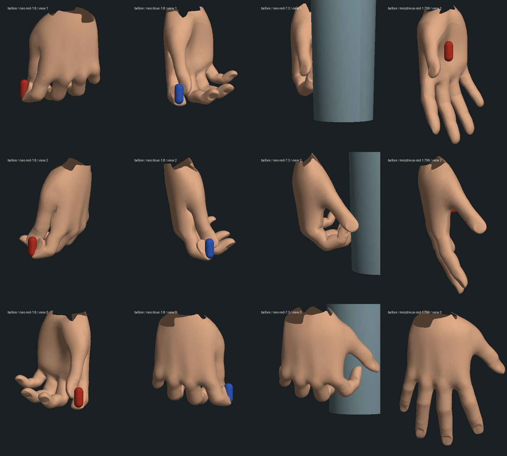
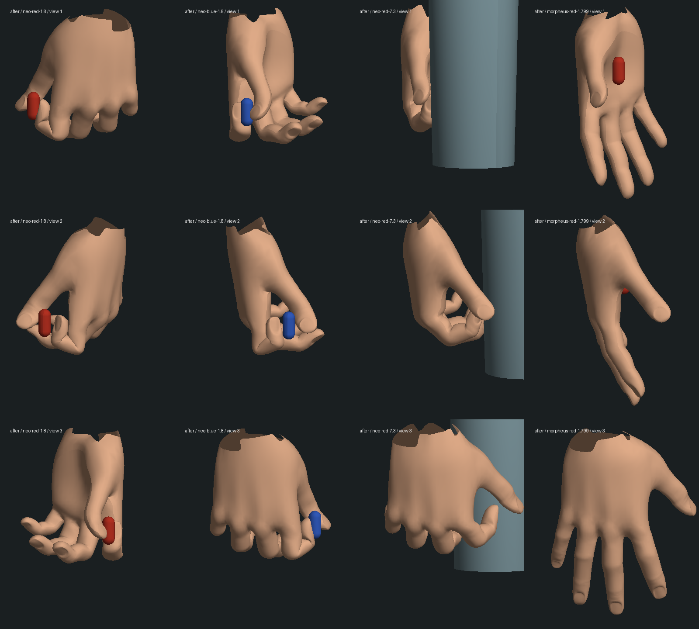

# Neo 取药：手指接触与反折修复

基线：`b19ea5e`。这是红蓝药丸场景的局部动作修复，三部曲仍处于专用玩法补齐、画面制作和逐段验收并行阶段。没有新增剧情完成项。

## 问题与修改

- 旧取药使用估算的指尖和逐关节迭代。实际蒙皮在交接时穿入胶囊，食指末节与中节方向约成 132°，不是表面材质问题。
- 按 GLB 真实指骨长度及指尖蒙皮计算拇指、食指的相对夹持。胶囊在手中的位置向手腕靠近 0.045 模型单位，使拇指能在胶囊外侧形成夹持；手腕随目标调整，交接和送药到嘴的位置保持原规则。
- 伸手时渐进形成夹持，修正原先一开始伸手便跳到强握姿的问题。左右手分别缓存固定夹持姿势；不移动或拉长指骨。
- Morpheus 的摊手、水杯握法、脸型、服装和剧情状态机保持原实现。

## 验证

- 修改前：药丸剧情/视角/玻璃/房间 23/23，实际双人交接专项 1/1。
- 新增取药回归先失败：[胶囊穿模](red-pinch.log)、[伸手跳变](red-pinch-transition.log)。后者在第一次夹持修正后、连续性修正前复现。
- 最终：[相关回归 25/25](final-regression.log) + [实际双人交接 1/1](final-transfer.log)，合计 26 项；[三包类型检查](typecheck.log)和[三包生产构建](build.log)通过。构建仍有现有客户端大包提示，未跑全库，也未宣称解决性能问题。
- 新回归检查红/蓝两种选择、交接/送药/吞服前六种姿态的真实蒙皮：胶囊外接触、拇指/食指相向、食指末节弯曲、关节长度不变、从另一个选择的喝水姿态恢复夹持；另查伸手开始两侧手指连续性。原有水杯、视角、剧情/暂停/保存恢复测试继续通过。没有新增实际服务端重启或冷启动实机证据。
- 四个离线输出姿态中，手指顶点对胶囊的最深穿入由约 0.015 模型单位降至 0；食指末节夹角由约 132° 降至约 80°。这是有限顶点/姿态检查，不等于所有三角面、双手交接、头部/袖口及全帧碰撞已验证。见[量化与保护结果](validation.json)。
- 204 个正式数据、人物资产和原有完整取药存档源文件的哈希不变。实机尝试仅启动独立暂停副本，tick 5232；本地 5197 返回 HTTP 200，但原生浏览器导航及聚焦均超时。临时 3180/5197 服务已停止，正式存档未运行。

## 实际几何检查

以下是运行项目动画后导出的真实 GLB 蒙皮和道具，以无贴图诊断光照渲染；不是浏览器截图或电影级效果图。四列分别为左手红药、右手蓝药、水杯旧姿势、Morpheus 旧摊手；三行采用相同的三个观察方向对照前后。

复现：在项目根目录执行 `node --import tsx output/characters/hand-pills-2026-10-14/inspect-pills.mts output/characters/hand-pills-2026-10-14/after`；再使用带 NumPy/Pillow 的 Python 执行本目录 `render-pills.py`，参数为上述输出目录和 `after`。导出中间 JSON、本次独立世界副本及完整保护哈希仅保留本地；仓库保留轻量诊断图、测试结果、导出脚本和此说明。

## 仍未完成

水杯握法仍像捏住杯壁，其他三指的旧弯曲、手腕/前臂/袖口、取药到嘴时的身体接触、连续动作与表情仍需制作；本次官方参考页也未加载成功，没有新增成片逐镜头核对。人物外形、材质、声音、房间还原、真实连续游玩与性能验收不在本次完成范围。修正一处夹持不能作为药丸整段、第一部或三部曲完成的依据。
