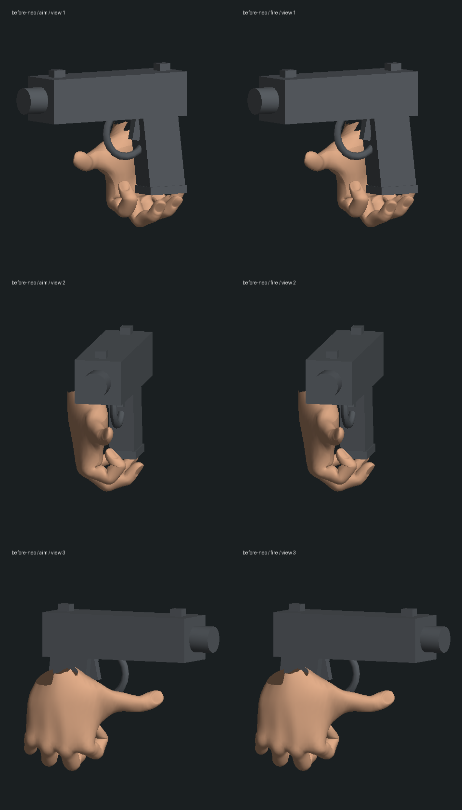
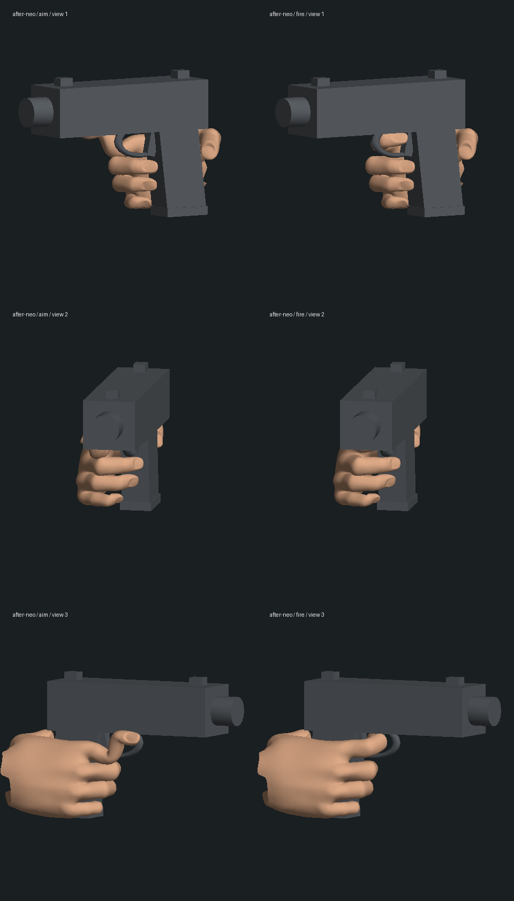

# 单手手枪：握持、扳机与前臂的局部修复

2026-10-14，基线 `4f342db827d92f66ad60fb0459d9bc100d6fd27a`。本轮改善 `hel_pistol` 在 Neo、Trinity、Smith、Morpheus 实际蒙皮模型上的右手握持，并接住 Hel 放枪和接枪的姿势。没有推进电影剧情、替换人物资产或写入正式存档；三部曲仍在补玩法、制作画面和逐段验收。

## 改动

旧枪柄与四指指根的排列方向相差约四分之一圈，统一的指骨转角使手掌垂在枪下、拇指向外翻。现在按真实关节长度和指尖蒙皮求解：下三指包住枪柄，拇指抵住另一侧，食指在开火时进入扳机区域，再沿绕开枪体的路径退出。缩短过高的圆形护圈，避免护圈侵占中指的握持空间。

抬枪距离现在计入实际握把偏移与人物臂长，手肘朝身体外侧展开，减少前臂与手掌的急折。Neo 的两个实际导出样本中，枪中心沿瞄准方向前移约 `.2954` 模型单位，高度与横向位置保持；枪口方向和实际枪口出弹检查通过。**枪的位置不是完全不变**，见 `preservation.json`。

放下枪和接住枪将道具的世界方向转换回手腕方向，并渐变手肘的弯曲方向，避免进入或退出动作时手臂姿势突然切换。没有改变服务器剧情、弹药或伤害逻辑。

## 实际模型几何

图来自正常角色工厂、项目 GLB、实际骨骼变形和游戏中的手枪几何，以中性光离线绘制。不是概念图，也不是浏览器游戏截图；这些图不能验收实际材质、光照、动态表演或帧率。

修改前：



修改后：



其他三人的实际手部：[Trinity](after-trinity-pistol-geometry.png)、[Smith](after-smith-pistol-geometry.png)、[Morpheus](after-morpheus-pistol-geometry.png)。

完整上半身同一投影：[修改前](before-neo-arm-geometry.png)、[修改后](after-neo-arm-geometry.png)。人物外形、关节皮肤、袖口和自然表演仍需继续制作。

`inspect-pistol.mts` 导出实际顶点；两份 Python 脚本使用已有 NumPy/Pillow 绘制。中间顶点 JSON 和测试运行存档未纳入 Git。复现当前版本：

```sh
node --import tsx output/characters/hand-pistol-2026-10-14/inspect-pistol.mts output/characters/hand-pistol-2026-10-14/after-neo neo
python3 output/characters/hand-pistol-2026-10-14/render-pistol.py output/characters/hand-pistol-2026-10-14/after-neo after-neo
python3 output/characters/hand-pistol-2026-10-14/render-arm.py output/characters/hand-pistol-2026-10-14/after-neo after-neo
```

## 验证范围

- 修改前四个相关文件为 **55/55**，见 `baseline.log`。新握持检查在原版四人均失败，见 `red-pistol-grip.log`；保留护圈、松开扳机与前臂折角的失败记录。
- 最终五个相关文件 **60/60**，见 `final-regression.log`。包括新增四人握持检查、放枪入口的手臂姿势检查，以及既有 Hel、六楼战斗和动作回归。
- 每人 27 次有限姿态采样，包含瞄准俯仰、开火和 `0–0.20` 秒每 `.01` 秒的松扳机过程。检查强手部蒙皮顶点与枪柄、滑套、弹匣、扳机和护圈的穿入深度，公差为 `.003` 模型单位；护圈采用保守的局部圆环距离。检查强权重指腹质心到枪柄小于 `.04`、扣扳机时食指到扳机小于 `.025`，以及原关节不被移动或拉长。
- 冻结、新建角色重建同一动作状态、切换步枪后重新装备、收枪恢复普通手势均检查。**这是模型层验证，不是实际玩家存档冷启动验收。**
- 手肘交接检查排除了普通待机与专用动作之间已有的整体呼吸高度差，比较相对肩部的位置，未放宽 `.005` 姿势公差。这个修正后的检查在旧交接逻辑仍有两项失败，见 `red-relative-elbow-handoffs.log`，最终通过。约 `.018` 的整体高度交接差仍需在连续表演中打磨。
- `after-*-contact.log` 的指腹使用主权重顶点，测试使用权重大于 `.95` 的顶点，两者统计口径不同，不能混为同一个间隙指标。
- `typecheck.log` / `build.log`：三包类型检查与生产构建通过，客户端大包提示仍在。未跑本轮全库测试，没有性能达标结论。
- 正式 `data/`、人物资产与原始 Hel 冻结副本共 **212 份文件哈希未变**，见 `protected-before.json` / `preservation.json`。

本轮原生浏览器打开独立本地测试服务时连接超时，标签页返回 `ERR_TIMED_OUT`；没有新的实机截图、完整存档续玩或性能基准。临时 5173 / 3180 服务已停止，未改动用户原先的 5197 服务。

仍需原生浏览器双视角检查、完整放枪/接枪的手指接触与衣物变形、手指之间及全身全帧的穿模检查、自然扣扳机/后坐表演与更精细的武器美术。普通双持枪、步枪及其他专用交互没有被本轮一并验收。有限采样和局部修复不表示所有手部问题或任何电影章节已经完成。
