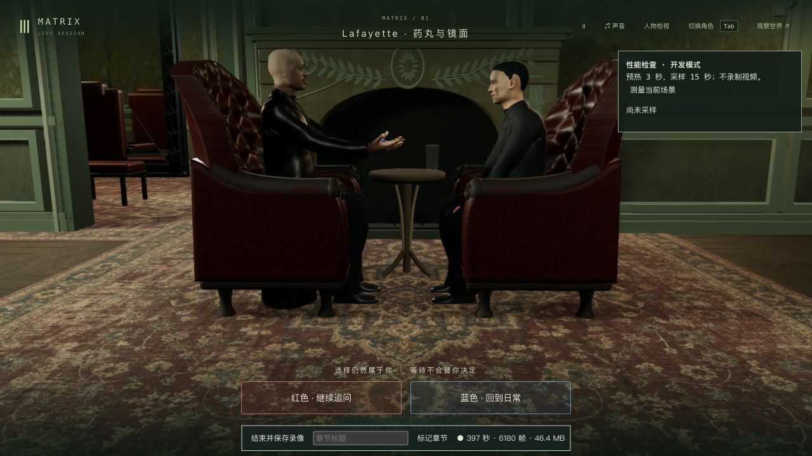
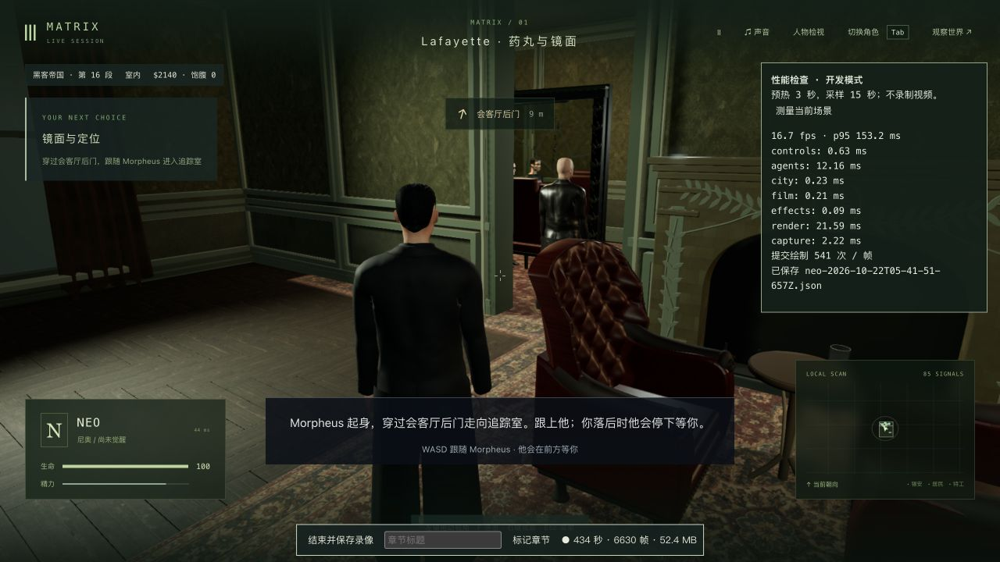

# 手部指面计算复用与药丸实机检查 · 2026-10-22

已采用一份人物运行源码改动及三项回归，并更新固定本机入口 <http://localhost:5173/>。Render 保持永久撤下。本轮是局部性能改进和剧情检查，**42组高质量验收仍为0**。

## 改动与首轮失败

基于 `77b99ea6bf19d9d13435cd5c98fe2e03049f169f`。1,148份包/测试/脚本先逐个核对Git对象；704份包文件只有 `FightingHands.ts` 改变，其余703份保持。新增 `hand-curve-cache.test.mts`，没有改模型、纹理、依赖、服务端或存档格式。11份未完成脱衣实验保持原哈希，未纳入试玩或提交。[源码边界](source-audit.json)

原CPU诊断936次手部形变中，580次手指关节不变，却重复执行完整曲线求值。现在按真实手指四元数精确缓存腕部空间的指面偏移；不量化关节、不减面、不减少动作采样。完整线性蒙皮、腕口边界与每个三角面的法线仍按当前姿态更新。绑定只在指面实际权重全部属于该手指/手腕骨族时启用缓存，否则沿用完整计算。每名人物最多新增320,304字节的双手缓存，销毁时释放。[原诊断](hand-runtime-profile.json)

新增前两项回归先在原代码失败：腕部移动重复11,982次曲线采样。首个直接缓存偏移的版本又未通过原法线精度门槛，左手最大误差约1.66×10⁻⁵；保留失败日志与[诊断](hand-cache-diagnosis.json)。根因是Float32权重和不严格等于1，腕部平移在材料坐标中留下微小相关项。最终在生成材料偏移前扣除该项，再叠加到当前完整蒙皮；原位置/法线容差不变。热缓存与全新求值比较覆盖四位主角的腕转、Neo药丸动作、整体变换及腕部平移/非均匀缩放，最终3/3通过。连续变化的拳形仍走完整求值。

## 验证

- 原药丸基线8/8通过；新缓存先2/2失败，直接偏移版2/2失败，精度修正2/2通过，加入平移/缩放后最终3/3通过。
- 普通手部9项、原药丸手部8项与前两项缓存共19/19通过；最后三项缓存另以最终版本3/3通过，合计20个不同手部用例。相关药丸/前臂/玻璃37/37、部署75/75、三包类型与生产构建通过。不是全库回归；原大JS分块提示保留。
- [完整手面验证](pill-path-verification.json)：650个人物时刻、1,300个双手姿态。Neo红/蓝服药按100ms及握持转换50ms、边界两侧取样；Neo入座100ms、全部四段对白200ms、张掌及终态也检查。Morpheus覆盖张掌、交接、首段对白和终态。保留每手6,673点/12,472面、原UV、权重、关节门槛及完整面法线/剔除边界。未检出超过原10微米阈值的自交，最大UV缝隙为0，PIP约82.26°、DIP约81.41°。
- 道具保留原容差：4,567个胶囊近面中最小间隙约−1.282mm，在3mm容差内，**不是严格零重叠**；154,638个杯壁近面的保守下界至少1.577mm，在原4mm门槛内。有限时间点不是连续数学证明，也不是身体、家具或其他剧情的完整接触验收。
- 离线自交加速器只改变候选面筛选，窄相交判定和共享边排除保持。12个真实旧失败/新通过控制的全部有向相交面与线段长度和原格网算法精确相同。[检查器对照](contact-grid-bvh-parity.json) 此BVH仅用于验收，不是游戏运行提速。

原始TAP与失败日志以 `.log.gz` 保留原字节；本机同名 `.log` 也保留。`verify-pill-hand-path.mts` 默认检查当前仓库，`--candidate` 检查本轮隔离副本；重新运行会覆盖同名扫描结果，应先另存既有证据。其他比较脚本依赖本机保留的77b99ea基线/候选副本，BVH失败控制还依赖前轮6e3235f副本，不能把它们当作独立自足的通用测试。

## 实际CPU测量

[成对数据](hand-cache-benchmark.json)在同一进程中交替旧/新版本，每阶段预热180个变化帧，之后各180帧，包含整个人物动画。其他验证可能并行；不以加载耗时或单次最大值声称提升。

| 阶段 | 原人物CPU中位/ms | 新人物CPU中位/ms | 中位下降 |
| --- | ---: | ---: | ---: |
| 接药 | 10.373 | 8.421 | 18.8% |
| 送入口 | 9.094 | 5.473 | 39.8% |
| 拿杯 | 9.092 | 7.537 | 17.1% |
| 喝水 | 9.764 | 6.128 | 37.2% |
| 放杯 | 8.895 | 5.926 | 33.4% |
| 持续变拳 | 9.124 | 9.019 | 约1.1%，基本持平 |

持续变拳的新版本最大值31.14ms，旧版11.95ms，异常尾值保留；没有宣称所有延迟改善。上述结果不是浏览器FPS。

## 原生实际试玩与录像

使用独立5200/5201世界，从历史P0入座前验收档开始，通过原生界面接管Neo、入座、走完四段哲学对白、回答“我希望自己决定人生”、选择红药、接药、吞药、拿杯喝水、放杯和起身，普通剧情进入 `m1_mirror / step0`。没有注入阶段或替换本机试玩存档。最终独立世界暂停于tick5312，两个自建验收进程已结束。[完整检查范围](native-verification.json)

原始本地视频 `native-recording/neo-2026-10-22T05-34-55-289Z.webm` 为437.56秒、55,871,474字节，保留游戏音频和检查时的等待，不能称为持续操作的完整P0长玩。原始WebM留在项目本地；入库的[92秒尾段](native-recording/native-red-pill.mp4)从源345秒截取，H264/AAC转码约4.79MB，包含对白收尾、选择与服药/起身；不补帧或改变播放速度，源捕获停顿仍在。

实际15秒采样252帧，仅 **16.73fps / P95帧间隔153.2ms**，人物CPU平均12.16ms、渲染提交CPU平均21.59ms、约541次绘制/帧。采样包含录像，另一固定入口页仍打开，且没有相同条件的原生基线；**本轮不能宣称FPS提高或游玩流畅**。完整录制统计另为8427渲染帧/19.26fps，但实际录制帧6674，不能互换。报告中的“预热3秒，采样15秒；不录制视频”是现有检查面板文案；JSON明确 `recordingActive:true`，以JSON为准。[原性能报告](native-recording/neo-2026-10-22T05-41-51-657Z.json)

本轮读取的原生warning/error为空。画面仍有光亮且僵硬的衣物、近似人物与动作，尚未达到电影质量；没有本轮蓝分支实机、失败/实际重启、进入追踪室的连续行走或完整P0通关。人物相似度、自然材料/表演、完整脱衣、全身接触和整体性能继续未完成。

## 固定本机更新

`index-CUKLY88G.js` 为3,735,054字节，SHA256为 `8bff9d35950d5e8e20dfdab67def4a0ec6f5387a44e32ab8a96802eec2886a7a`。只新增JS、镜像采用的源码/测试并原子替换入口；前版JS保留供已有页面使用。704份包文件与候选一致，280份后端文件和PID82106保持，没有重启或重新接入Render。[发布核对](local-update-verification.json)

5173原生重载实际读取新脚本，暂停入口无warning/error。更新、重载前后**完整原世界响应逐字节相同**，SHA256 `a413ef0071c70b21fb833b3b06f73954e4f8a4ed01de34e872f12152634bc040`，tick3757/暂停、Neo进度保持。该页未接管或推进玩家。最新入口仍为 <http://localhost:5173/>。
