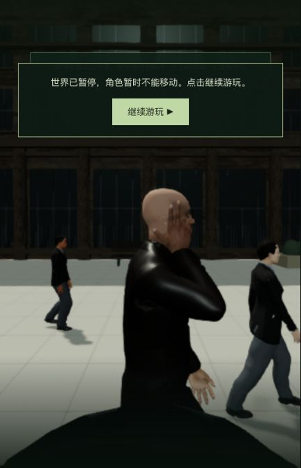

# 手部计算中的固定数据预计算

2026-10-24，基于7556630。本机入口 http://localhost:5173/ 已交付 `index-DpIKSNa4.js`；Render保持撤下。当前工作是降低已完成讲解动作的计算成本，42组电影质量验收仍为0。

## 改动与相同输出

保留全部手部顶点、三角面、圆滑指形、法线计算和累加顺序。将不随姿势改变的曲线区间/插值比例在绑定时求出；将每个面角的顶点/法线偏移放入连续索引数组，逐帧直接读取。只改动 `FightingHands.ts`，不增加素材或依赖，正式JS增加145字节。

原有缓存基线3/3。新增两项回归先0/2：双手每次更新查法线组88,178次，变换握姿查曲线区间11,898次。修正后分别13,346次（每个手部顶点一次）和0次；缓存与新预算共5/5通过。完整表面/接触42/42、部署75/75、三包类型检查与生产构建通过。保留既有大包提示；未跑全仓测试，也未宣称修复此前存在的前臂共享几何断言。

独立进程的新旧对照共256个姿态，覆盖四位主角握拳/持枪/手腕旋转、Neo红蓝药丸/触镜、Morpheus接口插接与完整5.3秒讲解。位置、法线、骨骼索引/权重、骨骼矩阵、网格矩阵和所有手部顶点世界坐标逐字节SHA256相同。完整两份结果留本机，摘要与总哈希见 `verification.json`；这不等于整个游戏所有可能动作均无穿模。

## 实际成本

单个真实Morpheus模型，同样5.3秒动画，636帧预热、1,590帧采样，分进程按旧/新/新/旧顺序执行；测试和构建未同时运行，系统后台未完全隔离。

| 样本 | 动画平均CPU | P95 |
| --- | ---: | ---: |
| 旧1 | 4.112ms | 6.064ms |
| 新1 | 3.894ms | 6.119ms |
| 新2 | 3.936ms | 6.392ms |
| 旧2 | 4.205ms | 6.357ms |

两次均值4.159→3.915ms，节省0.243ms、约5.85%。P95没有改善。本轮没有浏览器FPS测试，不能将这项局部节省称为整场提帧，更没有达到稳定60帧验收。60帧要求整帧约16.7ms，后续仍需处理其余人物动画和GPU绘制成本。

## 正式包实机

从真实检查点用W/D走进广场，按G播放，1.927秒暂停；隔离后端真正退出并重启（81574→83933），完整世界响应逐字段相等，7份记忆哈希相同。正式构建冷加载后检查V双视角，再经历漏看、G重试、鼠标看向女子/回头冻结、主动结束。首次短按G未推进，保持800ms后成功，未改剧情字段或输入逻辑。结束后实际移动3.245单位，停在 `m1_red_dress/step2`、tick12823，生命100；浏览器无警告/错误。未新增录像。

窄侧栏的暂停面板仍遮挡画面上方；人物相似度、服装和全场性能继续未完成。下图为实际冷恢复玩家镜头：

## 交付边界

固定主入口已真实重载并确认新JS，控制台无警告/错误。主PID83388保持；800份后端/共享产物、11份原有实验改动与85份主记忆保留，未写入主存档。只复制客户端源码/新JS并原子切换index，旧包保留。5200/5201临时服务已核对并停止。

提交的日志只清理行尾空白，原始日志、完整检查点、诊断脚本和候选构建留本机。本轮未引入下载资产、托管服务或费用。
