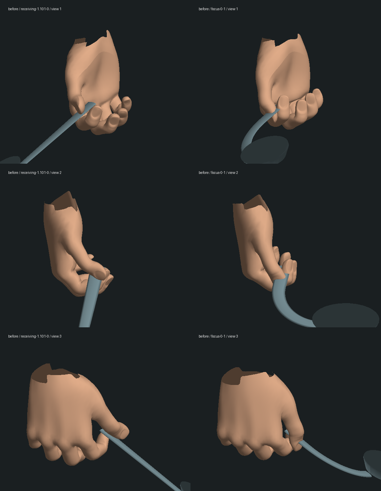
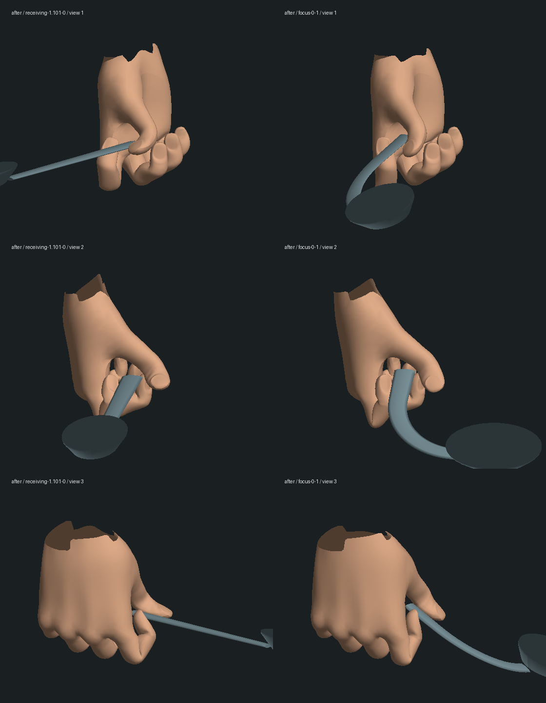

# Neo 接勺与握勺动作修复

基线 `6e190c6`。范围为第一部先知候客厅里的 Neo 接勺、持勺、起身和暂停姿势恢复。没有新增剧情完成项，三部曲仍未完成。

## 修改与证据

- 修改前 `oracle-room` **8/9**，已复现孩子交出勺子时位置跳动约 **0.0435** 世界单位。手臂够不到原交接点；加入随接勺进度变化的身体前倾后，仍沿用同一交接位置、朝向、尺寸和唯一持有者。新回归要求交接位置差小于 0.002、朝向差小于 0.01 弧度，同时检查手腕和手指的位置连续。
- 替换接勺/注视时互相冲突的固定手指旋转。使用实际 GLB 末节皮肤和原指骨长度求解拇指、食指夹持，伸手时逐渐收拢，取回时保持同一握法。手腕在够向孩子时逐渐伸直，指腹的完整朝向随金属转动，避免旋转后勺柄离手或穿手。49 个时刻的腕部检查通过；交接附近前臂与手掌轴的夹角约 52°，原中间版本约 73°。
- 修正暂停切换时残留的椅子坐姿。四个接勺/持勺/起身状态在喝水动作之后及新建实际人物模型中恢复一致；指骨位置和长度不变。
- [离线接触量化](contact-metrics.json)：原注视姿势中，拇指和食指分别有 38、39 个末节顶点进入勺柄直段；修改后三个导出样本均为 0。最终指尖皮肤到金属表面的最近距离约 0.0033–0.0066 模型单位。测试另覆盖三个持勺时刻 × 三种弯曲程度。

这些是指定姿态、末节顶点与勺柄直段的检查，不是全部手指、所有三角面、身体/衣服/家具和整场动画的完整碰撞验收。食指仍较弯曲，完整自然表演及人物外形仍需制作。

## 验证

- [基线 8/9](baseline-oracle.log)；新增[夹持/交接](red-spoon-grip.log)、[拇指穿柄](red-stem-contact.log)、[暂停姿势残留](red-pose-restoration.log)、[手腕折角](red-reaching-wrist.log)均先复现失败，再修复。
- 最终[模型、Oracle 房间和通用动作 40/40](final-model.log)，[勺子相关剧情、视角与检查存档 7/7](final-story-camera.log)，合计 **47 项**；[类型检查](typecheck.log)和[共享/服务器/客户端构建](build.log)通过。未运行全库；客户端仍有大包提示，没有据此给出性能通过结论。
- 正式 `data/`、人物资产和原 9 月 30 日递勺验收目录共 [207 个文件保持不变](protected-result.json)。本轮使用独立生成的视觉检查存档 `m1_spoon / focus`，暂停在 tick 0；这不是从正式 Neo 存档连续游玩到此处的证据。
- 3180/5197 的本地服务正常，页面 HTTP 200。原生侧边栏能建立空白页，但导航到游戏、对同一标签页复查状态和读取错误日志均超时。未启动替代浏览器或更改安全设置；已停止本轮临时服务。本轮没有新的实机截图/录像、实际存档重启、完整人工通关或帧率验收。
- 诊断初次导出漏更新蒙皮绑定逆矩阵，坐标异常的数据已弃用；修正导出器后才生成下方对照。新增恢复测试也曾错误读取尚未归 Neo 所有的道具，修正测试后另复现并修复了真实的坐姿残留。这些过程不计作通过证据。

## 实际模型几何对照

下面直接运行项目 `CharacterModels`，导出实际皮肤和勺子几何，再以无贴图诊断光照显示；左列交接，右列弯勺，各有三个观察方向。这不是原生游戏画面，也不展示最终材质和演员外形还原程度。

从项目根目录使用 `node --import tsx output/characters/hand-spoon-2026-10-14/inspect-spoon.mts <导出目录>` 可导出当前姿势；`render-spoon.py` 使用带 NumPy/Pillow 的 Python，参数为导出目录及图片前缀；`measure-spoon.mts` 参数为本验收目录。大量中间几何 JSON 和独立世界副本保留本地，仓库保存脚本、对照图和验证记录。

## 待完成

孩子仍是简化人物；候客厅人物/服装、自然注视与对白表演、全身与环境接触、原片摄影/灯光对照、完整路线实机验收和稳定帧率均未完成。本次修复不代表 1-10 整组、第一部或三部曲完成。
