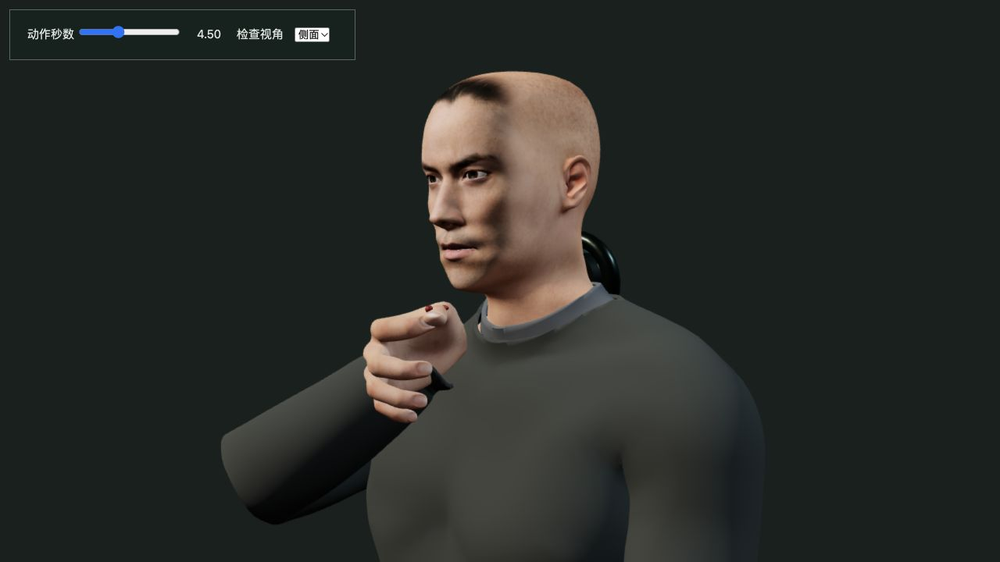
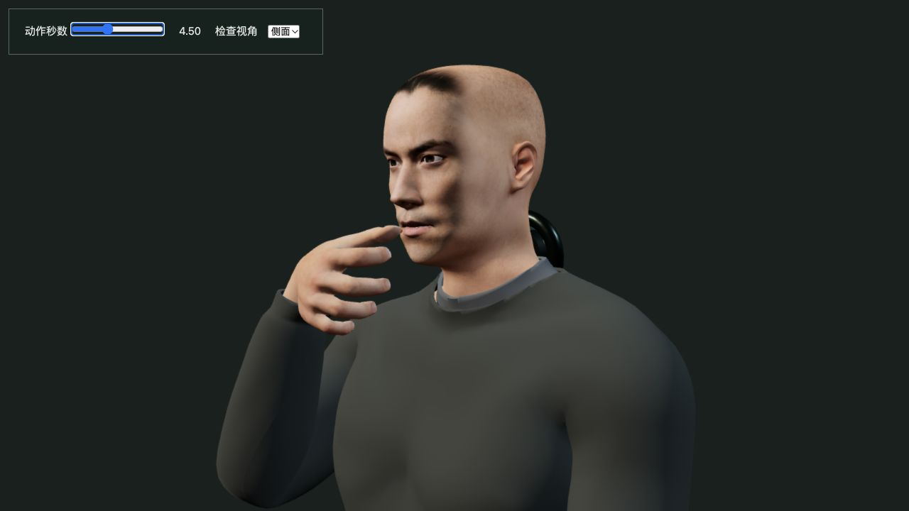
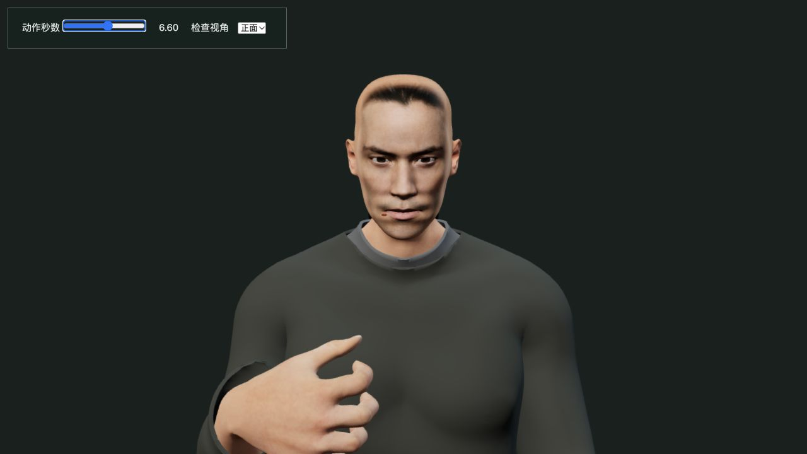
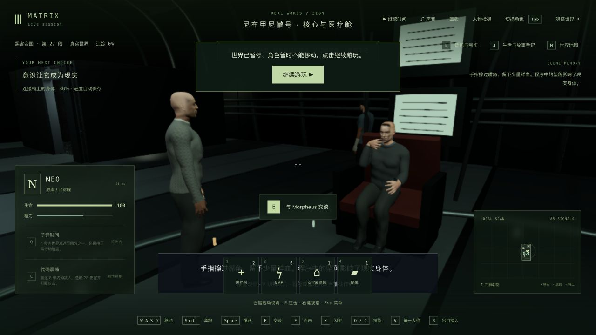
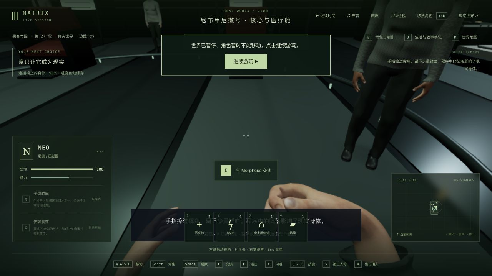
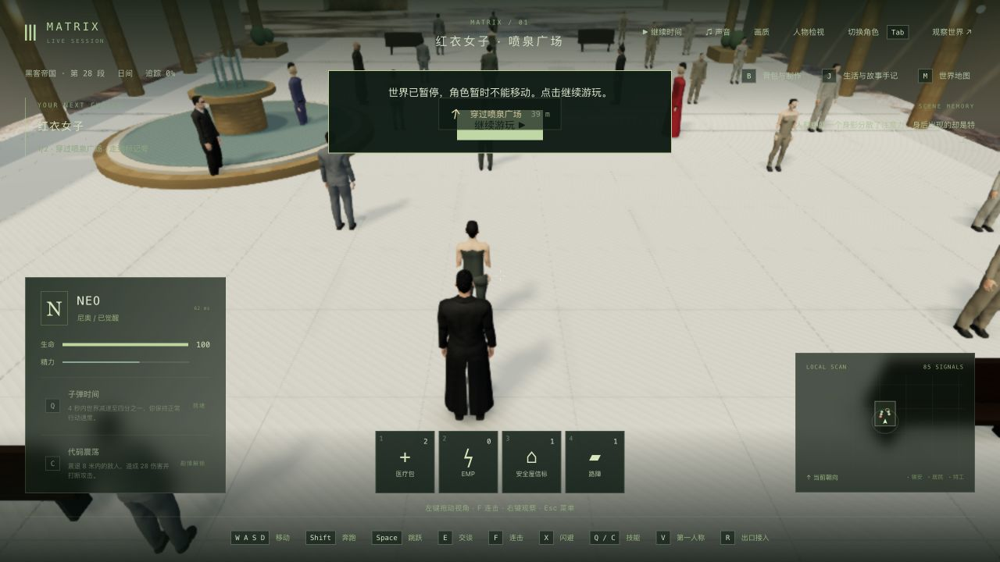
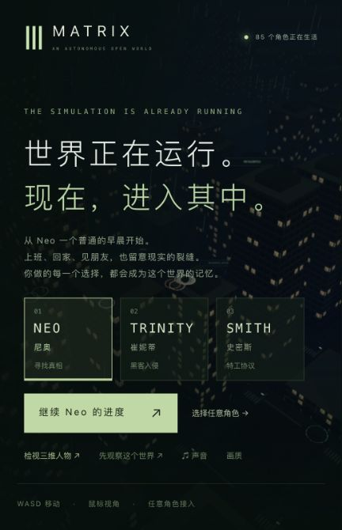

# 首跳返船：嘴角、拇指与读档连续性

日期：2026-10-24。基线：`dcb9cde`。本轮修正 Neo 首跳失败后回到连接椅的局部手部演出，42 组电影质量验收仍为 0。固定试玩入口继续为 <http://localhost:5173/>，Render 不接回。

## 发现与修改

旧动作只把拇指关节对齐一个旧头模坐标，实际指腹距离皮肤约 0.185 个模型单位；血迹也沿用旧头模位置。其余四指直接围绕同一局部轴旋转，接触阶段检测到 358 组手部三角面交叉。

现在在角色首次进入这类演出时，从实际交付头模定位嘴角，选择完全绑定远端拇指的表面点作为接触位置；嘴角和拇指血迹都附着在各自的皮肤位置，缩薄血迹几何。手腕转向及肘部路径使拇指根部避开脸颊，右手复用既有的连续手指变形，左手保持原有演出。

添加移开拇指、短暂停留查看血迹、再放下的动作节奏。进度来自已保存的剧情时间，血迹位置不依赖先前是否播放过擦嘴帧。没有新增依赖、人物资产、贴图或绘制部件；保留现有两块血迹网格。手部变形有额外计算，性能结果单列，不能称为提帧优化。

## 失败与验证

- 原有角色资产相关 2/2 和动作/训练相关 33/33 先通过，但旧嘴角断言只检查关节，未证明实际指腹接触。该断言已改为检查实际蒙皮表面。
- 新增接触回归原版 0/2。首版虽然修好了手指互穿，却出现 225 组拇指根部与头部交叉；没有放宽阈值，调整手腕朝向和肘部路径后通过。
- 冷加载血迹位置、查看血迹停留两项也分别先失败。固定材质点与新增停留阶段后通过。
- 完整右手 6,673 个顶点、12,472 个面，与头部 34,286 个面做接触检查。28 个动作时点未检测到手部自交或手部与头部交叉；6 个阶段边界检查皮肤连续，另检查冷读档、退出剧情恢复普通手势和角色之间的隔离。
- 扩大的修改前手部回归为 26/27：旧培养舱呼吸器动作在 4.81 秒的左肘，邻接 10ms 帧位移 0.08794247122591056，超过既有 0.05 限制。它不属于本轮返船动作，保留真实失败。

最终新增 5/5，动作/训练及完整脚底计算相关 35/35，角色资产相关 2/2；手部相关 26/27，与基线同一失败、同一错误码及同一关节位移数值。合计 68/69，没有新增失败。1,214 个冻结输入复核一致，见 `validation.json` 和各日志。

这些是有限采样的实际蒙皮几何检查，不是所有姿势、整件衣服或 GPU 像素无穿模证明。临时近景查看页使用真实模型及纹理，但采用独立灯光，已经从生产候选移除。

## 正式构建与原生游玩

正式候选 `index-CQbwUmEL.js` 已通过客户端类型检查与 Vite 生产构建；现有大包提示保留。没有运行全仓或后端完整测试。

隔离 QA 从上轮正常首跳失败后返回飞船的存档继续，以实际按键开始动作，在 4.374 秒暂停。真正终止旧后端 PID 10746，启动新后端 PID 30141；完整世界和 7 份记忆完全相同，tick 12201 保持。正式构建冷接管后核对 V 双视角、鼠标向下查看手、继续动作、J 反思；选择“虚拟环境中的人，也会承担真实后果”，再按 G 进入红衣女子场景。

最终测试世界 `m1_red_dress / step 0 / tick 12280` 暂停，返船段已完成，反思为 `care`。本轮没有新玩完整红衣女子段，没有调用测试推进 API 或改写主存档。生产页 warning/error 为 0。QA 两个进程均已停止，5200/5201 已关闭。

第一人称默认朝前，玩家需向下看手，现有字幕还会遮住部分手部。血迹几何位于可见表面，但尺寸、照明、镜头与 HUD 对可读性的影响仍待改善。飞船材质、人物相似度、衣服与全部原片表演继续未完成。

## 参考范围

沿用此前 [跳跃撞击与返船记录](../../gameplay/trilogy-jump-impact-2026-10-13/README.md) 及 [跳跃示范记录](../../gameplay/trilogy-jump-demonstration-2026-10-13/README.md)。本轮没有新增观看或逐帧比对原片的证据；查看血迹的具体动作时长属于游戏改编，不能据此宣称成片逐帧还原。

## 动画计算成本

在功能测试、构建和临时游戏页结束后，以原/新/新/原顺序离线运行每次 2,160 帧，覆盖三次完整 12 秒返船演出。未隔离机器上的其他应用，未测浏览器 FPS、GPU 或绘制耗时。

| 次序 | 平均动画 CPU | P95 | 首次进入动作 |
| --- | ---: | ---: | ---: |
| before-a | 0.184ms | 0.487ms | 87.81ms |
| after-a | 1.229ms | 5.047ms | 177.83ms |
| after-b | 0.968ms | 3.794ms | 140.91ms |
| before-b | 0.206ms | 0.552ms | 92.27ms |

新增的右手变形使这一小段平均增加约 0.76–1.05ms，首次进入还增加实际嘴角/指腹定位的成本；这个首次帧不包含人物模型加载。没有将这次修改宣传为性能优化，也没有证明浏览器稳定 60fps。曲线形变的过渡帧与首次定位仍有优化空间，普通行走/其他剧情未启用本轮新增的手部模式。原始数字和复现脚本见 `cpu-comparison.json`、`measure-animation.mts`。

## 本机发布与未完成范围

固定入口已实际重载 `index-CQbwUmEL.js`，操作通道连接正常，继续 Neo 进度可用，warning/error 为 0。JS 增加 2,149 字节，CSS、角色资产、280 份后端产物和全部共享产物不变。主服务 PID 43571 未重启；主世界自然推进，发布前后 tick 14367 → 14369，所以完整世界快照并不相同。发布未写入或恢复主存档，85 份记忆摘要一致，11 份其他实验逐字节保持。721 份正式包文件与本轮候选一致。旧 JS 继续保留，Render 没有接回。

本轮只修正返船动作的表面接触、变形与读档连续性。高质量人物、飞船环境、原片完整表演、首帧和动态手部计算成本、HUD 遮挡与稳定 60fps 均未验收完成。培养舱呼吸器左肘既有跳变继续列为待修复项。

近景与性能脚本引用本目录下的 `candidate-release`；该完整副本、测试存档和原始世界快照只保留本地，不提交。复查时可在该路径放置对应提交的独立检出并安装仓库依赖；正式回归测试位于仓库 `tests/`，其余日志和 JSON 保留原始失败与成功结果。文本日志去除行尾空白，压缩的 `.raw.gz` 保存原始字节。

