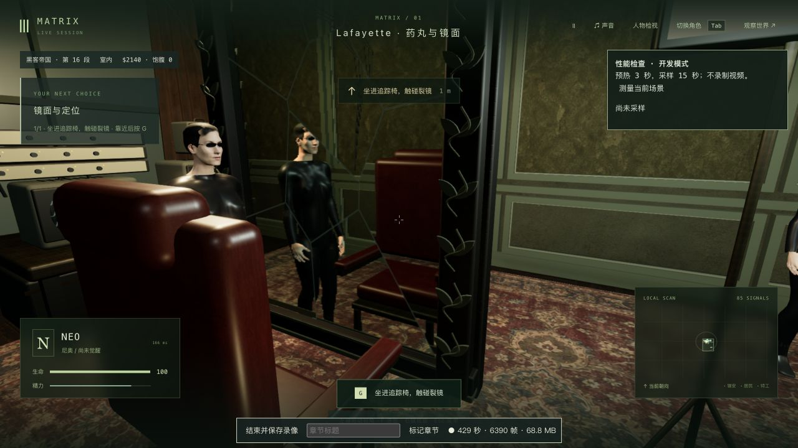
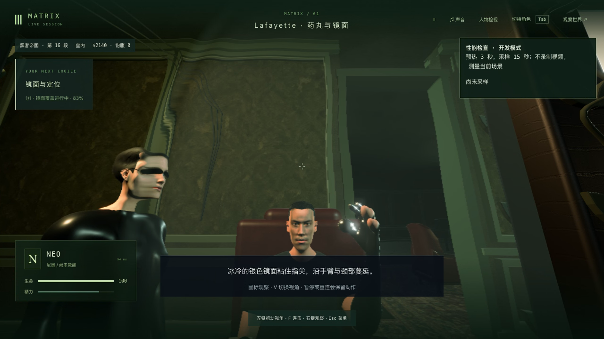

# 旧楼镜面渲染与连续实机 · 2026-10-22

已更新 <http://localhost:5173/>，只采用两份渲染源码改动和三项新增回归。镜面复用主画面已更新的场景变换，新显露的第一人称人物单独刷新蒙皮剔除边界。原几何、材质、阴影、镜面分辨率和后期效果全部保留。**本轮未证明FPS提升，42组电影质量验收仍为0。**

## 源码、失败与修正

基线 `b4d1cdca8f7851e814bd6e861a19ba432d50ad70` 的1,149份包/测试/脚本逐个核对Git对象后，建立两份隔离副本。704份包文件中仅 `MirrorSurface.ts`、`FilmSetRenderer.ts` 改变，其余702份保持；另扩展 `mirror-region.test.mts`。没有改人物素材、动作、依赖、服务端或存档格式，11份未完成脱衣实验保持哈希且未纳入试玩/提交。[源码核对](source-audit.json)

先验证原渲染/建筑/灯光14/14通过。新增两项先失败：主颜色渲染已更新整个场景，反射仍重复遍历隐藏城市；反射异常时的场景自动更新设置也需要恢复。现仅在这次反射调用内复用变换，并在`finally`恢复原设置。镜面原有裁剪、折射前置渲染复用、其他摄像机、裂缝/液态UV及资源释放逻辑保留。

补查发现第一次优化会让新显露的第一人称人物保留旧蒙皮剔除边界：真实SkinnedMesh回归先失败。`enableSkinnedCulling`在人物隐藏时不刷新边界，不能仅以骨骼矩阵已更新推断边界也正确。现显露主角与附件时只刷新这些根节点，继续保留主场景复用。三个骨骼位移时刻检查真实皮肤顶点位于边界内，并保持直接第一人称人物隐藏。最终镜面/遮蔽/旧楼/灯光/蒙皮相关19/19、部署75/75通过；`npm run typecheck && npm run build`退出0。生产大JS分块提示保留，未跑全库。

原TAP和两轮首失败日志以 `.log.gz` 保留字节，同名未压缩日志也留在本机。没有放宽原位置、UV、材质或剔除检查。

## 实际性能与画面对照

最初分别重载的原生测量为17.67→16.41fps，没有证明优化有效，因此保留这组结果，未当作提升结论。另进行了不采用的临时效果隔离：关闭AO约22.5fps，关闭阴影约18.7fps；这些诊断修改均已移除。没有将减画质版本发布。

异步GPU查询实验按[Khronos接口规范](https://registry.khronos.org/webgl/extensions/EXT_disjoint_timer_query_webgl2/)实现，但本机分段结果的均值之和约169ms，高于约59ms帧间隔，未建立可加的分段耗时含义；不能据此归因某个GPU阶段。原报告与QA探针保留，未采用这些数值作性能结论或游戏依赖。

随后在同一已加载场景中通过明确QA按钮切换两种算法，以 **B1/A1/A2/B2** 顺序各预热3秒、采样15秒。只有一个后台IAB游戏页，1280×720、像素比1.5，世界暂停、无录像、没有并行构建/测试，其他系统负载未控制。QA切换器和计时探针均已从最终源码移除；切换器的基线模式保留原场景更新，候选模式复用变换，不改变其他渲染参数。

| 顺序 | FPS | 渲染提交CPU平均/ms |
| --- | ---: | ---: |
| B1 原方式 | 16.50 | 18.041 |
| A1 复用 | 15.98 | 15.544 |
| A2 复用 | 16.69 | 16.783 |
| B2 原方式 | 16.54 | 17.774 |

两次平均渲染CPU由17.907降至16.164ms，约减少9.74%；帧率平均16.52→16.34，**没有FPS改善或流畅性验收**。这只证明当前机位CPU工作减少，不能推广到所有场景/硬件/前台游玩。两次原始截图排除顶部HUD和性能面板后，720,175个像素完全相同；该区域包含固定暂停/选择UI，不是全部动画或第一人称画面的等价证明。[原四次数据](native-ab-summary.json) · [像素核对](native-ab-picture-parity.json)

最终第一人称边界兼容修正随后通过真实蒙皮测试与连续实机检查；上述第三人称A/B没有触发新显露主角的分支，不能当作该分支的耗时测量。较早重载的图片平均通道差约0.238/255，保留在`native-picture-parity.json`，没有用后面的同页对照覆盖早期结果。

## 连续正常操作与真实重启

从历史P0验收档通过普通原生界面入座，走完四段哲学对白、选择自主决定；性能检查后继续选择红药、接药/服药、拿杯/放杯、起身，用WASD/鼠标/V穿过实际门洞，走到追踪椅右侧并按G，完成入座、接线、触镜与银液转换，真正进入 `m1_pod / step0`。没有注入剧情阶段，没有使用固定试玩存档。[完整范围](native-verification.json)

录制覆盖红药选择到培养舱入口，包含导航尝试、检查等待和菜单操作：原始 `native-recording/neo-2026-10-22T06-18-19-524Z.webm` 为544.20秒、85,886,284字节，保留音频及8,251个实际录制帧，原始文件只留在项目本地。入库的[62秒片段](native-recording/mirror-to-pod.mp4)从原390秒开始转码，616帧、4,008,651字节，保持源时间与捕获停顿。完整录像统计10,409个渲染帧、19.13fps、P95帧间隔152.3ms，含录制开销，不能与录制帧数混用或视为流畅通关。

独立世界最终暂停于tick6056。实际关闭并重新启动5200验收后端，世界阶段、时间、模拟、事件、完整沙盒/剧情五组保持，Neo位置/朝向/生命/觉醒/所在世界/地点六项保持，7份记忆文件哈希保持；原生页面重连显示相同培养舱检查点和暂停状态。[真实重启核对](restart-verification.json) 视角从第一人称变回第三人称，**未证明视角偏好保存**。这不是镜面动作中途重启或蓝分支/失败恢复验收。

读到的原生warning/error为空。实际试玩仍暴露：近墙第三人称镜头贴近身体、滑墙改变朝向、第一人称入椅时视线掠过几何、鼠标锁定下HUD点击不便；暂停最终通过菜单后的键盘激活完成。录像真实保留这些尝试，未将其抹去或算作已修复。人物、指面表演、衣物高光与培养舱美术仍明显近似，完整身体/道具接触和电影质量继续未验收。

## 固定本机试玩更新

`index-js5izVei.js` 共3,735,217字节，SHA256 `83ffc75067f17323652af11ef3a15e2783c5e33ea0ae1f4b42c587de33299048`。只新增JS、镜像采用的两份源码/一份测试并原子替换入口，旧JS保留。704份包文件与候选一致，280份后端文件和PID82106未变，固定试玩服务未重启。更新及原生加载前后完整世界响应逐字节一致，tick3757/暂停、Neo进度保持。[发布与存档核对](local-update-verification.json)

原生侧栏实际加载新脚本且无warning/error，入口为 <http://localhost:5173/>，没有接管或推进该试玩存档。两个临时验收服务均已结束，Render保持永久撤下。下一项优先处理实机暴露的近墙/滑墙视角与人物表演缺口，不以此次CPU改进替代42组电影质量目标。
