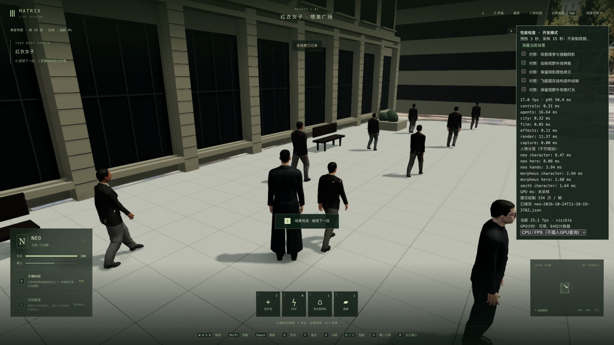

# 1080p 实际游玩性能基线

2026-10-24，源码 `942d8ef`。本轮只测量，没有修改运行代码、素材、画质或依赖。本机正式入口仍是 <http://localhost:5173/>，`index-DTIDupUE.js`，Render 保持撤下。稳定 60 帧及 42 组电影质量验收仍未完成。

## 测量方式

从上一轮真实游玩留下的 `hand-active-frame-budget-2026-10-24/qa-checkpoint-free-roam` 复制独立存档，原生接回 Neo 并继续时间。场景为红衣女子训练结束后的喷泉广场；训练群众保持剧情完成时的状态，其他世界逻辑仍运行。本轮没有通过接口改写剧情，也没有以空场景代替实际人物。

测试使用干净提交的独立构建目录、5200 独立后端、5201 Vite 开发客户端和 Chrome 的 `?profile` 面板。真实渲染缓冲为 1920×1080 或 1280×720，DPR=1；不是侧栏的小视口。GPU 报告为 Apple M3，系统物理内存 24 GiB。每次原生点击测量，预热 3 秒、采样 15 秒，不录屏、不同时构建或运行测试。

前六份报告保留了另一侧栏游戏首页仍打开时的诊断结果。随后确认首页没有玩家接入，临时关闭它，完成下面的单游戏标签页测量。服务器及其他系统负载并未完全隔离。结束后已重新打开侧栏正式入口。

## 单游戏标签页结果

| 条件 | FPS | 帧间隔 P95 | 人物更新 CPU/帧 | 渲染提交 CPU/帧 |
| --- | ---: | ---: | ---: | ---: |
| 1080p，站立 | 26.70 | 49.90 ms | 12.06 ms | 10.52 ms |
| 1080p，连续走跑 | 25.51 | 49.90 ms | 15.78 ms | 12.66 ms |
| 1080p，连续攻击输入 | 26.95 | 50.90 ms | 16.64 ms | 11.37 ms |
| 720p，站立 | 40.97 | 36.30 ms | 9.99 ms | 9.71 ms |
| 1080p，临时跳过接触阴影 | 37.80 | 39.40 ms | 11.89 ms | 9.50 ms |

精确值及对应文件见 [verification.json](verification.json)。站立的 720p/1080p 相机位置、方向、投影逐项相同，均为 330 次绘制、2,487,084 个跨渲染阶段累计三角形/帧；这里的三角形数不是独立模型面数。降低像素量显著改善帧率，但仍未稳定达到 60。

连续走跑使用 W/S 各 2 秒交替、Shift+W/Shift+S 各 2 秒，再 W/S 各 2 秒，包含相机随移动变化，不能把它与固定镜头结果当作严格单变量对照。攻击采样为 17 次原生 F 输入，每次持键 800 ms 后释放；它测的是攻击动作负担，没有验收完整敌对战斗、命中链或胜负流程。Neo 手部更新分别约占走跑的 2.75 ms、攻击的 3.94 ms；character/hero/hands 是嵌套计时，不可相加。

接触阴影诊断把绘制次数 330→245、跨阶段三角形 2,487,084→1,727,022，FPS 26.70→37.80。开关仅在采样期间生效，结束自动恢复。它用于定位成本，没有作为正式优化发布；仍须保留人物与场景接触的视觉质量。

早期诊断中：1080p 站立 26.43、走跑 25.20、攻击输入 26.78 FPS；临时关闭动态阴影 28.89 FPS，临时冻结 3D 绘制但继续世界逻辑 60.00 FPS。整段 GPU 查询均值 39.76 ms。分阶段 GPU 查询存在排队与平台影响，结果不可相加，也不能用它们代替正式逐阶段成本。所有 12 份报告均为页面 visible、未录屏、停止时 WebGL error=0。

## 对 60 帧与硬件需求的判断

60 FPS 对应每帧约 16.7 ms，且浏览器自身也需要时间；参见 [Chrome 团队的渲染性能说明](https://web.dev/articles/rendering-performance)。当前 1080p 站立约 37.5 ms/帧，达到目标需要明显缩减总成本，不能用某个局部函数几个百分点的收益推算整体已达标。

本项目在玩家浏览器用 Three.js/WebGL 绘制。因此显卡的几何、材质、阴影、后期处理负担，以及 CPU 的人物/骨骼/手部/布料计算，是接下来要减少的工作。服务器主要影响世界更新、操作响应和保存；扩容服务器存储或内存不会直接替玩家电脑完成画面绘制。

硬盘容量用于容纳素材、声音与存档，读取速度影响加载；系统内存与显存/统一内存必须容纳当前工作集，容量不足会造成换页及停顿。但本次机器已有 24 GiB，观察间系统交换空间占用保持约 6 GiB、Swapouts 增量 0、Swapins 增量 16 页，不能把累计交换空间归到游戏，也不能据此建议加内存。上述系统数据不是游戏独占内存峰值测量，尚不能给出经过验证的最低配置。

下一轮按实测优先级处理：

1. 接触阴影的重复几何绘制和像素处理成本；评估独立于主画面清晰度的优化，并核对人物边缘、脚底、衣物和道具接触。
2. 活动人物的手部、表面连续性和衣摆计算；保留动作、接触与法线，先测完整动作收益，再决定是否采用。
3. 在正式生产构建、没有诊断包装的条件下，测持续走跑、真实战斗、切场及更多场景的平均和尾部帧时间。当前结果不代表整个三部曲或最低硬件验收。

减少绘制提交、控制渲染缓冲像素量等方向也见 [MDN WebGL 最佳实践](https://developer.mozilla.org/en-US/docs/Web/API/WebGL_API/WebGL_best_practices)。实际采用与否以本项目的视觉与性能对照为准。

## 验证和清理

1,247 份候选源码/素材输入、11 份原有工作区实验、800 份共享/后端编译产物哈希保持不变。没有运行代码改动，未为诊断结果新增或重复运行行为测试；独立后端/共享构建通过。浏览器停止测试前 warning/error 为 0。

QA 后端 PID 97376、客户端 PID 97377 已按 PID、命令及工作目录确认后停止，5200/5201 关闭；见 [qa-stop.json](qa-stop.json)。临时浏览器尺寸覆盖已恢复，测试页已关闭。本轮实际暂停后的独立存档保留在本机 `qa-checkpoint-free-roam`，未提交，也没有覆盖主存档。

主 PID 83388 和正式 JS 的 HTTP SHA256 保持一致，主世界自然运行。正式入口重新在 Codex 侧栏打开。提交只包含本报告、原始测量与校验资料，不包含独立候选构建、大型资产副本或世界存档。
