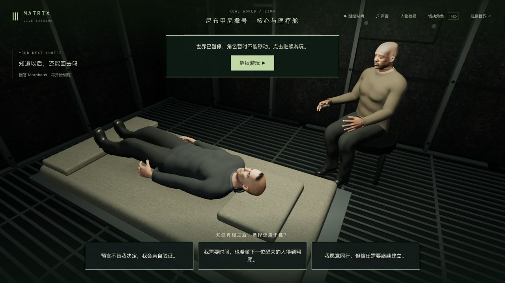
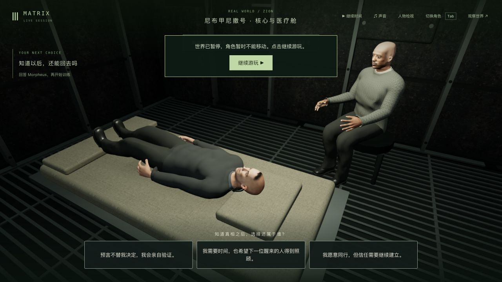
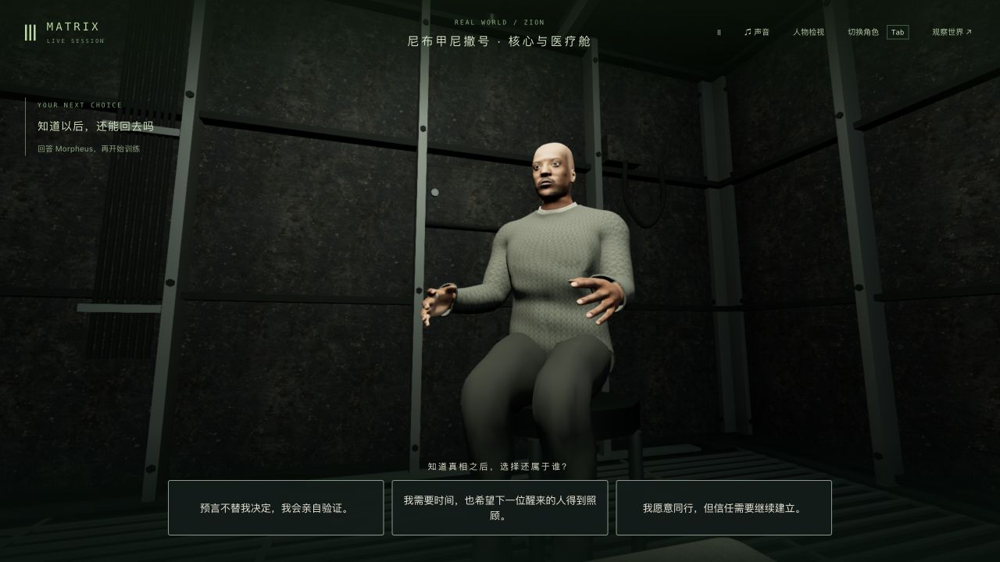

# Morpheus 飞船针织服装：胸口垂坠与织物

2026-10-23，基线 `80f2522`。本轮是局部美术修整，**不是全衣穿模修复、演员相似度、电影质量或60fps验收**。已同步到 <http://localhost:5173/>，正式构建 `index-G4_jO_n_.js`；制作目标的42组电影质量完成数保持0。

## 改动与成本

给飞船毛衣保留独立的胸口表面缓存，跨过胸骨及胸肌底部的凹槽，并加入轻微布料起伏；使用灰褐色、混色纱线的漫反射与原针织凹凸。领口、袖口、衣摆、UV、全部索引和蒙皮权重保留。原模型仍供构造体西装和旧楼服装制作，切回矩阵时恢复原几何。没有改变GLB或引入依赖。

原模型11,605点、22,310面不变，只调整1,642个胸口顶点；不增加绘制网格或三角形。新增几何数组缓存1,474,640字节、128×128纱线贴图基础层65,536字节，另有mipmap。它们不是浏览器总RAM或GPU内存测量。拟合只在该人物第一次使用飞船服装时执行，暂停和正常动画复用结果，离开时可恢复，销毁时释放。离线首次整个人物更新包含其他初始化且与回归并行，不能当作拟合独立耗时或浏览器FPS；本轮没有证明提帧。

## 参考和实际失败

实际抽看[Clip.Cafe收录的病床谈话片段](https://clip.cafe/the-matrix-1999/i-cant-go-back-can-i-no-but-if-you-could-would-you-really-want-to-i-feel-i-owe-you-an-apology-we/)的已解码画面，重点是40秒全屏侧面：灰褐混色粗针织、肩部接缝与松量、上臂纹路。它不是片方官方上传；没有完整观看影片、测量服装、精确对色或下载/导入影片素材。肩部真正裁片、领口磨损和演员轮廓尚未还原。

初版尝试展开原衣摆并为裤腰留余量，未满足整衣接触要求，并曾错误扩大袖口，已全部撤回。完整接触检查也明确发现原模型腋下和衣摆的既有缺陷。后续胸口修整曾扩大腋下交叉，逐面定位后限制到胸口前方，保留所有失败日志与被拒绝源码。

原先提出的“整衣零相交”验收没有达到；本轮最终门槛改为**胸口改善、其他服装保持、完整可见表面没有新增或加深的交叉**。五个坐姿时刻及一个站姿中，原自相交记录为1,032–1,586，衣摆与裤子为101或303；这些是有方向面配对计数，不是独立缺陷数。最终必须逐对与基线比较，不能只靠总数相同。旧的衣摆、腋下和蒙皮缺陷仍待修复。

## 验证记录

新增五项在原版3过2失败：胸口轮廓与纱线表面缺失。最终五项全过，包含全部索引/UV/权重、原制作源恢复、完整表面相交比较、连续动画/冷恢复/暂停的全部顶点比较、材质不重复编译和资源释放。

既有相关基线30项中26过4失败，原失败包括Neo/Trinity针织外形恢复、腕口覆盖与Neo离开场景后的服装恢复；不能宣称全套通过。候选首次25/30，多出的一项是原测试只允许纯色、无漫反射贴图，与本轮混色纱线/灰褐色目标冲突。仅更新Morpheus的材质预期，保留患者优先级、无矩阵翻领、Neo原材质及返回矩阵恢复检查；更新后的同一用例在原版0/1、候选1/1。其他29项复用已完成结果，生产源码保持（另有一个发射JS完全相同的属性类型修正）。最终相关26/30、四项错误正文/错误码与基线一致；**这是29项原结果加1项重测，不是重新全跑30项或全套通过**。其他Morpheus西装/旧楼服装及真实椅子/遥控器接触基线24/24、候选24/24；部署75/75、类型与生产构建通过，1,188份冻结输入保持。大JS分块提示仍在，详见[验证报告](validation.json)。

真实QA后端52751→73630重启，第一次读取仅缺少临时`neo.controller`字段；原生页面自动接管后，完整响应与重启前逐字节一致，tick7802、question/0秒、m1_truth_return/step2保持。七份记忆与未推进的真实起始检查点一致。保留首次严格比对失败，没有将该差异从原记录抹去。

## 实际游玩与发布

生产包从真实病床问题检查点冷加载；检查V两种视角和鼠标，继续时间后选care回答，再正常进入Tank唤醒/下载准备，按G起身、W/D与鼠标走动。一个排除传送的同场景位移样本为3.6625米，最终 `m1_download/step0/tick8649` 暂停，生命100、`downloadSetup.phase=walk`。**没有走到连接椅、开始下载训练或进入道场**。页面warning/error均0；无新录像或FPS基准。

实机仍看见[第一人称跨场景被自己衣领/身体遮挡](native-production-training-camera.png)、低头的颈口边缘，以及床边转向/通路不够顺手；没有将这些旧问题记成已修复。另见[实际操作与限制](native-verification.json)。

主试玩仅同步本轮两份客户端源码、三份测试/辅助文件和新JS入口，712份运行包匹配候选；280份后端、全部共享编译产物、主PID9294、发布及原生刷新前后完整主世界/85份记忆、tick3757/暂停及11份既有实验保持。旧JS/CSS保留，无正式服务重启；QA5200/5201及临时页面已关闭。Render未接回。见[本地同步守卫](local-update-verification.json)。

下一步仍须处理人物/服装源网格与蒙皮、第一人称交接、实际通路和慢帧；本轮胸口与材质改善不等于整套模型或电影场景完成。

## 当前画面

原版：

修整候选：

生产版正常床边选择：

