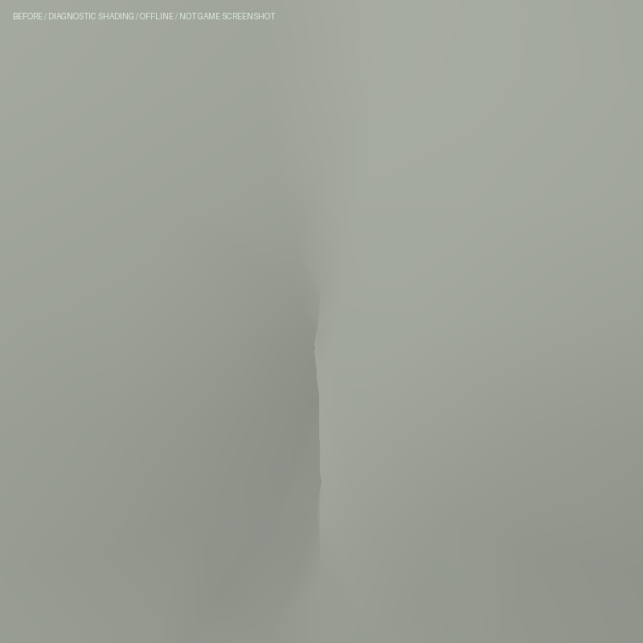
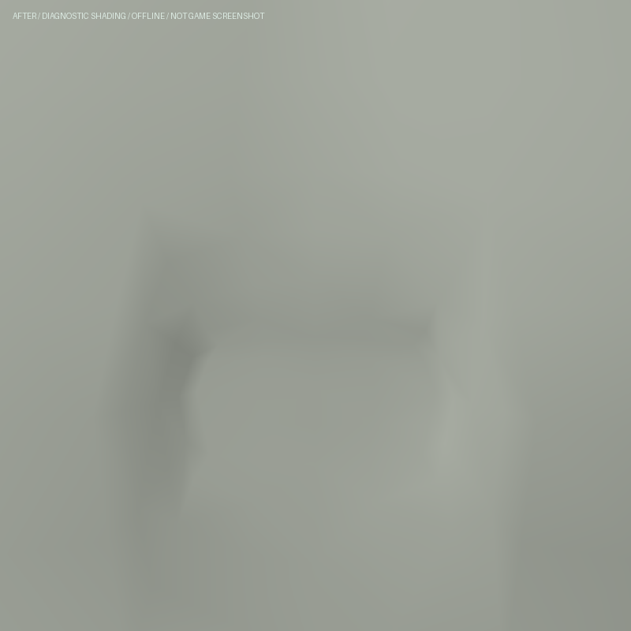

# 墨菲斯旧楼衬衫：修正前襟自交

2026-10-20。运行修正已提交并推送为 `b4dc4144ce20ccac9a6f7764c39579018d230116`，已随包含说明的提交 `d313b94` 发布到正式站。此次没有修改 GLB、贴图、存档、剧情或依赖，也没有接入尚未完成的脱外套动作。

## 问题与修正

实际游戏衬衫的镜像前衣片在腰部越过中线：整件 11,977 点、23,046 面中有 23 组相交三角面对，涉及 25 个顶点。原有退袖检查允许这些已存在的相交，因此身体路径通过不代表衬衫完整通过。

沿原始 UV 行恢复这一小段衣片的横向间距，并在四周连续衰减。保留全部原始面索引、UV、缝合中线和褶皱深度，重新计算受影响条带的法线；已有腰部贴合和蒙皮流程继续使用修正后的表面。只在人物创建时处理，没有新增每帧计算。

新增回归在修改前失败：站立、行走、奔跑和蹲伏的 12 个完整衣面样本，每个均有 23 组自交；修改后全部为 0。原退袖测试移除这 23 组豁免，退袖与恢复的 25 个关键姿态均要求整衣自交和皮肤交叉为 0。

## 验证范围

- 原相关基线 10/10；修正后相关 11/11，身体、袖口与恢复 10/10。
- 独立发布目录部署回归 69/69，三包类型和生产构建通过，仍有原有大包警告。
- 独立服装回归首轮 46/47；唯一失败是旧保护断言要求这次有意修正的前襟法线不变。检查范围仅增加这个明确的窄条带，仍逐点检查其余法线、袖子、UV、原始索引和背缝。更新后的该项及新增整衣回归再测 2/2；没有放宽相交阈值。
- 发布目录中 1,133 个其他已跟踪文件与基线 `c205f91` 相同，只覆盖一个运行文件、一个现有测试，并新增一个测试。原有脱衣工作区改动未包含。

[汇总](verification.json)保留检查数量及日志哈希。完整前后表面分别保存在 `shirt-contacts-before.json.gz` 和 `shirt-contacts-after.json.gz`；解压后可用 `render-comparison.py` 重做近景。

以下是相同镜头、全部衣面、诊断材质的离线图，**不是游戏截图或最终 PBR 材质**：

| 修正前：中缝折叠相交 | 修正后：连续衣面 |
| --- | --- |
|  |  |

复测命令：`node --import tsx --test tests/ambush-shirt-seam.test.mts`。更广泛检查见本地发布目录 `output/deployment/matrixai-shirt-2026-10-20/` 的日志。

## 仍未完成

有限姿态没有相交不等于连续时间和全部剧情姿态均通过。完整外套退出、抓衣与落地仍失败或未接入；此前冻结的物理对照没有因本次衬衫修正而重新验收。演员相似度、自然布料、完整剧情画面和性能仍需继续检查，不增加三部曲高质量完成组。

正常 Render 控制台恢复后，Codex 已发布并确认 `dep-dbbdc7u7bikc73855vug` 为 Live；正式站提供 `index-Yvjjmxdq.js`，交接存档保持。线上原生操作已检查墨菲斯旧楼动作预览及 Neo 走动、跳跃、两种视角转向，最终暂停于 tick17556。外套预览遮住前襟，因此尚未完成人物衬衫近景的实机视觉验收。发布、连接指标与准确范围见[线上记录](../../deployment/matrixai-shirt-2026-10-20/verification.json)。
