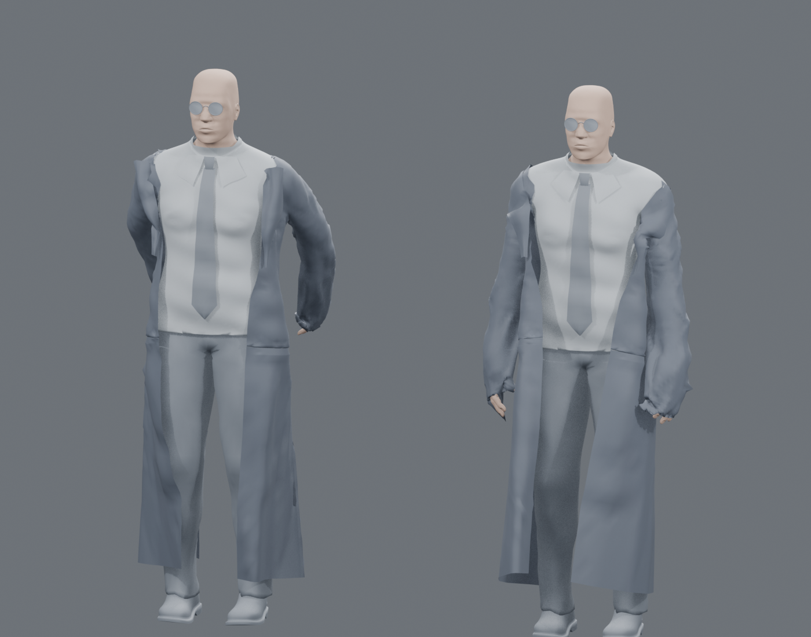
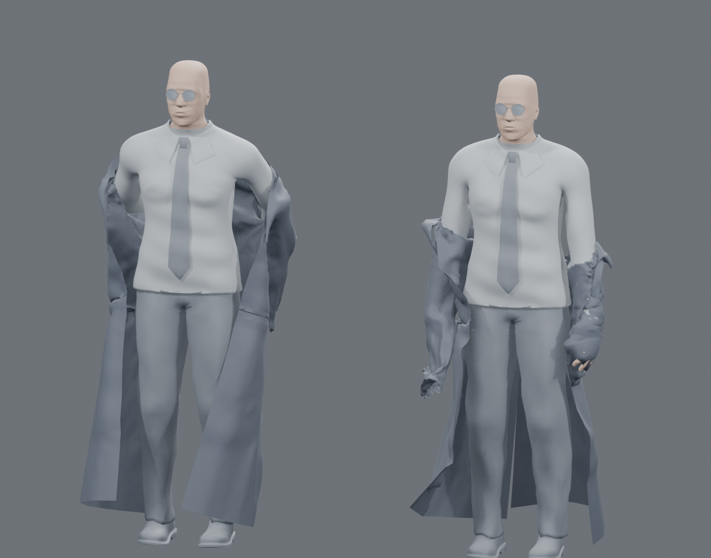
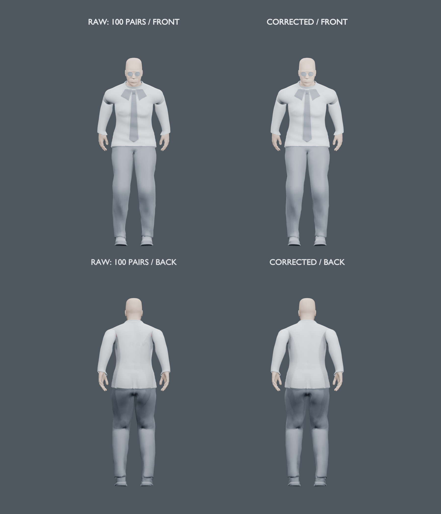
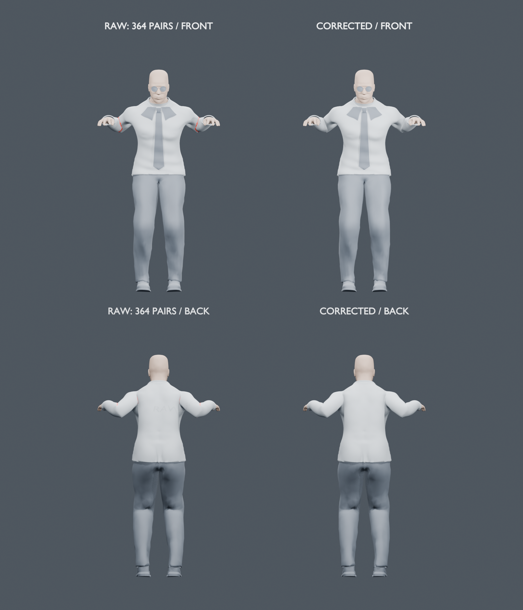
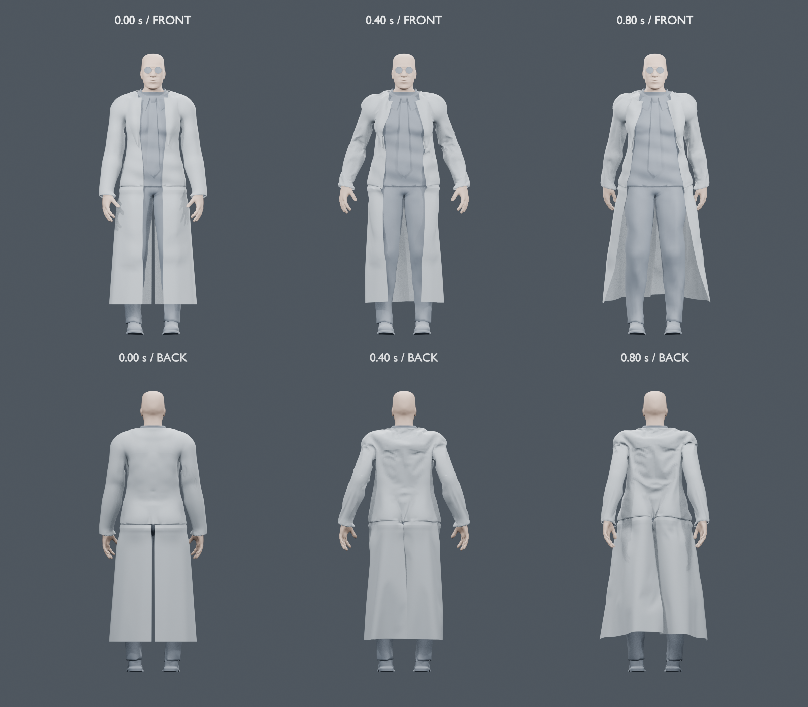
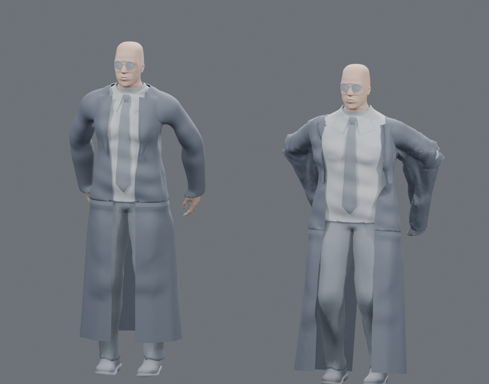

# 当前墨菲斯外套的物理校准

2026-11-01，离线衣物制作。**完整脱外套仍未通过，未接入正常剧情，三部曲综合高质量验收仍为 0/42。** 最新完成完整八秒衬衫与 0–0.8 秒外套准备段的独立显示面检查；整件衣物的退袖、真实抓放、结束状态和游戏恢复仍未通过。下方保留此前真实失败，最新范围见“完整衬衫与准备段检查”。

## 已完成的控制

- 使用当前人物实际导出的全部 **13,960 个焊接点、26,916 个显示面**和 **13 个可见内层**。物理网格为 **3,077 点、5,657 面**；起始姿态自身、人体交叉均为零。
- 原双袖口各 61 点和颈口 67 点，共 **189 个制作控制点**保持原位置。显示网格保留完整翻领及两片衣摆，没有删除衣面。
- 物理网格的 231 条非显示结构边连接翻领和衣摆；完整密度对照保留原来的 648 条连接。构造这些边时先去除上衣顶点列表中的重复编号，避免三个最近邻实际只连接到同一顶点。
- 旧参数的完整密度自由下落对照在 0.3 秒只下降约 **0.893 mm**，检查明确失败。按顶点质量归一阻力、使用工作材质及当前物理网格后，完整显示衣物下降约 **329.673 mm**，末帧最大相对形变约 **0.0038 mm**，九个模拟帧均报告 `SUCCESS`。
- 初始显示绑定的最大坐标误差约 **1.804 μm**，不是逐位相同；按项目已有的 10 μm 显示绑定精度检查。另对实际绑定后的完整显示面重新检查，仍为自身／人体零交叉，穿模检查的阈值未改变。
- `cage-rest.test.mts` **3/3 通过**，检查物理网格、完整制作控制以及实际绑定后的完整显示面；绑定测试同时核对生成输入、制作源码及原生输出的 SHA-256，不能在输入变更后静默复用旧绑定。
- 实际制作工程重开后，51,490 个内层顶点在四个指定整数帧与输入逐字节相同，一个子帧检查通过；PC2 使用相对侧文件。该检查范围为制作碰撞体恢复，游戏读档仍未验收。

参数是本衣物的工作标定，不是实测皮革常数，也不是通用单位换算公式。原生完整报告及输入摘要见 `verification.json`、`full-sewn-fall-original.json` 和 `sewn-cage-fall-normalized-material.json`。

## 完整时段与退肩控制

`export-clearance-input.mts --full-removal` 将原 0.8–3.2 秒的 73 帧输入延长到 `AMBUSH_DOFF.duration` 的八秒，共 217 个 30 Hz 样本。原 73 帧的身体二进制和袖口数据保持，最后恢复原站姿；`full-body-input.test.mts` 的三项检查通过。最终源码另在临时目录重新执行两条完整导出，各 217 个身体文件和清单与保留输入逐字节相同，见 `body-export-equivalence.json`。旧身体准备测试的面数预期已从过时的 25,796 更新为当前实际的 26,916，没有减少显示面。

新增可选的 `--shoulder-release` 身体控制，在收臂时向前俯身退肩，结束时恢复原站姿。原路线和退肩路线的身体检查各五项通过，包含完整准备衣物、指定退袖／恢复姿态、481 个 60 Hz 身体连续性样本、固定脚底、手腕可达和变换后的冷恢复。两份输入各 217 帧的完整衬衫自身及与其他十二个可见内层的检查均为零交叉。这些是有限身体检查，不代表外套或任意帧间路径通过。

原生完整烘焙在 1.7 秒之后解除全部 122 个袖口点的固定；每帧读取实际求值后的顶点组权重，并检查完整显示袖口确实离开引导路径。原路线和退肩路线各两项释放检查通过。手与衣口距离审计确认，原路线 1.7 秒时右拇指距袖口约 121 mm、右食指约 67 mm，不能据此称为真实抓衣。

两条路线都没有完成整件脱衣。新增 `full-removal-finish.test.mts` 检查完整显示外套接地，并在结束时低于恢复后的双手；两条路线各自仍为 **0/2**。这只是必要的结束条件，通过后仍须检查全时段接触、抓衣／松手、自然形变与游戏恢复。

| 八秒结束状态 | 原路线 | 俯身退肩控制 |
| --- | ---: | ---: |
| 最低显示点离地 | 129.756 mm | 34.999 mm |
| 最高显示点 | 1.520 m | 1.259 m |
| 原生模拟拒绝 | 第 2 帧含 `NO_CONVERGENCE` | 第 2 帧含 `NO_CONVERGENCE` |





以上均是完整显示面和全部可见内层的离线灰模，不是游戏画面或演员验收。精确落点和八秒编排属于游戏动作设计；现有成片片段遮挡了退袖和落点，不能称为电影已确认的时刻或位置。

231 条连接边按最近源顶点权重分类，未发现手臂权重超过 50% 的锚点；两片衣摆的该权重为零，53 条翻领连接存在不超过 11.302% 的混合手臂影响，不能写成全部零影响。上衣前开口与颈口属于同一个 488 点边界，另有两个完整袖口，未发现被闭合的前襟。Blender 4.5.3 源码的[结构弹簧构造](https://github.com/blender/blender/blob/v4.5.3/source/blender/blenkernel/intern/cloth.cc#L1479)也确认，未开启零长度收缝时，这些边仍以原长结构弹簧工作；没有将它们误改成收缩到零的连接。

向身前退袖的本地候选曾产生衬衫／手腕交叉，已停止对应烘焙（退出 143），未替换上述两份控制输入或游戏模型。解除旧手腕固定朝向后，指定姿态的皮肤交叉降至零，但衬衫自身交叉仍在；现有圆弧袖管修正可清除部分肘部交叉，2.0／2.4 秒仍有肩部交叉。后续需先修正这一条身体／衬衫路径，再烘焙整衣；失败日志和本地候选保留。

两份完整烘焙的原始脚本快照为 `bake-full-control-snapshot.py` 与 `bake-shoulder-control-snapshot.py`，SHA-256 与各自原生元数据一致。退肩烘焙当时漏加 `--python-exit-code 1`，虽然进程退出零，日志中的 Python 断言与第 2 帧仍明确失败，不能记作通过；下列复现命令均带该参数。逐帧大缓存仍只保存在本机，摘要、哈希与准确范围见 `full-duration-verification.json`。

本轮未替换固定 5173 运行包或手工改写主存档，没有新增浏览器成功／失败／读档、电影画面或性能验收。

## 前伸路径、完整衬衫与站姿起点接续

前伸候选原来分别瞄准上臂和前臂，会使肘部偏离原有局部 X 屈伸轴。现使用双骨解算，由肩部承担旋转，保留肘部屈伸轴，并沿原屈伸平面连续选择解，避免混合肘部引导方向经过奇点时翻臂。`front-hinge-before.log` 保留先失败的肘部检查；最终 `front-hinge-full-inner-final.log` 为 **4/7**，通过肘部、脚底／连续性、变换冷恢复和八秒终态四项，衣物三项继续失败。481 个 60 Hz 身体样本的最大单步位移为 0.077545 模型单位；十三个可见内层恢复原站姿的最大差约为 `1.586e-15` 模型单位。这不是自然动作或衣物验收。

原始衬衫检查已从只比较头／手主皮肤加强为比较全部十二个其他可见内层。2.0 秒仍有 440 组衬衫自交与 46 组内层交叉；恢复段仍有 23 组自交。原外套准备动作在 0.8 秒仍有 76 组自交与 20 组层间交叉。不能直接把新骨骼输入交给旧整衣烘焙。

`export-shirt-contact-input.mts` 导出 0–8 秒、481 帧的完整原始衬衫目标与另外十二个可见内层。衬衫保留 11,977 个显示顶点和 23,046 个面，UV 重合点在求解器中合为 11,675 点，显示时恢复原点数；另外十二层共有 39,513 点，碰撞网格总计 97,646 面。3,950 个纯躯干衬衫点和全部其他内层按原输入固定，袖口没有硬钉死。仅禁用其他内层互相之间的碰撞；完整衬衫自接触及与十二层的接触均保留。这是可见内层集合，不是假定存在完整隐藏躯干。

独立的 `verify-shirt-contact.mts` 使用实际模型、原面索引和 Float32 显示坐标，并重新求值真实骨骼中间姿态。第一份前缀到 1.55 秒，193 个关键点／中间点检查通过，最大校正约 2.518 mm；该次检查的原始源码 SHA 对应 `verify-shirt-contact-prefix-snapshot.mts`。BVH 版本到 1.5667 秒的 197 个样本也通过，另在 1.7 秒所在区间检查八个点通过，最大校正约 8.828 mm。它们均是有限前缀，完整八秒门槛对不完整缓存明确失败。



图中左侧原始衣面有 100 组自交，右侧为接触校正，保留完整显示面和十二层；该帧正反面已实看。肩背仍有偏硬的折痕，皮肤、服装和表演未达到电影质量。这是中性诊断材质的离线网格，外套不在本图中，不是游戏画面或演员验收。

原求解器在静态端点已清除交叉、但整体直线扫掠仍失败时继续优化同一端点。BVH／提前细分版本保留相同接触门槛，并经过三项移动三角面检查与完整网格对照；原进程 33365 在已核实身份后退出 143，完整前缀保留至第 95 帧。替代进程 51560 最终在第 104 帧约 1.702 秒、细分深度八处以退出码 1 拒绝，未记为通过。

具体失败区间中，身体移动约 60 μm，绝对原始目标却要求衣面立即退回约 9 mm 的旧自交形状。保留并推进先前校正后，同一 97,646 面区间在一次投影后通过原静态／扫掠检查，实际最大位移约 71 μm，见 `shirt-interval-104-diagnosis.json` 和 `shirt-transport-reproduction.json`。`shirt_targets.py` 使接触校正随原动作延续，在 3.2–8 秒用五次平滑曲线逐渐恢复，八秒时目标回到精确原姿；相关五项几何／恢复测试通过。新 `construct-shirt-contact-transport.py` 从头执行完整路径，未继承被拒绝结果。它仍是几何接触制作，不声称布料能量平衡，完整结果见后续实际检查；不能把此处的单区间复现当作八秒通过。

整衣起点也改为从真实站姿准备。`export-front-standing.mts` 保留原全部 26,916 个显示面和十三层；未经细化的模拟网格有 856 组层间交叉，按实际接触区域细化后依次为 683／190／10／0，没有删除显示面或放宽门槛。选中物理网格为 3,206 点／5,918 面，189 个原袖口／领口点保持。原生完整显示绑定的最大误差约 0.795 μm；无身体、地面、碰撞和固定点的 0.3 秒自由下落约 329.670 mm，相对形变约 0.00334 mm，九个模拟帧均报告 `SUCCESS`。`front-standing-cage.test.mts` **3/3** 通过。这仅接受站姿物理起点和释放控制，未接受穿着／退袖动态。

本轮运行时代码和正式人物资产未改动，前一轮刚执行的类型检查、构建和 359 项集成回归结果不变；四项世界衣物渲染失败仍保留。完整抓衣／退袖／松手／落地、成功／失败／读档、电影画面及实机性能继续制作，综合验收仍为 **0/42**。

## 完整衬衫与准备段检查

`shirt-contact-transport` 已完成 **481 帧、586 个连续子段**。独立检查使用全部 **11,977 个原显示顶点、23,046 面**，重新求值另外十二个实际内层与骨骼中间姿态；**1,173 个关键点／中间点全部为自身、内层零交叉**。最大制作校正约 **45.807 mm**，求解坐标在八秒末帧精确回到原始站姿；显示 Float32 的末帧坐标差约 0.049 μm。见 `shirt-contact-transport-display-verification.json`。它只接受这一有限接触检查，不证明任意非线性帧间路径、材质、电影动作或游戏运行。



该帧原始衣面为 364 组自交和 16 组层间交叉；修正帧通过独立检查。已实看肩袖、肘弯和背面，袖形保持，但褶皱仍偏圆，诊断图没有外套，也不是游戏画面或人物相似度验收。另在旧楼真实根位置与朝向检查该帧，CPU 读取内层顶点的最大坐标偏差约 0.320 mm，未检出新交叉；没有据此声称 GPU 大坐标蒙皮已验证。

`export-corrected-body-input.mts` 将已检查的衬衫与其他十二层导出为 **587 个真实自适应时刻**，保留全部子段，不压回固定 60 Hz。全部十三层共 51,490 点，最后一个身体文件与第一个 Float32 文件逐字节相同，最短间隔约 1/480 秒。新增两项回归先 **0/2**，定位到摘要中的 `frames` 计数覆盖同名帧数组；计数改为 `frameCount` 并重新完整导出后为 **2/2**。原错误导出和源码快照保留为 `corrected-body-input-count-collision/` 与 `export-corrected-body-input-count-collision.mts`，没有修补缓存假装旧输入有效。

外套准备段使用真实站姿开始，0–0.8 秒共 49 帧。以下三份原生对照均保留全部 26,916 个显示面和十三个实际内层，且第 2 帧仍含 `NO_CONVERGENCE`，不能作为合格模拟：

| 原生对照 | 0.8 秒自身交叉 | 0.8 秒内层交叉 |
| --- | ---: | ---: |
| 3,206 点物理网格与完整显示绑定 | 88 | 146 |
| 完整 13,960 点直接模拟 | 3 | 4 |
| 完整密度、碰撞迭代 5→20 | 11 | 1 |

把质量步数 20→80、初始支持矩阵改为精确单位矩阵，都没有清除早期不收敛；精确矩阵对照的四帧输出与原输出逐字节相同。退化三角面、零长连接和固定点落入碰撞厚度的诊断均未发现对应问题，未将这些假设写成根因。

原生[相邻面候选过滤](https://github.com/blender/blender/blob/v4.5.3/source/blender/blenkernel/intern/collision.cc#L1031)会忽略共享任意顶点的两面。完整密度 0.8 秒的三组真实自交中，两组共享一个顶点，仍必须由完整显示面门槛拒绝。新 `construct-preparation-contact.py` 直接处理所有原衣面，自接触、与十三层接触、189 个袖口／领口控制及连续子段扫掠均保留，不使用删面或放宽阈值。

修正后的准备段共有 **120 个连续子段**。独立检查展开回全部 **14,600 个原 UV 显示顶点与 26,916 面**，重新求值真实骨骼中间姿态，**241 个关键点／中间点全部为自身、内层零交叉**；189 个边界控制保持各自施加的路径。见 `preparation-contact-display-verification.json`。这项几何制作没有接受原生引导的未收敛状态，也没有证明布料能量平衡。



六个视图已实看，衣面完整，肩背仍有偏硬褶皱和不自然的鼓起，未达到电影衣料质量。图像是完整网格的中性诊断材质，不能替代原片或游戏验收。

完整八秒外套仍需制作；新内层的非均匀时刻还要正确接到原生模拟时间，不能把 587 帧都当成 1/60 秒。正在独立核查的时间控制与完整密度自由落体仍有数值误差或不收敛，未借它们宣布整衣通过。上轮对同一运行时代码实际执行的类型检查、生产构建和 **359/359** 集成回归通过；四项 `ambush-doff-renderer` 仍 **0/4**。正式人物资产、运行代码、5173 发布包和主存档未修改，三部曲综合验收保持 **0/42**。

## 新身体的完整袖口与八秒引导

`FrontExitCuffs.mts` 将原退袖控制从 0.8 秒的参考姿态组合到站姿起点，覆盖与完整内层相同的 587 个真实时刻。检查保留每侧全部 61 个原点，不缩放衣口，不改手部。首份检查错误地将制作控制点的编号顺序当成边界环；右／左两侧分别只有 31／44 条所连线段属于实际边界。该检查被明确作废，保留 `front-cuff-passage-unordered.mts` 和 `front-cuff-passage-unordered-verification.json`，没有把其负余量归咎于手部或衣口。

增加实际边界断言先复现失败后，沿原 26,916 面的边界图遍历出两条各 61 边的闭合环，原顶点集合和坐标均保持。最终 `front-cuff-passage.test.mts` **2/2**：0.8–1.7 秒的 218 个完整手面／袖口截面样本满足原 1 mm 净余量要求，最小约 **1.175 mm**；结束样本双手均已通过。0–1.7 秒的 120 Hz 路径最大单步约 0.01994 模型单位，尺寸误差小于 `6.6e-16`，另一根位置／朝向／缩放的冷恢复偏差小于 `3.5e-14`；回放顺序不改变结果。它只接受有限袖口截面与刚性控制，不代表整条袖管、真实抓衣或全部帧间接触通过。

`export-corrected-cuffs.mts` 在核对该检查的完整源码哈希后导出 `corrected-cuff-input.json`，保留全部 587 个身体时刻；初始矩阵为精确单位矩阵，所有变换为有限刚性矩阵。领口在 0.8 秒后、袖口在 1.7 秒后解除控制，解除时刻不能替代完整衣物退出或抓放验收。

时间控制依据固定 Blender 4.5.3 的[原生力与求解源码](https://github.com/blender/blender/blob/v4.5.3/source/blender/simulation/intern/SIM_mass_spring.cc)及[缓存时间应用](https://github.com/blender/blender/blob/v4.5.3/source/blender/blenkernel/intern/cloth.cc)：布料重力乘以 `.001`，采用原生帧单位，不能直接把实际秒数乘渲染 FPS。独立四顶点控制在全部 587 个时刻、八秒内比较物理重力／已知线性阻力的解析离散参考；原 FPS 假设明确失败。换算后仍保留约 **315 μm** 的最大累计偏差，未通过预设的 **100 μm** 精度门槛。无阻力完整密度对照仍有不收敛。原始失败、固定版本探针快照及范围均保留，未提高阈值。

`bake-corrected-full.py --diagnostic` 在新的 `corrected-full-physics/` 中制作完整八秒引导候选：同一 13,960 点／26,916 面衣物直接模拟，完整十三层、587 个非均匀时刻和地面均保留；每帧检查实际身体缓存、衣面索引和边界解除权重。元数据明确记录 `clockPrecisionPassed: false`、`actualHandPinchProven: false`，最后仍拒绝任何未收敛及未通过的时间精度，不能作为正常游戏资源。当前执行状态见 `continuation.json`，观察超时不能当作进程停止而重复启动。

```sh
node --import tsx --test "$MATRIX_CLOTH_WORK/front-cuff-passage.test.mts"
node --import tsx "$MATRIX_CLOTH_WORK/export-corrected-cuffs.mts"
# 时间精度门槛当前仍应退出 1。
"$MATRIX_CLOTH_BLENDER" --background --factory-startup --threads 2 --python-exit-code 1 --python "$MATRIX_CLOTH_WORK/probe-native-clock.py" -- --damped
# 仅制作明确未接受的完整诊断引导，保留末尾所有拒绝门槛。
"$MATRIX_CLOTH_BLENDER" --background --factory-startup --threads 2 --python-exit-code 1 --python "$MATRIX_CLOTH_WORK/bake-corrected-full.py" -- --diagnostic
```

## 更早的动态失败控制

0.8–1.6 秒的完整退袖烘焙仍有一个早期模拟帧未收敛。完整显示面与实际可见内层的检查如下，数字是相交三角面对数，不能当作穿入深度或画质评分：

| 时刻 | 自身交叉 | 人体／内层交叉 |
| --- | ---: | ---: |
| 0.8 s | 0 | 0 |
| 1.1 s | 6 | 210 |
| 1.3 s | 28 | 213 |
| 1.6 s | 32 | 374 |



该图保留全部衣面和内层，使用诊断材质；不是游戏截图、电影相似度或演员验收。现有四项世界外套渲染失败、完整 0–8 秒接触、抓衣、松手、落地、成功／失败／读档与实机性能继续保留。后续连续接触修正仍在本地制作，不能以端点无交叉代替完整帧间路径。

## 复现

需要项目已有 Node 依赖和 Blender 4.5.3。工具位置及按需恢复见项目的 `docs/storage-recovery.md`。没有新增运行时依赖或外部素材服务。

在项目根目录执行：

```sh
npm run build -w packages/shared
node --import tsx output/characters/morpheus-withdrawal-path-2026-10-20/export-clearance-input.mts ../morpheus-wardrobe-recovery-2026-11-01/current-input/
export MATRIX_CLOTH_BLENDER=output/tools/blender-4.5.3-arm64/Blender.app/Contents/MacOS/Blender
export MATRIX_CLOTH_WORK=output/characters/morpheus-wardrobe-recovery-2026-11-01
"$MATRIX_CLOTH_BLENDER" --background --factory-startup --threads 2 --python-exit-code 1 --python "$MATRIX_CLOTH_WORK/calibrate-sewn-cage.py" -- --normalized-drag --working-material
node --import tsx --test "$MATRIX_CLOTH_WORK/cage-rest.test.mts"
```

原完整密度参数的对照应以退出码 1 拒绝悬浮衣物：

```sh
"$MATRIX_CLOTH_BLENDER" --background --factory-startup --threads 2 --python-exit-code 1 --python "$MATRIX_CLOTH_WORK/calibrate-sewn-cage.py" -- --full-mesh
```

`bake-sewn-cage.py` 保留动态制作及其失败门槛。它写入新的 `sewn-cage-verified-physics/`，使用原生 PC2 精确驱动全部内层，并将侧文件相对绑定到保存的工程；已有 PC2 不会覆盖。当前输入下该动态命令应失败，不能把完成导出或局部下落控制称为脱衣通过。大体积逐帧缓存、工程和原始日志保留在本地，不随这些制作源码提交。

动态缓存导出后，`node --import tsx "$MATRIX_CLOTH_WORK/audit-dynamic.mts"` 检查上述四个指定时刻的全部显示面和源输入内层，当前同样应以退出码 1 拒绝。`verify-body-cache.py` 可单独检查保存工程中的完整内层缓存；它通过也不能接受衣物动态。

完整时段控制在新的制作工作副本中生成，避免覆盖已有失败缓存：

```sh
node --import tsx output/characters/morpheus-withdrawal-path-2026-10-20/export-clearance-input.mts ../morpheus-wardrobe-recovery-2026-11-01/full-removal-input/ --full-removal
node --import tsx output/characters/morpheus-withdrawal-path-2026-10-20/export-clearance-input.mts ../morpheus-wardrobe-recovery-2026-11-01/shoulder-release-input/ --full-removal --shoulder-release
node --import tsx --test "$MATRIX_CLOTH_WORK/full-body-input.test.mts"
MORPHEUS_SHOULDER_RELEASE=1 node --import tsx --test output/characters/morpheus-withdrawal-path-2026-10-20/withdrawal-path.test.mts
MORPHEUS_BODY_INPUT=shoulder-release-input node --import tsx "$MATRIX_CLOTH_WORK/audit-inner-body.mts" --all-frames
"$MATRIX_CLOTH_BLENDER" --background --factory-startup --python-exit-code 1 --python "$MATRIX_CLOTH_WORK/bake-sewn-cage.py" -- --full-removal
"$MATRIX_CLOTH_BLENDER" --background --factory-startup --python-exit-code 1 --python "$MATRIX_CLOTH_WORK/bake-sewn-cage.py" -- --full-removal --shoulder-release
```

两条完整烘焙当前均应拒绝未收敛的模拟。导出后可以独立检查释放与结束，不将两个门槛互相替代：

```sh
node --import tsx --test "$MATRIX_CLOTH_WORK/full-release.test.mts"
MORPHEUS_BODY_INPUT=shoulder-release-input MORPHEUS_CAGE_RESULT=shoulder-release-physics node --import tsx --test "$MATRIX_CLOTH_WORK/full-release.test.mts"
node --import tsx --test "$MATRIX_CLOTH_WORK/full-removal-finish.test.mts"
MORPHEUS_BODY_INPUT=shoulder-release-input MORPHEUS_CAGE_RESULT=shoulder-release-physics node --import tsx --test "$MATRIX_CLOTH_WORK/full-removal-finish.test.mts"
```

两个结束命令当前各有两项明确失败。`FrontExitBody.mts`、`front-exit-path.test.mts` 与 `diagnose-front-sleeves.mts` 保存前伸候选及圆弧袖管对照；前伸候选的身体测试也应失败，尚不能用于有效整衣烘焙。

新接触制作和站姿起点应在新的制作副本中复现；不要覆盖保留的失败缓存。接触工具使用本机已有的 `output/tools/cloth-ipc-venv` 和 `output/tools/ipctk-1.5.0`；它们不是游戏运行时依赖。输入二进制与大缓存不提交 Git，可按以下源程序重建：

```sh
MORPHEUS_SHOULDER_RELEASE=front-exit node --import tsx --test "$MATRIX_CLOTH_WORK/front-exit-path.test.mts"
node --import tsx "$MATRIX_CLOTH_WORK/export-shirt-contact-input.mts"
output/tools/cloth-ipc-venv/bin/python "$MATRIX_CLOTH_WORK/test_feasible_shirt_projection.py"
output/tools/cloth-ipc-venv/bin/python "$MATRIX_CLOTH_WORK/construct-shirt-contact-transport.py"
node --import tsx "$MATRIX_CLOTH_WORK/verify-shirt-contact.mts" --cache=shirt-contact-transport
```

第一条仍应有三项衣物失败；最后一条必须等完整 481 帧才可通过，不可用 `--prefix` 代替。`--prefix` 只生成明确标记为不完整、未生产验收的独立检查记录。

完整衬衫检查通过后，在新制作副本中导出全部内层并检查：

```sh
node --import tsx "$MATRIX_CLOTH_WORK/export-corrected-body-input.mts"
node --import tsx --test "$MATRIX_CLOTH_WORK/corrected-body-input.test.mts"
node --import tsx "$MATRIX_CLOTH_WORK/export-preparation-input.mts"
# 当前原生引导仍应退出 1；保留完整输出和未收敛状态。
"$MATRIX_CLOTH_BLENDER" --background --factory-startup --threads 2 --python-exit-code 1 --python "$MATRIX_CLOTH_WORK/bake-preparation-full.py"
node --import tsx "$MATRIX_CLOTH_WORK/audit-preparation.mts" --cache=preparation-full-physics
output/tools/cloth-ipc-venv/bin/python "$MATRIX_CLOTH_WORK/construct-preparation-contact.py"
node --import tsx "$MATRIX_CLOTH_WORK/verify-preparation-contact.mts"
"$MATRIX_CLOTH_BLENDER" --background --factory-startup --threads 2 --python-exit-code 1 --python "$MATRIX_CLOTH_WORK/render-preparation-contact.py"
```

原生与其审计两条命令当前均应明确失败；后续几何制作通过并不改写前两条的拒绝。全时段和准备段的大缓存只保存在本机；提交的原生元数据、摘要、独立报告与源码哈希保留各自准确范围。

站姿起点的独立制作控制：

```sh
node --import tsx "$MATRIX_CLOTH_WORK/export-front-standing.mts"
"$MATRIX_CLOTH_BLENDER" --background --factory-startup --threads 2 --python-exit-code 1 --python "$MATRIX_CLOTH_WORK/front-standing-work/build-boundary-cage.py"
node --import tsx "$MATRIX_CLOTH_WORK/audit-standing-cage.mts"
# 先保留上条真实失败，再依次执行 1、2、3、4；每次立即重新审计相应输出。
"$MATRIX_CLOTH_BLENDER" --background --factory-startup --threads 2 --python-exit-code 1 --python "$MATRIX_CLOTH_WORK/front-standing-work/fit-boundary-cage.py" -- 1
node --import tsx "$MATRIX_CLOTH_WORK/audit-standing-cage.mts" boundary-cage-fit-1
# 完成相同的第 2、3、4 次接触细化后：
"$MATRIX_CLOTH_BLENDER" --background --factory-startup --threads 2 --python-exit-code 1 --python "$MATRIX_CLOTH_WORK/calibrate-front-standing.py"
node --import tsx --test "$MATRIX_CLOTH_WORK/front-standing-cage.test.mts"
```
