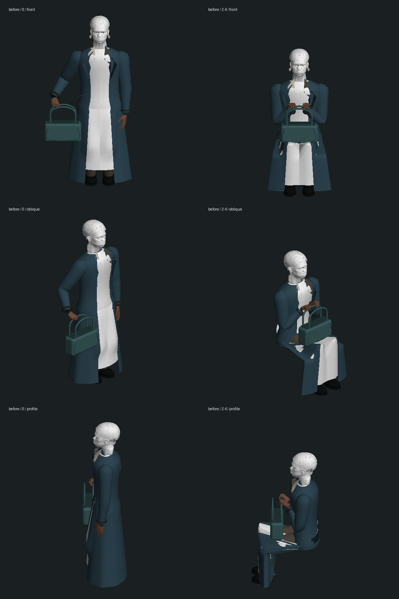
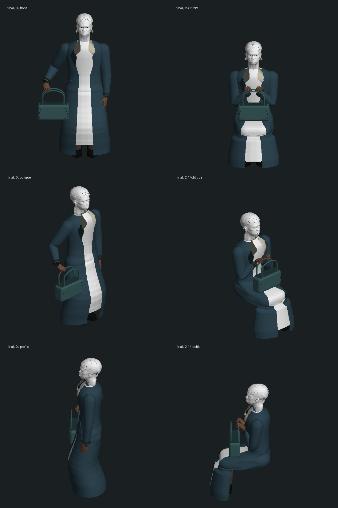

# 先知公园衣物：局部几何修复，尚未整段验收

2026-10-14，起始版本 `e0820601e48b90892bc321f049a59bd3cd5c52d1`。本轮没有新增剧情完成项，也没有推进此前停在 `m1_sentinels` 第 0 步 ready / tick 9134 的连续 Neo 验收副本。

## 改动与实际观察

旧裙面分别围绕两条腿变形，并把前后裙面同时抬过膝盖；衣物在落座时自行交叉，外套和裙子也相互切入。现在以两条腿的截面共同支撑连续的衣物轮廓，按高度连接上下裙面，长椅前缘约束保留两层间距。上身衣物的下缘参与变形，包底射线同时检查上下裙面。衣领和翻领改为贴合既有胸廓的曲面。

站立衣物恢复后再次进入保存的坐姿会重新计算；同一保存姿势不重复修改或上传衣物顶点。未增加依赖，也未改变人物 GLB、剧情状态或服务器代码。

下列图片来自真实 Three.js 人物、蒙皮手部及衣物几何的离线正交栅格化。纹理已剥离，白色面部/裙子不代表游戏材质；**图片不是原生游戏截图，不证明电影级人物还原或游戏帧率**。已检查正面、斜面、侧面两种姿势，最终裙层明显更连贯；膝下轮廓仍偏僵硬，身体比例、袖口和自然布料仍需制作。

修改前：



修改后：



## 验证

- 修改前相关基线 16/16，见 `baseline.log`。
- 新增衣物边与三角形相交检查，先排除几乎共面的数值误报，再在隔离的原提交源码重新运行：两项均失败。最终坐姿原外套有 207 个相交边，裙面自身有 63 个相交边，见 `red-corrected-baseline.log`。计数是被检测的网格边数量，不是独立破洞数量。
- 原平面领片有六个三角形中心被胸廓遮挡，最深约 0.035 个模型单位，见 `red-collar.log`。最初测试未考虑已有几何合批；修正夹具后才获得该结果。
- 未加入姿势缓存的中间实现会反复上传相同顶点，新增检查先失败，见 `red-rebuild.log`。
- 最终 **83/83 不同测试通过**，见 `final-regression.log`：包含五项新检查、既有长椅/地面/腿部与包底接触、手部握持/恢复、镜头、尾声剧情、人物恢复及动作测试。有限姿势采样不代表所有帧、任意角度或完整人物都无穿模。
- `npm run typecheck` 和 `npm run build` 三包通过，见 `final-typecheck.log`、`final-build.log`。仍有客户端包体积警告；没有运行全库测试。
- 520 个存档、原人物资产及既有证据保护文件哈希不变，见 `protected-before.json`、`protected-result.json`。

提交的日志只去除了行末空白和文件末尾多余空行，诊断、失败及数值均保留；相应原始日志以 `.raw.log` 留在本地。

最终测试命令：

```sh
node --import tsx --test tests/oracle-park-clothes.test.mts tests/oracle-garden.test.mts tests/oracle-park-grip.test.mts tests/garden-camera.test.mts tests/oracle-restoration-render.test.mts tests/motion.test.mts tests/trilogy-epilogue.test.mts tests/epilogue-cast.test.mts tests/sunrise-garden.test.mts
```

## CPU 代价与未完成项

`bench.mts` 加载真实模型，以 40 次预热、300 次采样测量 `CharacterModels.animate`。以下为顺序单独运行，避免把并行测试竞争混作结果；这是 Node 模型 CPU 耗时，**不是浏览器 FPS，也不含 GPU 或完整世界**。

| 姿势 | 原版中位数 / p95 | 当前中位数 / p95 |
| --- | --- | --- |
| 同一静止坐姿 | 0.822 / 1.003 ms | 0.510 / 0.655 ms |
| 连续变化的落座姿势 | 0.724 / 0.880 ms | 3.124 / 3.604 ms |

数据见 `cpu-isolated-baseline.json` 与 `cpu-optimized.json`。新轮廓、更多裙面顶点与法线重算增加运动代价；移除截面求解中的临时数组并缓存静止姿势后仍未抵消。保留这一局限，后续须在实际镜头测量和优化，不能称性能验收通过。

可用 `node --import tsx output/characters/oracle-park-clothes-2026-10-14/bench.mts current` 重测当前模型。原版测量使用本地 `baseline-source` 中的隔离源码（上述起始提交的两个生产文件，其余依赖复用项目）；该临时源码副本不提交，重测 `baseline` 参数前需恢复这一环境。

本轮没有新的原生游戏画面、连续人工游玩、实际存档重启或声音检查。查询时侧边栏标签清单为空，`127.0.0.1:5197` 未监听；本轮没有尝试新导航或启动游戏，不把此前导航超时作为本轮新结果。`inspect.mts` / `render.py` 仅用于模型诊断，原始中间 JSON 和 CPU profile 不纳入提交。

待完成：人物相似度与全身建模、袖口/腕部衔接、自然步态与布料、任意接触、真实镜头/纹理/声音、实际帧率及整段连续体验。本次衣物修复不等于公园尾声或三部曲完成。
