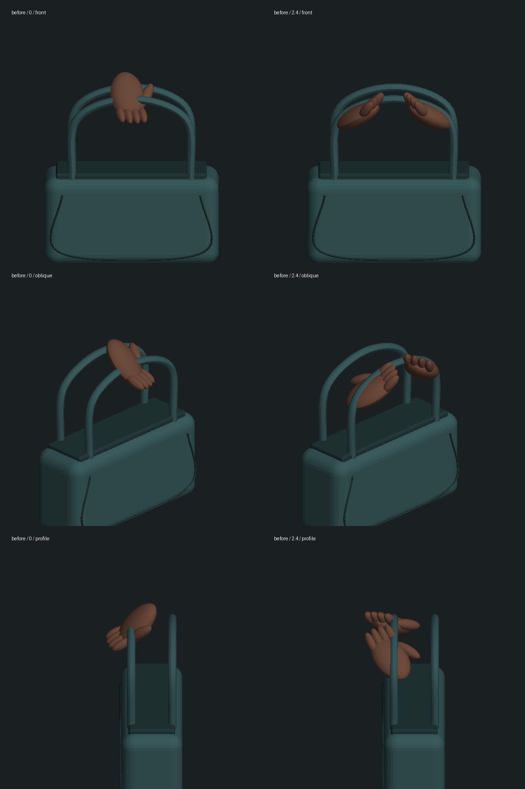
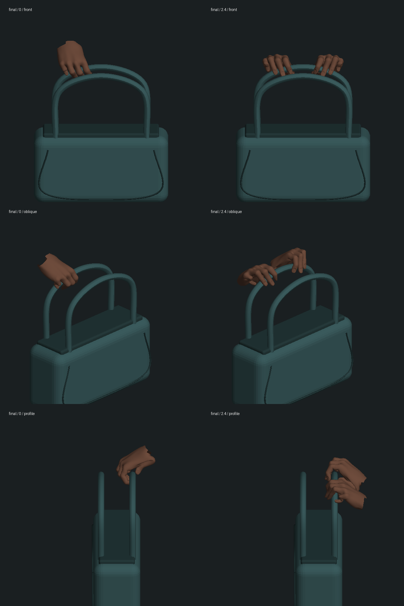
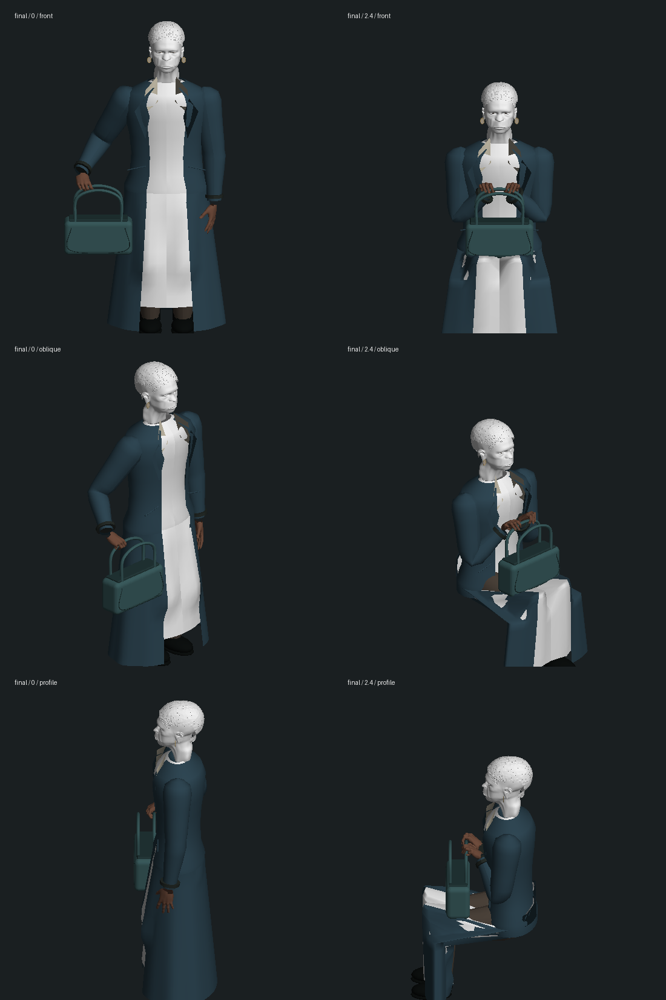

# 先知公园握包：手部骨骼、接触与恢复

2026-10-14；起点 `89615de`。这是第三部尾声的局部人物修复，三部曲和先知人物仍未完成。本轮没有推进正式剧情或修改真实存档。

## 改动

- 公园专用双手从已有 Trinity 的 CC0 MakeHuman 解剖手部提取，保留每手十五节指骨与腕骨；不复制人物脸部或贴图。新增 GLB 为 1,055,676 字节、24,944 三角形、两张蒙皮表面，沿用先知皮肤材质；离开公园恢复旧表演用手。构建脚本为 `scripts/build-oracle-hands.py`，无新运行时依赖。
- 按真实指骨长度和末节皮肤求解五指在弧形包柄上的接触，拇指从另一侧包覆。包向前移动并改握靠身体的包柄，避免另一条包柄穿掌；底面按当前位置的裙面支撑。抬包时手腕随前臂旋转，左手稍后沿身体前方接近，肘部避开外套。
- 保留既有先知近景。旧 `camera.test.mts` 在 choice 阶段要求两人同时入画，与 `dcd305c` 已落地的先知近景设计冲突；将该断言放回建筑师到场 3.8 秒的双人建立镜头，另把真实人物近景检查扩展到 4:3 和 9:16。没有修改相机生产代码。

## 验证

- 修改前公园模型/近景基线 10/10（`baseline.log`）。旧双人 choice 断言单独复现失败，建筑师在 4:3 的投影 x 为 1.145（`legacy-camera-baseline.log`）；依据既有镜头设计修正测试，不把它记成新相机功能。
- 新握持测试先复现旧拇指穿入包柄 0.019658 模型单位（`red-grip.log`）；中间实现还出现前臂穿身，先记录失败再修正（`red-forearm-body.log`）。
- 最终公园/握持/近景 **16/16**（`final-focused.log`），其他动作/尾声/角色 **62/62**（`related-final.log`），建立镜头 **1/1**（`camera-final.log`），共 **79 项不同测试**。62 项初跑中的头部测试把新手部请求错回为头部资产，已单独修正测试夹具；角色文件重跑 **12/12** 且无该加载警告（`cast-final.log`），不重复计数。未跑全库。
- 有限检查包括：五个保存时刻的 40 处指尖/拇指接触；49 帧双腕夹角不超过 60°，最低方向点积 0.52145；四个时刻双手全部顶点及每个三角形中心对两条包柄的穿入检查（容差 0.003 模型单位）；五个时刻的前臂三点中心线不在上身内部。中心线和离散面采样不能证明所有袖口、身体和全帧接触。
- 暂停时刻、插入无关跑跳动作、新建模型都重建相同指部蒙皮；验证离场恢复、迟到资产保持隐藏，以及释放后迟到资源不再挂回旧人物。这是模型层恢复检查，**不是实际存档重启验收**。
- `typecheck.log` 三包类型检查和 `build.log` 三包生产构建通过；保留既有大包警告。`protected-result.json` 对照 402 个保护文件，401 个保持，唯一有意变化为人物资产 README；真实数据、既有人物资产和旧公园验收材料无意外变化。

## 实际模型几何核对

以下由游戏当前实际变形后的表面导出，再做无贴图正交几何检查。**不是实机截图、生成的效果图或最终光照效果**。手部图只抽出双手及包，因此腕部在图中截断；整个人物图同时检查前臂位置。头部/衣物去掉贴图后显示白色，人物及衣服仍有明显精度缺口。

旧手部：

修正后持包与双手扶包：

全身上下文：

复核工具为 `inspect-palm.mts`、`render.py`、`render-body.py`。在项目根目录运行 `node --import tsx output/characters/oracle-park-hands-2026-10-14/inspect-palm.mts final -0.11` 导出当前皮肤，两个 Python 脚本接收导出目录和标签；`before` 模式仅关闭新手部，走保留的旧姿势路径。原始大体积顶点 JSON 与中间拟合尝试留在本地，未提交。

## 仍未验收

侧边栏对最小本地静态页的导航仍超时，HTTP 直接读取为 200。工具随后拒绝访问该标签的内部错误页，未绕过限制；临时 HTTP 服务已停止。本轮没有新的浏览器实机、录像、实际重启、剧情完成或性能结论。

先知头脸/年龄和身体比例、服装/袖口与自然布料、完整身体/手指相互接触、自然抬包表演和整段连续体验仍需制作、复拍。当前连续主线实机记录仍停在第一部红衣女子完成后接到 `m1_sentinels` 第 0 步 ready / tick 9134，不把本次局部修复计为第三部或三部曲完成。
