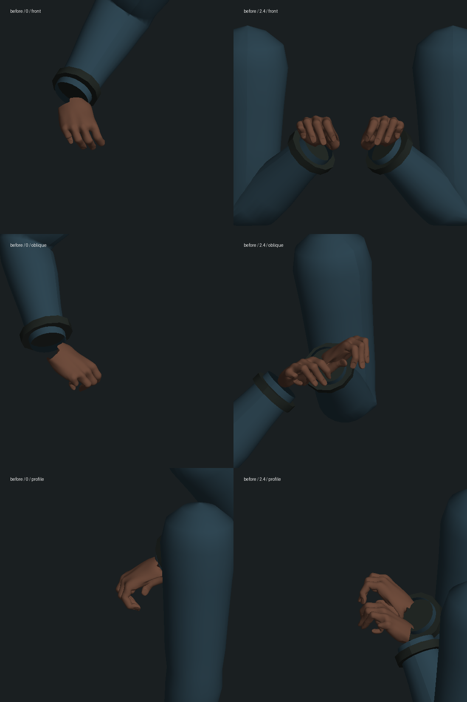
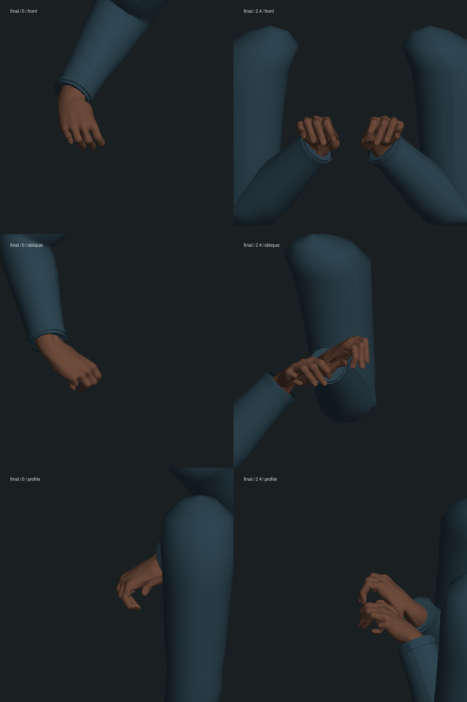

# 先知腕部、袖口与肩部：局部修复记录

2026-10-14，起始版本 `9ef139846d3979d52ebb98b5289c409d19b641d7`。连续 Neo 验收副本仍在 `m1_sentinels` 第 0 步 ready / tick 9134；本轮没有新增剧情完成项，不表示公园尾声或三部曲已完成。

## 实际改动

原解剖手部在手腕处切开，旧袖口与开口之间没有皮肤；抬包时侧面能看到断开。现在先合并手部 UV 接缝，再沿实际 48 个边界顶点连接至袖内前臂。两手共增加 686 个顶点、1152 个三角形，复用已有皮肤材质。连接随保存姿势重建，静止时不重复上传，离开公园服装后隐藏；新增几何随原资源生命周期释放。

先知的袖口缩小并移至袖端，改用外套材质；袖山向胸廓内收，消除抬臂时肩部开口。这两项调整也作用于先知日常衣袖，解剖手腕连接仅在公园启用。没有改变剧情时间线、人物 GLB、头部或全身比例，没有增加依赖。

以下是实际 Three.js 蒙皮几何的离线诊断图，**不是原生游戏截图**。只导出手臂，因此握持的包、身体和贴图未显示；光照/法线由诊断脚本计算，不是游戏渲染器。两种姿势的正面、斜面、侧面已检查，断腕间隙缩合；整体人体、自然布料和游戏内材质仍需实机复核。





完整人物的有限离线几何见 `final-body-geometry.png`。头部/裙子白色是剥离纹理的结果，不能用此判断演员相似度。

## 验证与保留的失败

- 修改前已有相关测试 21/21，见 `baseline.log`。
- 新腕部测试在原版先失败：八个时刻、两只手、两个截面、四个方向，共 128 条射线可检出开口，见 `red-wrist-gap.log`。
- 新肩部测试在原袖山上先失败，十个肩部采样有八个离开外套，间距约 0.0365–0.0484 个模型单位，见 `red-shoulder.log`。
- 中间实现因 `SkinnedMesh.bindMatrixInverse` 未随实际父级刷新而产生错误连接。先复现失败，再在计算蒙皮边界前刷新蒙皮世界矩阵；没有通过扩大测试容差处理，见 `wrist-first.log`、`connection-first.log`、`wrist-bind.log`。
- 新增专项最终 **3/3**，见 `tailoring-final.log`。包括上述间隙/肩缝，以及五个姿势的两只手共 480 次实际边界顶点重合检查；同时检查同姿势缓存、切回日常隐藏、其他动作后恢复及新建模型恢复。有限采样不证明所有时刻或全身均无穿模。
- 最终较广回归 **106/107**，见 `final-regression.log`。唯一失败是 `oracle-absorption-contact.test.mts` 中 Smith 同化先知的手指穿衣：穿入深度 `0.020154264249867992`，要求小于 `0.005`。在隔离的原提交源码运行同一测试，失败和数值完全相同，见 `absorption-baseline.log`（3/4）；该既有问题保留待修，没有放宽断言。
- `npm run typecheck`、`npm run build` 三包通过，见 `final-typecheck.log`、`build.log`；仍有客户端包体积警告。较广回归后仅给新测试补了非空采样断言并单独重跑 3/3，生产代码未再改。没有运行全库测试。
- 249 个原存档、人物资产和先前证据保护文件哈希保持，见 `protected-before.json`、`protected-result.json`。

较广回归命令：

```sh
node --import tsx --test tests/oracle-park-tailoring.test.mts tests/oracle-park-clothes.test.mts tests/oracle-garden.test.mts tests/oracle-park-grip.test.mts tests/garden-camera.test.mts tests/oracle-restoration-render.test.mts tests/motion.test.mts tests/trilogy-epilogue.test.mts tests/epilogue-cast.test.mts tests/sunrise-garden.test.mts tests/oracle-room.test.mts tests/oracle-last-render.test.mts tests/oracle-absorption-render.test.mts tests/oracle-absorption-contact.test.mts
```

提交日志只去除行末空白和末尾多余空行；原始日志的 `.raw.log` 副本留在本地，测试结果、错误及数值未改。原提交验证使用本地 `baseline-source`，其中三个修改的生产文件来自上述提交；临时源码、运行状态和原始几何 JSON 不提交。

## 重启、原生画面与性能边界

将已有公园选择点完整副本复制到独立 `runtime-state`，使用独立端口 3189/5389，世界暂停于 tick 14031。两端 HTTP 返回 200，但侧边栏同一标签的导航与聚焦均 20 秒超时，最后标题为“无法访问此站点”。没有操作内部错误页，没有获取新的游戏画面或进行原生游玩，见 `native-attempt.json`。

随后对隔离服务器实际停止、重启，并通过 API 比较八项完整快照分组（人物、区块、地点、阶段、事件、模拟、沙盒、时刻）：全部一致，15 份记忆哈希一致，见 `restart-result.json`。这是后台存档检查，不能代替浏览器冷读/角色姿势验收。验证后只停止本轮两个服务，3189/5389 均已释放；原试玩数据未改。

CPU 比较顺序单独运行，40 次预热、300 次采样，测量真实 `CharacterModels.animate`：

| 姿势 | 本轮基线中位数 / p95 | 修改后中位数 / p95 |
| --- | --- | --- |
| 同一静止坐姿 | 0.523 / 0.673 ms | 0.535 / 0.680 ms |
| 连续变化的落座姿势 | 3.151 / 3.409 ms | 3.040 / 3.358 ms |

数据见 `cpu-baseline.json`、`cpu-final.json`。结果接近，不把差异当作优化成果；这是 Node 模型 CPU 耗时，**不含完整世界/GPU，不是浏览器 FPS**。此前衣物形变的运动代价仍存在，实际性能未验收。可用 `node --import tsx output/characters/oracle-park-tailoring-2026-10-14/bench.mts current` 重测当前模型。

待完成：已复现的 Smith 同化手指穿衣，人物相似度/全身建模、自然动作/布料、全帧接触、原生近景/材质/声音、稳定性能与整段连续体验。此次不将三部曲或任何整组标记为高质量完成。
