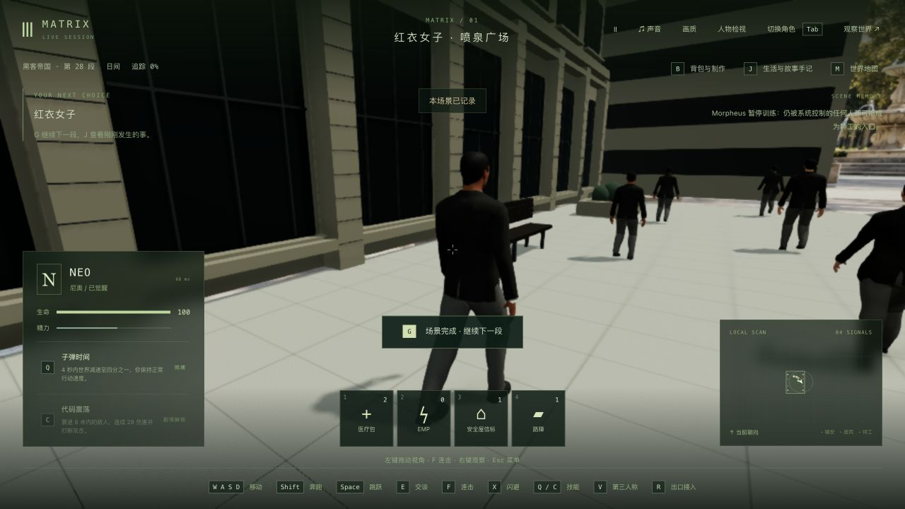
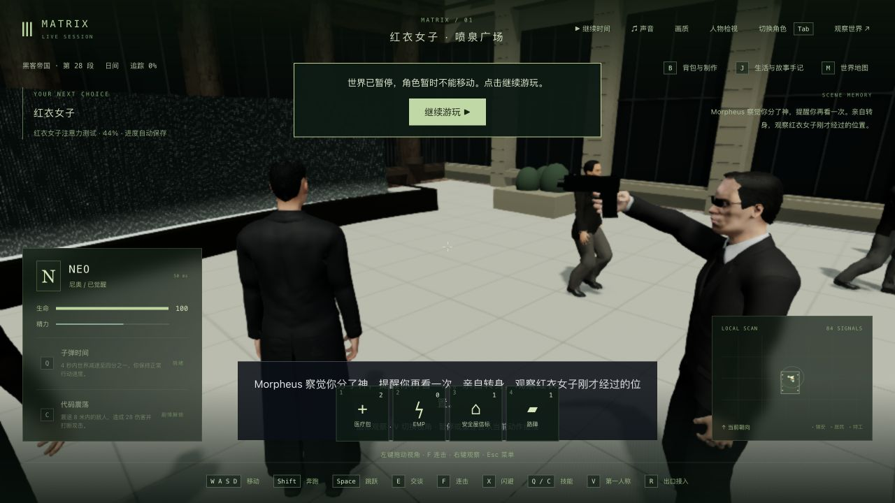
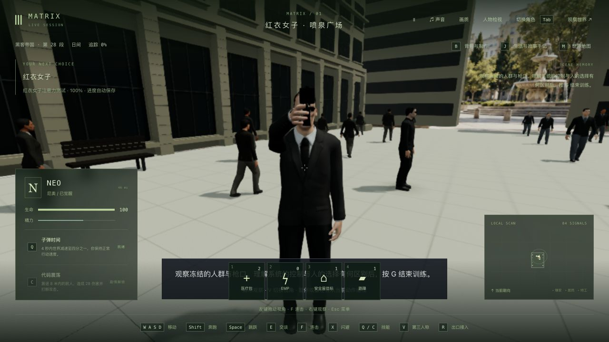
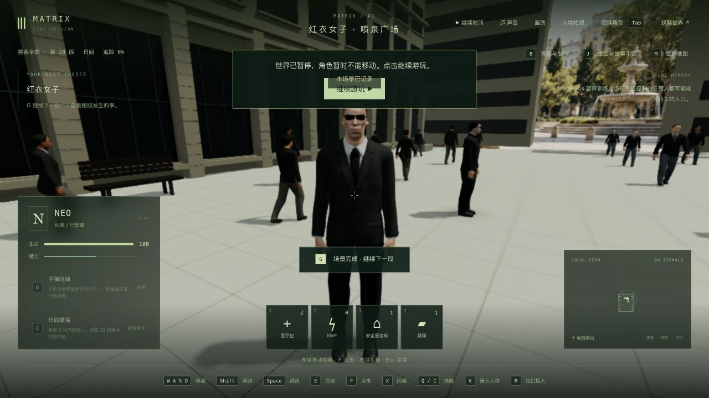

# 广场路人：衣服接触与简化接缝

2026-10-24，基于 `089c6ff`。本机入口 <http://localhost:5173/> 已替换两个广场路人 GLB，正式 JS 仍为 `index-CCOTDEXi.js`。本轮没有新的 FPS 测量或 60 帧结论，也没有增加 42 组电影质量验收完成数。

## 原因和修复

上一轮实机画面出现肩背肤色斑块。闭合衬衫下面仍画着源身体的肩部皮肤；衣领、袖口没有按当前身体贴合，外套下摆还继承了迈步大腿的权重。修正只进入离线烘焙资产：遮掉衬衫覆盖的肩部三角形，领口和袖口按实际皮肤表面外扩，下摆跟随骨盆，适当调整摆臂的外张角度，为手与裤子留出空间。源手腕网格有开放边界，袖口上方的两处残余相交通过延伸手腕截面解决，见 [边界探针](cuff-boundary-evidence.json)。

肩部皮肤消失后，真实试玩又暴露了衣服肩袖的白色破洞：[中间版本画面](seams-before.jpg)。原 SimplifyModifier 独立收缩 UV 接缝两侧顶点，导致衣服开裂。仅外套改为 MeshoptSimplifier 保留接缝并锁定边界，再用保留下来的原顶点编号恢复所有姿态。直接声明已安装、已锁定的 `meshoptimizer` 0.18.1 开发依赖；没有新增下载、游戏运行时依赖或逐帧服装求解。

保留全部源脸/手顶点与每套 6,236 个手部三角形，手部索引哈希与原版一致；没有通过删手指或缩小手掌消除接触。男/女分别移除衬衫覆盖的 564/722 个皮肤三角形。待机和 20 个步态、12 个实例化表面及动态阴影保留。

| 资产 | 修改前字节 | 修改后字节 | 修改前三角形 | 修改后三角形 |
| --- | ---: | ---: | ---: | ---: |
| 男性路人 | 6,785,916 | 6,660,996 | 21,560 | 20,975 |
| 女性路人 | 6,830,504 | 6,696,300 | 21,734 | 20,972 |

两份 GLB 合计 13,357,296 字节，减少 259,124 字节，约 253 KiB。文件缩小不能直接换算为帧率提升。源中间模型和最终资产哈希、各表面统计见 [资产对照](asset-comparison.json)。制作来源、重建命令及 CC0 许可继续记录在仓库的 `PLAZA-CROWD.md`。

## 测试与实际游玩

- 原相关测试 [12/12](baseline-tests.log)。新增男女接触测试原版 [0/2](new-test-before.log)；随后发现男款摆臂与裤子仍有 6 处相交，保留 [失败日志](candidate-trousers-first-test.log)。独立接缝测试也先 [失败](seam-test-before.log)，男款肩袖有 17 条开放边。
- 所有资产构建结束后重新运行相关测试，最终 [15/15](candidate-final-tests.log)。接触测试覆盖每款待机与 40 个步态采样，包含烘焙帧之间的插值；检查手部自交、皮肤与外套/裤子相交及完整手部索引。接缝检查覆盖待机与 20 个烘焙姿态的肩袖区域。原有落脚、腰部覆盖、加载、冻结、恢复、绘制次数及释放检查保留。这是有限姿态与区域检查，不是任意动作都无穿模的证明。
- [部署回归 75/75](deploy-tests.log)，[三包类型检查](typecheck.log)、[共享构建](shared-build.log)、[后端构建](server-build.log)、[客户端构建](build-client.log)通过。客户端仍有原有大包警告；生成的 JS/CSS 与线上本机版本逐字节一致。
- 在隔离的正式构建 5200 中，原生继续 Neo、V 切换第一人称、W 行走和鼠标转向，实际位移 [3.967 单位](production-walk.json)。然后使用既有训练起点的独立副本，正常走到训练入口、开始演出并转身观察。
- 在转身阶段暂停 tick 12625，真正停止并重启后端（85188→90196），冷加载、原生继续 Neo 后完整世界及 7 份测试记忆保持相同，见 [重启对照](restart-comparison.json)。再用鼠标和 V 对准 Smith，触发冻结，G 主动结束。短点一次 G 只出现训练进行中的提示，随后按住 500 ms 完成；没有修改输入机制或声称该短按问题已解决。
- 最后停在 `m1_red_dress / step 2 / attention.done`，生命 100，暂停 tick 13346，见 [最终状态](production-final.json)。[控制台 warning/error 为空](production-console.json)。本轮没有重新验证漏看失败/重试、完整战斗、全部三部曲，也没有录制新视频。

## 实机画面

以下是本轮实际浏览器截图，没有用生成图替代游戏。不同画面相机/尺寸不同，不能作逐像素前后对照。

脸部相似度、服装轮廓、女性摆臂自然度、近景品质以及场景整体电影还原仍有明显差距。修正这些接触不等于人物或整段电影质量验收完成。

## 发布与边界

候选来自 1,249 份已提交输入，仅 7 份预期输入变化；原有 11 份工作区实验和 800 份共享/后端编译产物均未改动。测试独立构建，没有在根目录重新编译共享或正式后端。见 [输入及保护基线](baseline.json)。

[发布脚本](publish-assets.py)对两份模型使用原子替换，更新工作区和正式 release 的 public/dist，同时更新制作说明。主 PID 83388、JS/CSS 和入口页面不变，HTTP 实际返回新模型哈希且 `max-age=0`。85 份主记忆保留随世界自然更新，没有将测试世界写到主存档；Render 没有重新接入。见 [发布核对](publication.json)。

制作说明曾与历史副本共享硬链接，第一次编辑影响了共享 inode；已恢复 8 个历史链接的原文，并单独替换工作区和候选说明文件，见 [修复记录](doc-hardlink-repair.json)。发布使用原子替换以避免同类问题。

三组拥有的测试服务均核对 PID、命令及工作目录后停止：[自由行走检查](qa-free-roam-stop.json)、[重启前](qa-restart-stop.json)、[最终停止](qa-stop.json)。5200/5201 已关闭，临时浏览器尺寸恢复、测试页关闭，正式 5173 入口保留在侧栏。

最近的帧率证据仍是 [上一轮 1080p 采样](../ao-channel-budget-2026-10-24/README.md)：M3 / 24 GiB / Chrome，广场约 28.93 FPS、飞船另测约 23.6 FPS。当前约 34–42 ms 的单帧间隔离 60 FPS 的 16.7 ms 仍有差距；先继续定位人物动画与绘制提交的开销，不据此提出未经验证的内存/显卡最低配置。
