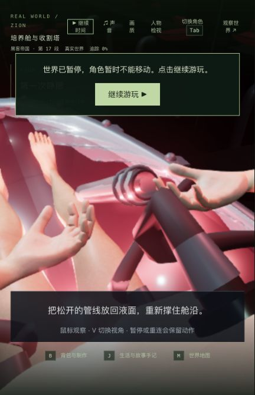

# 培养舱动作与实际构建一致性

2026-10-24，基线 `9ac18ff42db94b41310cccbe3637ce6fe8bd766a`。固定试玩 <http://localhost:5173/> 已读取 `index-rjDK4MJ-.js`，Render 未接回。本轮消除旧共享编译产物导致的动作回退；没有新增电影场景或人物资产，42 组电影质量完成数仍为 0。

## 根因与修改

此前记录为“既有左肘失败”的问题，实际是源码和交付代码不一致：源码的回落时间已经是 0.95 秒，但交付的 `@auto_matrix/shared/dist` 仍使用 0.55 秒，并保留已经移除的向身体后缩及旧左手抬起时序。客户端只执行 `tsc && vite build` 时直接读取这个旧包，不会先编译共享源码。旧数据使肘部急转，也让管线与手掌重新碰到皮肤及胸前硬接口。

给客户端增加 `prebuild`，在独立客户端构建前编译共享包。两项集成回归通过实际 npm 工作区、TypeScript 和 Vite，验证旧产物、后续源码变更、缺失产物都得到正确浏览器包，并验证共享源码编译失败时保留上一个客户端输出。没有新增依赖，也没有改动人物动作源码或放宽穿模阈值。

完整编译差异只有 `constants/awakening.js` 及其映射；280 份后端产物逐字节一致，后端没有调用这个姿态函数。见 [根因](root-cause.json)、[实际编译差异](compiled-awakening.patch) 和 [输入审计](source-audit.json)。1,215 份源码、资产、配置和测试输入在最终检查后保持相同。

## 验证结果

| 检查 | 修改前 | 修改后 |
| --- | --- | --- |
| 独立客户端构建集成回归 | 0/2 | 2/2 |
| 培养舱相关回归 | 47/51 | 51/51 |
| 部署、存档、会话与操作回归 | 本轮仅最终执行 | 75/75 |
| 客户端及后端构建 | — | 通过 |

四项原失败全部恢复：胸前管线的取样表面、完整管面/皮肤、手掌/硬接口和双臂连续性。最大邻接 10ms 关节位移从 0.087942 降到 0.049214，原有 0.05 限制未改。检查包括 252 个完整管面姿态、387,072 次管面三角形检查、768 个加速树/原始射线对照及 61 个姿态的 12 个硬接口。它们是有限采样，不等于任意动作、身体和服装都无穿模。见 [统计及原失败名称](validation.json)、[旧包日志](related-baseline.log) 和 [新包日志](related-after.log)。

新构建回归的原始失败与通过分别在 [修改前](build-dependency-before.log) 和 [修改后](build-dependency-after.log)。生产构建仍报告既有大包警告，不能据构建成功宣称加载性能达标。

## 实际游玩与重启

使用原先保存的培养舱历史检查点，未改写剧情进度。正常输入推进到拔管 4.139 秒、tick 5943 后暂停；真正停止并重启隔离后端，以正式生产包冷加载接回 Neo。完整世界响应及 6 份记忆相同，动作仍在 4.139 秒，见 [重启核对](restart-verification.json)。

实际使用 V、G 和运行时鼠标拖动，观察 4.835 秒回落，完成拔管、后颈断线、排出与救援托举，正常进入 `m1_recovery/step0`；最后在 tick 6090 暂停，生命 100。没有从薄膜开始重玩完整培养舱段，也未新玩医疗恢复段。正式页警告/错误为 0，见 [操作范围](native-verification.json) 和 [控制台](production-console.json)。

[冷读档握管](native-first-person.png)、[拔管完成](native-breather-finished.png)、[排出培养舱](native-disconnected.png)、[救援托举](native-rescue-lift.png)、[到达医疗舱](native-recovery.png) 和 [运行时转头前](native-look-before.png)/[转头后](native-look-after.png) 保留实机原图。暂停遮罩和窄视口遮挡了一部分身体，不能将这些截图当作全面美术验收。暂停时鼠标拖动未改变视角；转头验证来自恢复运行后。一次 DOM 点击超时后先确认仍暂停，再使用实际按钮继续，没有重置存档。

## 发布与限制

主服务 PID 43571 未重启，发布时主世界自然从 tick 17982 推进到 17986，未写入或恢复主存档。85 份记忆、11 份无关实验和 280 份后端产物保持；只更新构建配置、测试、两份已核对的共享产物、新 JS 和入口。JS 减少 4 字节，CSS、模型、贴图与依赖不变，旧 JS 保留。侧栏已真实重载新包并恢复连接，隔离 5200/5201 已停止。见 [发布核对](local-update-verification.json) 和 [停机核对](qa-stop.json)。

准备过程中有一次目录错误：隔离脚本提前断言失败，但后续构建命令仍执行，写到了与两个历史候选共用的编译文件。主目录和正式服务的产物未受影响；之后拆开当前候选的全部共享/后端硬链接，并从未改变的正式旧产物恢复两份历史候选，完整哈希核对通过。此操作问题没有隐藏，见 [范围及恢复记录](build-isolation.json)。今后复跑构建前应先确认输出目录不与其他候选共用硬链接。

没有新增 FPS 测量或视频，也没有证明稳定 60 帧。人物相似度、手部和衣物、电影空间和连续演出继续未完成。下一次性能调查应拆开人物更新和渲染提交：最近的同页 1080p 道场新版本样本分别约 12.36–14.30ms、11.00–13.85ms，存在后台负载与少量绘制数差异，不能把这两项当成独立 GPU 计时或已证明的提帧收益。原数据在 [道场对照](../dojo-animation-budget-2026-10-24/browser-comparison.json)。

完整候选、运行存档、世界响应和旧编译目录只保留本地，不提交；正式回归位于仓库 `tests/`。文本日志去除行尾空白，旁边的 `.raw.gz` 保留原始字节。
