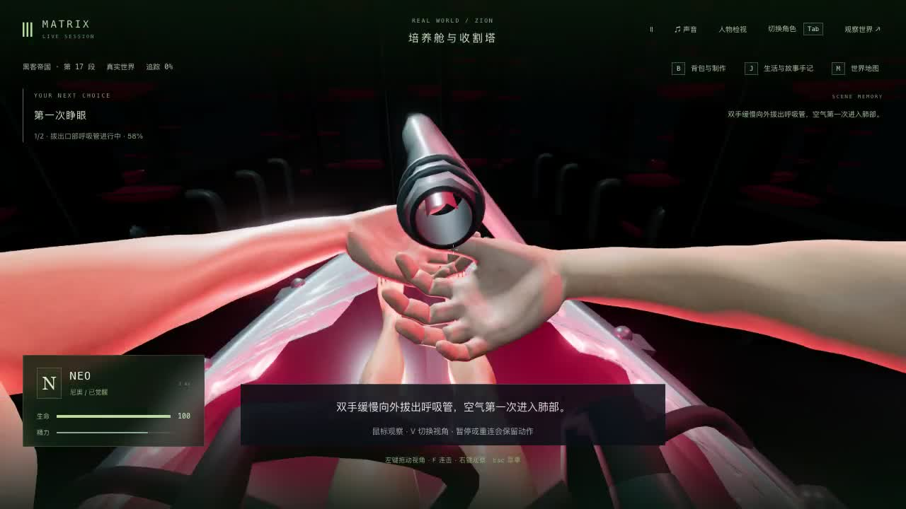

# 培养舱第一人称眼点、握管构图与自由观察

2026-10-23（上海时间）。在独立的 `49fc9e7` 基线上处理培养舱第一人称的管口遮挡和手部裁切。固定试玩 <http://localhost:5173/> 已同步 `index-Cq-WL6DL.js`。**这是局部视图修正，42组电影质量完成数仍为0。** 本轮不宣称人物相似度或稳定60帧达标。

## 问题与采用的修正

原镜头使用头部局部 `(0,.1,.32)`，与交付模型已有的 `cameraEye` 相差约 .1120 个世界单位，并在人物本帧动作之前读取。现在沿用实际眼点，在当前人物姿态完成后重新同步；不把镜头移到身体之外。新增原生鼠标接管后，自动注视停止，保持玩家观察方向。培养舱躺姿可以向头部局部上下各约83度观察，普通站立视角限制保持。

拔管过程中，用实际双腕方向的角平分线和原保存时钟平滑引导视线；放手时返回进入这一动作时的观察方向。该场景第一人称视野78度，两种视角及其他场景的规则分别保留。暂停不会重复累计自动转角。保留真实双手、身体、管线和接触，不隐藏道具来通过检查。

口部橡胶接头由实心端盖圆柱改为有内壁、倒角和贯通气道的旋转体，原外轮廓尺寸、位置、材料及握持环保持。离线对照说明，单独开孔并不能解决画面遮挡；单纯向上看又会丢失手部，因此未把这两种试验作为完整解决办法。

## 可复现的有限检查

- 新六项行为检查先在原版得到2通过、4失败：实际眼点偏差、握管手部裁切、躺姿观察限制和不通气的实心端盖。最终同一六项候选全部通过。
- 握管及回落9个时刻，左右手各6,673个实际蒙皮顶点全部在画面内；门槛仍为至少90%，没有降低。
- 拔管完整5.5秒按10ms采样551帧，相邻镜头最大转角 .0256681 弧度，小于 .05 门槛。最大头部局部俯角1.06480弧度。此有限检查不能推导为任意观察方向、任意宽高比均不遮挡。
- 暂停握管点连续12帧没有视角漂移，小幅鼠标接管没有跳变，之后不会被自动注视拉回；向上下观察不会转动患者身体。
- 双向轴线光线能穿过实际气道，径向光线仍命中橡胶壁。原接触检查不放宽几何容差；眼点检查由估计点/ .05 容差改为已有标记/1e-6。

最初三项离线遮挡试验曾被 `possess()` 重设为约57.7度视野，所以只用于位置/距离诊断，不作为游戏68度的占屏比例证据。后续诊断在接管后显式恢复68度，正式检查读取候选真实78度投影。实际眼睛网格的深度范围也单独核对，沿用标记而未修改模型。完整诊断数组以无损 `logs/*.json.gz` 保存。

首轮完整回归为284/285；断线旧检查仍比较估计眼点而失败。随后把该检查改为实际标记并收紧到1e-6，同时发现漂浮/救援分支仍用旧偏移，统一整个培养舱患者阶段的眼点和当前帧同步，保留原救援观察方向和第三人称规则。新增当前帧检查扩大到顶膜、坠落、漂浮和救援19个姿态。原失败保存在 `logs/pre-fall-eye-correction.tar.gz`，说明见 `fall-eye-correction.json`；没有把首次失败写成通过。

## 最终检查、实玩与发布

[验证记录](validation.json)冻结1,162份输入，全部检查和构建期间输入保持：

| 检查 | 结果 |
| --- | --- |
| 原版既有眼点/管口选定检查 | 6/6 |
| 原版通用镜头与追踪室眼点 | 210/210 |
| 新六项对原版复现 | 2通过、4失败 |
| 最终培养舱、通用镜头及追踪室相关回归 | 285/285 |
| 部署检查 | 75/75 |
| 三包类型检查与生产构建 | 均通过 |

从此前实玩得到的拔管2.648秒/tick5965原始存档复制到独立目录，没有编辑剧情和人物位置。原生按V检查双手握管，并用鼠标抬头看培养塔、低头看身体；普通第三人称仍可使用。关闭网页后真正停止验收后端30901，再用相同编译结果和数据目录启动33814。重启前后完整公开世界响应逐字相同，Neo六字段、暂停状态和六份记忆文件保持，见[真实重启](native-restart-verification.json)。

在5200冷加载生产构建，实际DOM脚本为 `index-Cq-WL6DL.js`，检查两种视角和小幅鼠标接管。第一次接管后紧接的V输入未形成第一人称画面，以实际截图重新确认并再次按V；没有只凭输入返回就宣称视角切换成功。随后返回录制页，继续拔管，按正常提示断线、排水和救援，到 `m1_recovery/step0/tick6136` 暂停，生命100。三页控制台warning/error均0；验收5200/5201已停止，见[实际范围](native-verification.json)。救援与医疗舱是衔接检查，没有新增完整失败路线或全接触验收。

两段原录共约159秒，原WebM保存在本项目候选目录 `output/gameplay/neo-longplay-2026-09-20/`；以下均为未加速、保留声音的连续节选：

- [34秒：握管、上下观察与第三人称](native-eye-observation.mp4)
- [62秒：松手、断线、排水与船底救援](native-oral-rescue.mp4)

见[原录路径、节选和编码核对](native-video-excerpts.json)。原录平均渲染约52.26/39.69fps，包含暂停、等待和录像开销；不能当作正常游戏对照或稳定60帧证据。视频编码为30fps不改变实际游戏时间，也不能提高游戏帧率。

发布只同步五份已验证源码/测试，新增JS并原子替换网页入口，旧JS保留。705份包文件与候选一致，280份后端构建和主服务82166保持；发布及侧栏原生打开前后完整主世界响应同为 `05dbda2d…`，tick3757/暂停和85份记忆哈希保持。侧栏已打开新版，无warning/error，见[发布核对](local-update-verification.json)。未重接Render。

## 制作与来源边界

候选和基线来自逐个Git对象核对的1,158份包、测试及脚本，额外核对 `package.json`、`package-lock.json` 和 `tsconfig.base.json`。初始隔离目录漏了最后一项，构建诊断失败；只纠正隔离目录配置并重建，未更改运行逻辑。另一次诊断在共享包构建结束前启动而失败；后续等待原构建终止再继续。失败保留在原始日志及 `baseline-audit.json`，未作为通过结果。

只改变三份客户端源码和一份既有测试，增加一份行为测试；模型、纹理、服务器、存档、依赖和其他11份工作区实验不变。独立测试目录、原始世界、记忆和本机数据库不入库。

尝试打开原片 Movieclips 培养舱参考，但上传者地区限制阻止播放；没有绕过限制，也没有把搜索结果当作已观看的动作参考。本轮是玩家视图与实际模型关系的修正，不是新完成的原片逐镜验收。见 `reference-attempt.json`。

当前机器为Apple M3、10核GPU、24GB内存。此前同机绘制消融已显示接触阴影有明显开销，但不足以证明唯一瓶颈或给出稳定60帧配置要求。本轮不在运行回归、录像和构建的同时测FPS，也不会把录像帧率当正常游玩性能。

口部管道仍处于近景；本轮双手构图只验16:9，不保证任意观察方向和其他宽高比都无遮挡。人物相似度、皮肤、腕口、衣物、水面及自然动作仍粗糙，整体培养舱和42组逐段电影质量、全游戏稳定帧率继续未验收。
