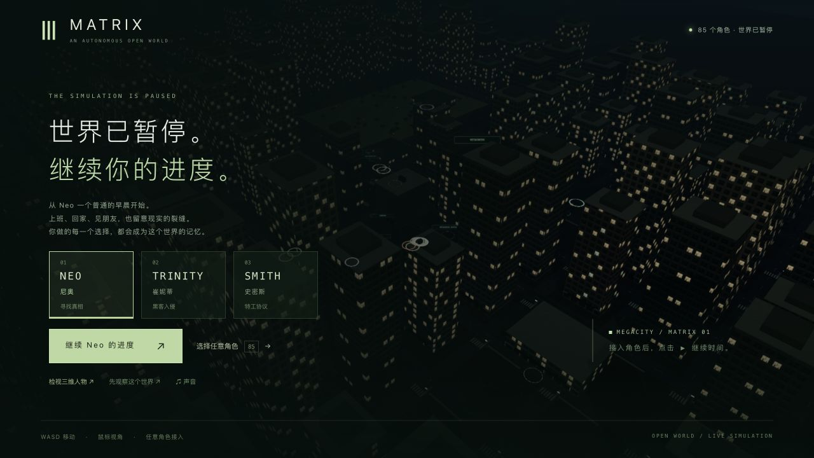

# 培养舱手面、接触与远景开销（2026-10-22）

固定试玩入口：<http://localhost:5173/>。本轮基于 `98ae9a0` 的独立副本，已更新为 `index-B6LsFQoq.js`，没有重启主服务或接回 Render。42 组电影质量验收完成数仍为 **0**。

## 采用的改动

- 顶膜起始双手向两侧移开，避开胸前供给管；最终撕膜手距保持。模型尚未加载时的膜面备用落点同步。
- 拔呼吸管时启用已有连续四指形变，保留实际手面、UV 和原专用关节。原拇指目标超出骨链可达范围；现从实际拇指皮肤校准指腹，在腕部空间求可达的管壁接触，避免无约束迭代扭曲指蹼。
- 腕部空间的恒定握姿复用已有指面缓存。六个持续持管时刻原先调用 HandCurve.sample 共 71,892 次，现为 0；仍更新身体、完整蒙皮、腕口及法线，不代表人物更新成本归零。
- 只将远处七份实例网格归入远景，跳过局部接触阴影的法线重绘。彩色主通道、几何、深度写入和阴影保留；近处两排培养舱、盆体与供给管继续参与接触阴影。
- 开发模式性能面板增加同页对照开关，采样中锁定；正式构建不包含这个面板。没有新增素材或依赖。

## 实际帧率

机器为 Apple M3 / 10 核 GPU / 24 GiB 统一内存 / 60 Hz。此次观察没有内存压力，不能据此推断全部场景峰值。60 fps 需要约 16.7 ms/帧；还没有建立能保证本游戏 60 fps 的最低硬件配置。

同一页面、第一人称拔管 2.943 秒暂停点、1280×720 CSS、DPR1.5、同镜头和噪声纹理，无录制、无并行测试/构建，各预热 3 秒、采样 15 秒：

| 顺序 | 远景法线 | FPS | p95 帧间隔 | 提交绘制/帧 | 三角形/帧 |
| --- | --- | --- | --- | --- | --- |
| B2 | 原始 | 33.70 | 36.9 ms | 142 | 2,844,793 |
| A2 | 优化 | 36.79 | 35.1 ms | 135 | 1,735,993 |
| B3 | 原始 | 34.57 | 34.2 ms | 142 | 2,844,793 |
| A3 | 优化 | 36.69 | 34.4 ms | 135 | 1,735,993 |

均值 **34.13→36.74 fps，约 +7.63%**，每帧减少 **1,108,800 个三角形（38.98%）**。CPU 绘制提交时间不是 GPU 执行时间，尚未隔离 CPU/GPU 瓶颈。这是单个暂停检查点，不是移动、全游戏或稳定 60 帧验收。

早先分别重载页面的 B1/A1 为 18.18/37.79 fps；GTAO 在加载时生成随机噪声，条件不够一致，**不能宣称翻倍**。原始数据保留在 [同页对照汇总](native-performance-comparison.json)。

同页画面对照按两份实际 DOM 界面的联合区域加 3 像素边缘排除 UI，剩余 636,230 像素中 37,929（5.96%）有差异，3,371 个差异超过 3/255，最大 15/255、平均绝对差 0.0795/255。远景与轮廓的接触阴影确有少量变化，**不是像素完全相同**。见 [图像对照](native-same-page-picture-comparison.json)。

## 回归与失败记录

- 原基线培养舱检查 **47/48**，唯一既有失败为顶膜 .7 秒供给管与身体相交；强化初始时刻后先在 0 秒失败。修复起手跨度后相关检查通过。
- 新完整手面检查先复现双向计数 26 次自交（不是 26 个独立伤口）。单独换四指、限制拇指关节、拇指曲线与全局权重实验仍失败，未采用。可达接触校准实际皮肤后通过。
- 较广培养舱/真相检查 **53/53**，随后将等价拇指计算改为腕部空间以稳定缓存，最终全部受影响检查 **7/7**。后者覆盖供给管、呼吸管皮肤、28 份完整双手面、关节/接缝/法线、冷加载完整握姿及缓存；没有宣称最终重新跑过合并 54 项。
- 其他手部首次运行 **9 通过、4 个文件加载失败**，失败来自编辑中的重复局部变量。修正后仅重跑这四份文件，**24/24**；原先已通过的完整普通手面为 **9/9**。保留首轮失败日志。
- 远景新回归先失败；实现后首轮 **14/15**，原因是测试把原本隐藏的维护机支杆算作可见近舱。按实际可见性检查八份近舱实例后 **15/15**，没有放宽几何或接触门槛。
- 部署检查 **75/75**，三包类型/生产构建通过；最后客户端类型/构建通过。保留既有大包提示。最终 JS 为 3,738,716 字节，SHA256 `41559b29bbff85c07338e3873acdd5883352ae8d3b818f268d46acb9d6aab5dd`。

具体命令、阶段与日志见 [验证范围](validation.json)。原始日志逐字保留在本机，以无损 `.log.gz` 副本入库；没有为消除日志空白警告改写测试输出。没有在根目录构建未完成的脱衣实验。

## 原生游玩与读档

独立验收使用前一轮实际玩到培养舱的历史存档（tick5925），没有修改位置、任务或剧情。通过正常界面与 V/G 按键完成顶膜、拔呼吸管、后颈断开、排水、飞船救援，进入医疗舱后暂停于 **m1_recovery/step0/tick6572**，生命 100。没有完成医疗恢复治疗或重新走完整 P0/三部曲。

拔管 2.943 秒/tick5941 暂停后真正停止并重启后端（PID23107→64187），五组公开状态、Neo 六项字段与六份记忆相同；浏览器冷加载、手动按 V 后恢复同一握姿，并继续完成救援。视角偏好仍需手动切回。最终警告/错误为 0。见 [原生验证](native-verification.json) 与 [实际重启](restart-verification.json)。

两份完整原录共约 **410.4 秒**，包含导航、暂停和检查等待，保存在本目录 `native-recording/`，没有上传原始 WebM。含捕获开销的平均渲染为 14.52/24.70 fps，不能代替上面的无录制对照。下方是第二份原录第 280–313 秒的连续节选，保留原时间节奏与全部 335 帧，没有插帧或加速：

第一人称手臂/腕口、皮肤与身体光照仍粗糙，身体和环境尚未电影级。完整手面检查只覆盖列出的有限姿态；没有任意姿态、全身或全场景无穿模的证明。下一步应继续定位实际运动中的 CPU/GPU 成本与不可见实例绘制，不能以增加存储或内存替代优化。

## 发布与保留

[源码审计](source-audit.json) 对照 1,151 份已跟踪文件：五份客户端与两份既有测试改变，其余 1,144 份相同；704 份包文件中其余 699 份不变。根目录 11 份其他工作原样保留。

[发布核对](local-update-verification.json) 逐份确认全部 704 份运行文件与候选一致。仅新增 JS、原子替换入口并保留旧 JS；280 份后端、PID82106、更新及原生打开前后的完整主世界响应保持，tick3757/暂停未变。侧栏实际加载新 JS，警告/错误为 0。验收 5200/5201 进程和临时页面已关闭，固定 5173 入口保留；没有重新接入 Render。

