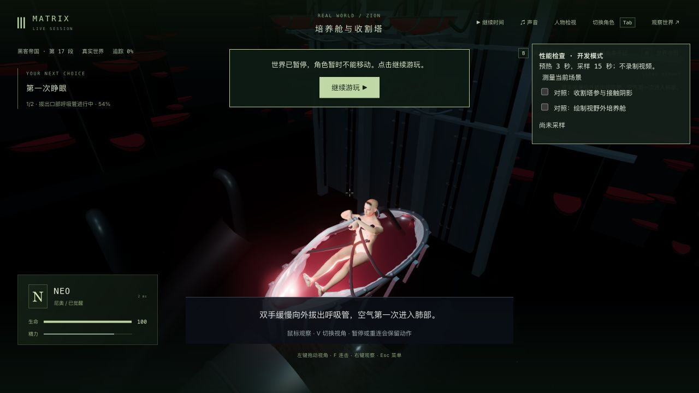

# 培养塔实例筛选（2026-10-22）

已更新固定试玩 <http://localhost:5173/>，构建 `index-ByDoGF_7.js`。同一培养舱检查点每帧少提交 **918,608 个三角形（约53%）**；最终帧率 **37.49→37.61 fps，基本持平**，没有稳定提速或60帧的证明。42组电影质量完成数仍为0。

## 采用范围

远景36座培养塔、2,880个培养舱原来按整批巨大包围范围绘制。现在按当前实际镜头筛选七批实例，每个实例保留完整几何的保守球形边界和2毫米余量，未删模型、面、材质或贴图。原始矩阵保持单精度逐字一致；另保存804,096字节的原始矩阵及边界对象，以便转头时恢复。主色通道仍最多七批，近舱、身体、道具、阴影和后期配置保持。

镜头或场景变换改变后重新筛选，列表不变时不上传矩阵；无相机时恢复完整世界。保留完整批次包围范围，避免一次空选择让后续视角无法恢复。该远景原本不投射阴影，培养舱场景没有镜面反射；没有把此处的主镜头筛选推广到其他世界的反射或阴影。

暂停时还缓存投影与场景组合矩阵，避免12帧重复检查150,768个边界。新回归先失败，修正后0次；转头或移动场景仍在首个变化帧重建。比较容差1e-12仅跳过浮点尾差，保守边界余量保持。开发面板提供正常UI对照开关，测量中锁定；面板不进入正式构建。

## 验证与实机

- 基线渲染检查15/15。新行为回归先1通过/2失败；初版18/18后，缓存回归先0/1，再最终19/19。最终覆盖实际顶点的同一裁剪面排除证明、原矩阵/几何/材质保留、横竖屏/水面/高空与非均匀变换视角、转头恢复、冷加载、暂停缓存和实际FilmSetRenderer调用路径。有限视角检查不等于任意相机或全游戏证明。
- 部署75/75、三包类型与生产构建通过，缓存最终客户端构建通过；保留既有大包提示。相关命令与失败范围见[验证记录](validation.json)，原始日志本地保留、无损`.log.gz`副本入库。
- 原生使用前轮实际拔管2.943秒/tick5941的历史存档，没有改位置或剧情。正常V/鼠标转头检查两种视角；真正重启验收后端12955→25859、浏览器冷加载后，五组公开状态、Neo六字段及六份记忆保持。随后正常继续拔管、后颈断开、排水与救援，进入医疗舱，暂停于m1_recovery/step0/tick6315，生命100。最终warning/error为0。没有重新走整条P0、完成医疗恢复或新增录像。见[原生检查](native-verification.json)与[重启核对](restart-verification.json)。

## 性能与画面限制

Apple M3、1280×720 CSS、DPR1.5，同页同镜头/噪声，拔管2.943秒暂停点，无捕获或其他游戏页，各预热3秒并采样15秒。最终缓存版按B/A/A/B顺序测量：

| 样本 | 筛选 | FPS | p95帧间隔 | 绘制/帧 | 三角形/帧 |
| --- | --- | --- | --- | --- | --- |
| B3 | 关 | 37.29 | 35.2ms | 133 | 1,735,737 |
| A3 | 开 | 37.40 | 37.5ms | 135 | 817,385 |
| A4 | 开 | 37.81 | 32.4ms | 135 | 817,385 |
| B4 | 关 | 37.70 | 32.6ms | 135 | 1,735,993 |

第一份基线在其他主色物件上少2次绘制/256个三角形，数据原样保留。稳定后的A4/B4均135次，阴影/法线通道完全同量，只减少远景主色几何。四份FPS均值仅约+0.30%，不作为稳定改善；场景CPU约0.52–0.54ms。初版未缓存的四次对照均值35.85→38.63，但第二对持平，也不能据此宣称稳定提速。八份原始报告均保留在本目录，见[最终对照](native-performance-comparison.json)和[初版对照](native-performance-initial.json)。CPU计时不能代替GPU实际耗时，下一步仍需隔离真正瓶颈。

画面对照初始DOM选择器包含全屏透明容器，已拒绝；随后一对图因性能面板高度改变，3,400处差异集中在面板边缘附近，也保留原结果。最后用正常UI把面板文字/高度保持一致，使用实际HUD子面板区域加3像素边缘的联合遮罩，剩余 **593,491像素全部相同**。这是单个固定视角的画面等价，不代表全部运动帧。见[最终画面对照](native-picture-comparison.json)、[原差异](native-picture-first-comparison.json)及原图。

人物腕口、皮肤、前景手臂和整体光照仍粗糙，电影级人物/场景与流畅度未验收。本轮没有借远景优化宣称人物精修或三部曲制作完成。

## 发布与保留

以76f3284为基线，对照1,151份旧源码/测试/脚本，只有三份客户端改变，其余1,148份相同，另新增一份行为测试；704份包文件中其余701份、素材与依赖保持。11份其他工作原样保留，见[源码审计](source-audit.json)。

只新增JS并原子替换5173入口，旧JS保留；全部704份运行文件与候选一致。280份后端、PID82106、更新及原生打开前后的完整主世界响应保持，tick3757/暂停不变；侧栏实际加载新版，无warning/error。5200/5201验收服务和临时页面已关闭，没有接回Render。见[发布核对](local-update-verification.json)。
