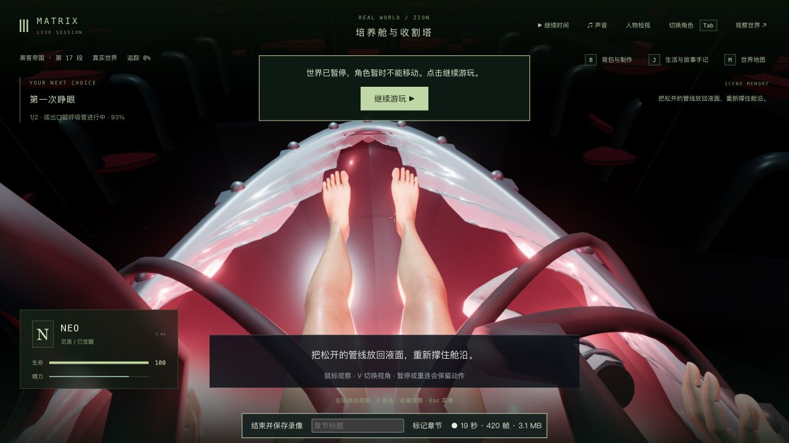

# 培养舱双腕、胸前管线与连续读档

2026-10-22 开始，2026-10-23（上海时间）完成本轮实机检查。修正 Neo 顶膜、握管及松手时的腕部反折，并让胸前软管避开实际手臂和胸部。固定试玩 <http://localhost:5173/> 已更新为 `index-i7Yn8qBL.js`。这是局部动作和接触修正，**不是人物相似度、完整培养舱或三部曲电影质量验收；完成数仍为 0/42 组**。

## 实际修正

- 支撑舱沿、顶膜和握管使用与手掌方向相容的肘部弯曲平面。握管时两掌分别绕管轴转动约 60°，接触点随实际掌面方向确定，不再为了追随任意肘部目标把腕部折回前臂。
- 伸手与收手分别沿抬起的弧线避开胸前硬接口；左手更早开始伸出，但仍在 2 秒形成完整握持。松手从 4.55 秒开始，到原有 5.5 秒动作结束时完成，保留原剧情时长。
- 四根胸前管线分别跟随对应一侧手臂；修正左手仍在支撑、管线却提前进入伸手路线的问题。握持与回落采用不同的有限曲线，前侧引线在手臂抬起时展开。重用原 TubeGeometry，未加入运行时皮肤碰撞求解器。
- 没有改变模型、皮肤纹理、拓扑、依赖、服务端逻辑或存档格式。`podBreatherPose` 是客户端表演数据；已确认服务端源码及现有服务端构建不使用它。

## 几何证据与检查器纠正

最初的独立人物夹具漏掉了游戏中 AgentRenderer 的躺姿父变换，因此不能用其腕角作为游戏证据；原始失败保留，见 [纠正说明](wrist-checker-correction.json)。后续夹具通过实际 AgentRenderer 加载 Neo、办公室和追踪室三个现有 GLB，在真实躺姿、世界坐标和动作时钟中检查。

修正后的基线诊断在拔管 2.943 秒测得右腕偏折 130.237°、左腕 126.434°；98 对腕口接缝顶点的间隙均为 0，说明这里的明显反折不能简单归因于接缝裂开。新版 9 个握管样本的最大偏折为 65.571°；顶膜与拔管两个完整时段的 1,072 个 10ms 采样中，最大分别为 62.857°、67.994°。相邻 10ms 的肘/腕关节最大位移分别为 .023408、.049214 个世界单位，均低于本轮 .05 门槛。这是有限采样的工程门槛，不代表全人物、全动作已具备精确人体运动。

- 252 个实际患者姿态：检查四根软管的全部三角形，共 387,072 次管面三角形检查，未发现超过既有容差的穿肤交线。皮肤来自实际显示网格及 Float32 蒙皮位置；包含旧存档和已顶膜两条拔管路径、顶膜及有限断线状态。
- 61 个伸手/回落姿态：检查双手与 12 个胸前接口、插头网格，未发现超过容差的相交。
- 768 次加速结构/原始光线检查结果一致。离线曲线制作另检查 151 个姿态和 2,304 次交叉核对；没有把曲线拟合搜索结束当成最终游戏通过。
- 原舱沿检查扩大了实际手面覆盖范围，原 .005 穿透容差不变。握管检查改为实际圆柱的轴向位置和径向距离，允许掌面绕管转动，原 .035 接触容差及其他指面/管壁检查保持。

保留了腕角、管面和硬接口的真实失败。固定引线、单一回落曲线及几种手掌旋转试验均曾产生新的穿模，未采用。最初同时缓存大量皮肤 BVH 的离线搜索触发 Node 8GB 堆上限；后来逐姿态流式检查，最终验证仍覆盖完整实际网格。这个离线工具的内存失败不是游戏需要 8GB JavaScript 堆的结论。部分搜索因决定修改引线路线而主动结束，见 [中止原因](authoring-route-change.json)，没有归因为观察超时。

## 测试与构建

[验证记录](validation.json)冻结并核对了基线 1,154 份包/测试/脚本、四份新检查及根依赖文件。最终候选在检查和构建期间输入未改变：

| 检查 | 结果 |
| --- | --- |
| 修改前既有接触检查 | 49/49 |
| 修改前补查场景、救援及剔除 | 15/15 |
| 最终相关七文件，含新增腕角及实际管面检查 | 69/69 |
| 部署检查 | 75/75 |
| 三包类型检查、生产构建 | 均通过 |

新增行为先复现失败再修正，原始日志以无损 gzip 保留在 `logs/`；没有只保留最后的绿灯。生产构建仍有既有大主包提示。[源码审计](source-audit.json)确认只改变三份运行源码和一份既有测试，增加四份测试/夹具；其他 11 份未完成工作保持。

提交前 `git diff --check` 发现新夹具末尾多出一个空行；只删除这一个 LF 后，重新执行同一整套候选检查。此前检查日志另存为 `logs/pre-whitespace-cleanup.tar.gz`，见 [清理记录](post-validation-whitespace-cleanup.json)。运行源码和原生验收所加载的客户端没有因此改变。

## 原生操作、真实重启和录像

从此前触镜路线实际产生的 tick5925 历史存档复制到独立验收目录，没有编辑人物位置或剧情。通过正常界面接管 Neo、继续时间、按住 G 顶膜、再按 G 拔管；在拔管 2.648 秒/tick5965 暂停。关闭网页后，真正停止验收后端 PID32501，再以同一编译结果和数据目录启动 PID42264。重启前后完整公开世界响应逐字相同，Neo 六字段和六份记忆文件哈希保持，见 [重启核对](native-restart-verification.json)。

随后在 `5200` 冷加载生产构建，实际 DOM 脚本为 `index-i7Yn8qBL.js`，按 V 检查两种视角；再返回开发录制页，通过正常操作完成剩余拔管、后颈断线、排水和船底救援，进入 `m1_recovery/step0/tick6062` 并暂停，生命 100。初段、生产冷加载及继续游戏三个页面的控制台 warning/error 均为 0。验收后 `5200/5201` 已停止，主试玩服务保持。见 [原生检查范围](native-verification.json)。

两段原录约 48.59 秒、70.53 秒，原 WebM 留在本项目候选目录的 `output/gameplay/neo-longplay-2026-09-20/`；下列 MP4 为未加速的连续节选，保留游戏声音：

- [24 秒：顶膜、握管和暂停](native-emergence-grip.mp4)
- [46 秒：松手、断线、排水与救援](native-disconnect-rescue.mp4)

[节选范围和编码结果](native-video-excerpts.json)保留原录路径及时间范围。两段原录渲染统计分别约 59.36、29.90fps，包含录像、静止、暂停和检查等待，不是同机位性能对照，更不能作为正常游戏稳定 60 帧的证明。救援/医疗舱用于连续性检查，没有新增失败分支或完整接触验收。

## 本机同步与剩余问题

通过验证后只同步这八份源码/测试，并新增一个客户端 JS、原子替换网页入口，旧 `index-BLEhj-db.js` 保留。705 份运行包文件与候选一致；280 份后端构建保持，发布没有重启 PID82166。发布及原生打开 <http://localhost:5173/> 前后，完整公开主世界响应均为 `05dbda2d…`、tick3757/暂停；发布前后 85 份记忆文件哈希相同。侧栏实际加载新版，无 warning/error，见 [发布核对](local-update-verification.json)。没有重新接入 Render；旧域名 DNS 仍待原撤下流程处理。

本轮早先因上一轮中断，原主服务进程已消失，曾从原磁盘存档恢复为 PID82166，不能说整个制作期间主服务从未重启。恢复时 simulation、sandbox、Neo 六字段和 85 份记忆保持；与中断前 API 相比，仅 Neo 的 mind/thought 文本不同，见 [此前恢复核对](main-relaunch-verification.json)。之后本次发布没有再次重启它。原始世界、记忆、数据库和候选目录不入库。

第一人称默认向前看时，口部管线仍遮挡较多画面，需要继续制作视线、头部与道具的合理关系；皮肤、腕口外观、湿润材料、服装、人物相似度、水面及自然表演仍粗糙。有限接触与连续性通过不能推导为全场景无穿模；稳定帧率、完整成功/失败路线和 42 组逐段电影质量验收仍未完成。
