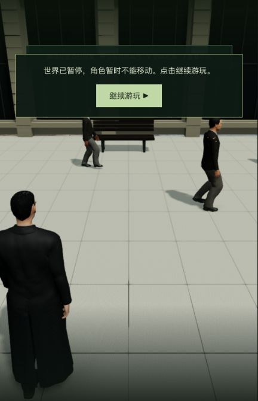

# 帧率基线：渲染预算与未采用实验

2026-10-24，基于 `f16c1ad`。本单元完成性能诊断，没有采用运行时代码改动。本机正式入口仍为 http://localhost:5173/ ，包为 `index-BbnkcfNs.js`；Render 保持撤下，42 组电影质量完成数不变。

## 测量范围

使用已有真实红衣女子训练 1.927 秒暂停检查点的独立副本，通过浏览器原生入口接入 Neo。每次预热 3 秒、采样 15 秒，不录制视频，不在采样期间编译或跑测试。各报告中的相机位置、四元数、投影矩阵和视口逐字段相同。视口是 **431×670、DPR 1.5**，设备为 Apple M3；不是 1080p，也不是持续行走或战斗基准。

性能面板启用了逐次绘制统计，自身存在测量开销；后台负载没有完全隔离。系统有 24 GiB 内存，采样期间查询到约 6 GiB 交换空间占用，这是整个系统的状态，不是游戏内存，也不能据此认定正在频繁换页或需要扩容。

## 结果

按旧 / 实验 / 实验 / 旧顺序取得无 GPU 查询的报告，中间包含重新加载和其他诊断，并非无间隔的实验室基准：

| 版本 | 平均 FPS | 帧间隔 P95 | 渲染提交 CPU 均值 | 人物更新 CPU 均值 |
| --- | ---: | ---: | ---: | ---: |
| 旧版 1 | 46.47 | 34.8 ms | 11.23 ms | 5.49 ms |
| 实验 1 | 49.65 | 30.8 ms | 9.93 ms | 5.78 ms |
| 实验 2 | 53.02 | 27.5 ms | 9.77 ms | 5.41 ms |
| 旧版 2 | 52.35 | 27.8 ms | 9.50 ms | 5.35 ms |

所有正常渲染样本均为 279 次绘制、2,456,054 个三角形/帧，含颜色、阴影、接触阴影和后处理的重复绘制。基线中阴影占 140 次提交；临时跳过动态阴影的诊断样本为 139 次、56.67 FPS、P95 24.7 ms，渲染提交均值 6.90 ms。**没有把关阴影作为正式画质方案。** 单次诊断不能精确归因全部差值，但支持继续检查阴影成本。

单独启用整段 GPU 查询后，旧版 14.24 ms、实验版 13.95 ms，差约 0.29 ms；平均 FPS 为 51.06 / 52.06。所有 GPU 查询报告结束时 GL error 为 0。GPU 区间与 CPU 提交耗时不能相加；分阶段结果也不作为可相加的纯着色耗时。

旧版与实验版结果明显重叠，**没有证明稳定提帧，也未达到稳定 60 FPS**。不能把第一次旧版较慢、第二次实验较快直接换算成优化百分比。原始报告与汇总见 [comparison.json](comparison.json)。

## 未采用的改动与验证

实验为广场行人的颜色和深度材质添加紧凑步态权重：每步只混合两个有效姿势，避免逐顶点读取全部 20 个权重；保留原模型、人数、全部姿势、纹理、动态阴影及 AO 原路径。仅涉及 `RedDressCrowd.ts` 和其测试，无新依赖或资产。由于实测收益不明确，已将这两份源码恢复到原 HEAD，未更新正式包。实验补丁留在本机本目录 `unadopted-compact-walk.patch`，不属于当前游戏实现。

修改前相关测试 19/19；新紧凑姿势测试先失败，实验版本 20/20，撤回后原测试再次 19/19。实际资源检查覆盖站立、行走、循环、倒回及暂停的稠密/紧凑权重、表面坐标和法线；浏览器编译无警告或错误。未跑全仓测试，也未为未采用代码重新发布生产构建。

同镜头截图目视保留了行人表面、脚步和阴影，但并非逐像素相等：432×670 截图有 22,791 个像素不同，最大通道差 12/255，平均通道差约 0.100/255。这是有限画面对照，不能据此宣称所有动作和视角没有差异。

## 后续目标与交付状态

60 FPS 对应约 16.7 ms 的整帧预算。继续优先分析实际绘制/阴影负载和人物 CPU 更新，检查高面数远景角色的细节分级，以及隐藏角色仍执行完整动画的成本。下一轮应覆盖正常行走、战斗与场景切换，并扩大到真实 1080p；同时记录长帧和内存变化，不能只看暂停镜头的平均 FPS。尚无经验证的最低硬件配置。

1,247 份候选输入已恢复，11 份原有实验文件、800 份共享/后端编译产物哈希保持。正式服务 PID 83388、JS SHA256 保持，主存档未写入，85 份主记忆文件保留并随世界自然运行。独立 QA 的 5200/5201 服务已核对 PID、命令与目录后停止。见 [verification.json](verification.json) 和 [qa-stop.json](qa-stop.json)。
