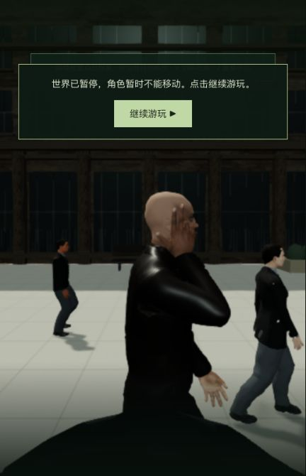

# 红衣女子训练：墨菲斯的讲解动作

2026-10-24，基于85d9370。本机试玩入口 http://localhost:5173/；Render未接回。只完成一项表演修复，42组电影质量验收仍为0。

## 实际改动

根据[既有片段参考](https://www.youtube.com/watch?v=YgJ5ZEn67tk)约00:20处的两指指向太阳穴动作，加入抬手、停留、收手并转头的程序化表演。参考来自Flashback FM片段，未声称看完三部原片或逐帧动作捕捉。动作压缩在现有5.3秒同行阶段，沿用保存的训练时钟；按实际头部表面与指尖定位，保持全部骨骼长度、模型顶点和贴图。Neo看见女子后，墨菲斯不再瞬间切换手臂姿势。没有新资产或依赖，JS增加2,979字节。

## 验证与真实失败

- 既有红衣女子回归12/12；两项新增复现先0/2：手指始终在腰部，停步时右手10毫秒内跳动约1.424世界单位。
- 第一候选还存在手指蹼相交、袖口穿模和手腕弯折118度。保留原失败日志。对齐中指/无名指根部、独立弯曲指节、调整掌面方向并放慢抬放后，最终新增5/5通过；15个时点的完整右手、脸和所有可见衣物无检测交叉，手腕最大52.606度。531个10毫秒关节采样最大位移0.057394，原门槛0.06未变。有限采样不等于所有连续表面永不穿模。
- 扩大人物/握拳/前臂/红衣女子检查34/35。唯一前臂“共享资产保持原几何”失败，在未修改HEAD模型与手部实现中复现，断言差异内容完全相同；没有修改或豁免这个测试。部署75/75，三包类型检查、生产构建通过；仍有既有大包提示。未跑完整仓库测试。
- 实机先从真实检查点走入广场，按G开始，在2.017秒暂停。实际停止并重启隔离服务（34282→52102），完整世界响应及7份记忆相同；正式构建冷加载、V双视角、漏看、G重试、回头冻结与主动结束通过，最终m1_red_dress/step2、tick13406、生命100暂停。没有手改剧情字段或录制新视频。窄侧栏暂停面板/字幕仍遮挡人物，截图有真实取景限制。

## 计算成本与未采用的尝试

离线实际Morpheus模型，同样5.3秒步行，每次318帧预热、1,272帧采样，旧/新/新/旧交替；未完全隔离系统后台，不是浏览器FPS或1080p验收。

| 样本 | 动画平均CPU | P95 |
| --- | ---: | ---: |
| 旧1 | 1.805ms | 2.294ms |
| 新1 | 4.870ms | 7.674ms |
| 新2 | 4.610ms | 7.123ms |
| 旧2 | 1.901ms | 2.435ms |

新增约2.7–3.1ms，属于制作成本，不能称为提帧。进一步测试提前固定手势，指形曲线已缓存但完整网格重算仍约3ms，整体没有明确改善；取消额外手部形变又产生最多492组指面交叉，因此两项尝试都撤回。最终恢复已经实机验证的原候选并重复构建，仍为同一index-C3De-ski.js。后续要降低此形变成本；稳定60帧、全场性能、演员相似度、自然服装、对白与完整电影编排仍未完成。

## 交付

主入口已实际重载新包且连接正常，日志无warning/error。主PID83388不重启；280份后端、520份根共享产物与11份既有实验改动保持，85份主记忆保留，未写入主存档。只更换客户端源码/JS并原子切换index，旧包保留。隔离5200/5201进程已核对并停止。临时候选、完整QA存档和诊断中间文件只留本机。提交的日志仅清理行尾空白；两个大型断言输出提交摘要和SHA256，完整原输出留在本机。

