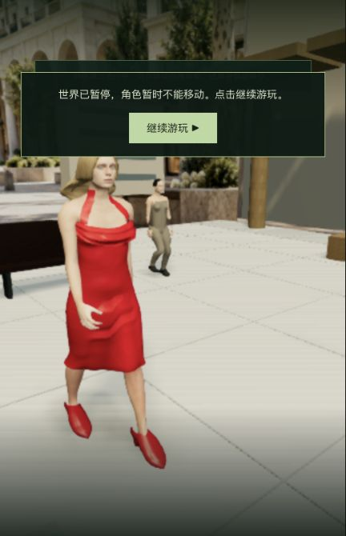

# 红衣女子独立人物与训练验收（2026-10-24）

为 `m1_red_dress` 的 `citizen_2` 接入独立三维人物，替换原来的程序拼装外观。使用项目既有 MakeHuman CC0 人体和完整指骨，制作挂脖红裙、垂褶领口、及膝裙摆、包趾高跟鞋和肩长金发。只修改人物加载、离线制作脚本与对应素材；训练规则和存档格式保持。

参考实际观看的[红衣女子短片](https://www.youtube.com/watch?v=YgJ5ZEn67tk)约 0:37–0:40。Flashback FM 是片段上传者，不是官方授权或扫描来源；没有把电影画面用于游戏纹理。CC0 来源固定版本与哈希见[素材说明](../../../packages/client/public/assets/characters/RED-DRESS.md)及 `source-manifest.json`。

## 修正与验证

- 初稿腿间裙面、鞋面朝向、外侧脚趾覆盖和挂脖悬空/穿入均有实际失败记录；最终分别修正截面包络、面绕序、鞋楦和颈肩贴合，不靠隐藏皮肤通过检查。
- 八项人物测试通过：素材依赖完整性、独立模型加载、真实步态与冻结恢复、躯干/大腿衣面覆盖、54 个时刻完整鞋面支撑、双脚前掌射线覆盖、531 个时刻手部连续性与挂脖贴合。手部 10ms 最大相邻转角 0.0231rad，有限采样最大指节弯折 0.4884rad。相关训练、动作、资产和镜头十项通过；客户端类型检查与生产构建通过。
- 单独检查真实存档中 2.833 秒的世界坐标：人物根节点与广场面同为 Y=0，完整鞋面最低约 -0.012、鞋跟约 0。近景仍有接触阴影偏弱的悬浮观感，未把数值支撑等同于最终视觉质量。
- 独立测试从真实前序检查点正常进入训练。首次注意到女子、转身看到 Smith 并冻结，在冻结处真正停止/重启后端，完整 API 世界和七份角色记忆一致；新生产页切第一人称、正常 G 确认完成。首次完成分支保留在本地 `qa-completed-first/`。
- 另从同一真实入口检查点的完整副本测试：故意看向另一侧，漏看不会推进；G 重试后实际注意到女子、转身冻结并主动确认完成。最终 `m1_red_dress/step2/tick12515` 暂停，控制台零警告/错误。未改写剧情字段、传送或使用主存档；这不是全三部曲连续通关。

## 资源成本与本机更新

首次正式冷加载发现 `bluegreen_eye.png` 在候选副本内但未进入发布清单，正式请求 404；已补素材依赖回归（先失败，再补齐贴图），对照 CC0 原始文件哈希，并从正式 HTTP 入口逐字节确认。初次发布/控制台记录保留为 `initial-publication-*`，不能把首次校验说成全通过。

人物共 123,044 个三角形；新增 GLB 5,402,804 字节、头发纹理 2,915,253 字节，眼睛纹理 697,879 字节，合计约 9.02 MB，复用已有皮肤贴图。新 JS 比前版增加 598 字节；没有新增运行依赖。本轮没有新的浏览器 FPS 或 GPU/内存实测，不能据模型验证声称稳定 60 帧。

正式包 `index-clOxxm33.js` 更新到 <http://localhost:5173/>。主服务 PID 43571 不重启，世界自然推进 tick28140→28144；主存档没有写入/还原，85 份记忆、280 份服务端产物、共享产物和工作区原有 11 份实验保持。旧 JS 留存；独立 QA 5200/5201 已停止。发布与原生重载结果见 `local-update-verification.json`。Render 不接回。

## 未完成

面部仅为 CC0 形态拟合，演员相似度、自然转头/表情、头发和布料动态尚未完成。广场空间/人群/灯光、接触阴影以及正确配角配置仍待制作；有限衣面和手部检查不代表所有动作没有穿模。42 组电影质量完成计数仍为 0。
