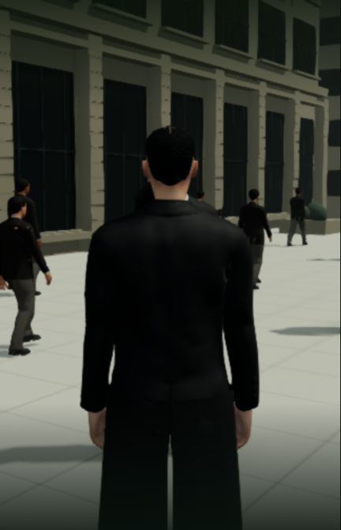
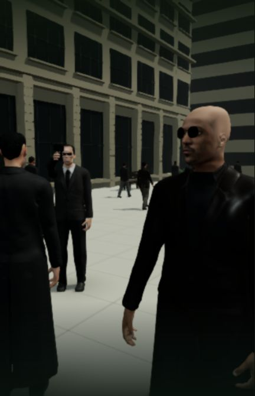

# 红衣女子：玩家能看见枪口

2026-10-24，基于59d9ce9。本机入口 http://localhost:5173/ 已更新 `index-BbnkcfNs.js`；Render保持撤下。本单元修正玩家镜头的遮挡，不增加42组电影质量完成数。

## 问题与改动

核对 [Flashback FM 的原片片段](https://www.youtube.com/watch?v=YgJ5ZEn67tk) 1:00、1:05 的冻结人群和三人持枪构图。该来源不是官方完整电影。当前游戏水平视线下，Neo的身体把Smith及枪口完全挡住；新增实际模型射线测试首先碰到Neo的头发。

仅调整 `PlayerControls.ts` 的红衣女子第三人称机位：相机和观察点一起向肩侧平移，保持鼠标方向，宽窄窗口均保留足够横向视野。去掉揭示前突然收窄的镜头。角色站位、手部、枪械、第一人称眼睛、服务端注意力判定和存档格式保持。无新资源或依赖，正式JS增加208字节。

同一真实检查点、同一水平视线的正式包前后画面：

## 验证

修改前讲解/持枪9项及原有鼠标注意力1项通过；新测试为1/2，失败是Smith脸部被Neo的真实蒙皮遮挡。修正后相机、红衣女子讲解与持枪相关218/218，部署回归75/75；客户端类型检查与生产构建通过，共享/后端在隔离副本构建通过。未跑全仓测试，保留既有主包体积提示。

新测试用交付的Neo、Smith、Morpheus模型和真实枪械检查16:9与431×670、三种俯仰；脸、枪口、套筒须在画内且首个射线命中属于目标物。另检查Neo仍在画内、暂停中自由转头、服务器方向一致、V回到实际眼睛以及保存时钟保持。没有用空关节或代理盒代替人物表面。已有完整手/枪表面接触回归仍通过；不能因此宣称所有动作没有穿模。

正式包实机先从真实入口走入训练，经历漏看、重试和回头冻结。在tick12703真正停止并重启后端（9368→15770）；刚启动的唯一差异是Neo会话控制已释放，重新接回Neo后完整世界逐字段相等，7份记忆哈希相同。保留这次启动差异，不将它隐藏成一次直接相等。冷加载V双视角、鼠标观察、G结束及恢复移动3.167单位通过。

再从独立真实入口副本完整运行新正式包：走入、漏看、G重试、观察女子、回头冻结、主动G结束、W/D移动3.242单位。最终 `m1_red_dress/step2`、tick12552、生命100、暂停，未手改剧情字段。浏览器无警告或错误；本轮没有新视频或FPS测量。

## 交付与边界

1,246份构建输入中仅目标相机源码改变；原有11份实验改动、800份共享/后端编译产物保持。固定主入口已真实重载并核对JS及控制台，PID83388保持，主世界自然运行，未写入主存档；85份主记忆文件均保留，运行中的NPC自然生成新记忆，内容哈希并非保持不变。5200/5201临时服务已核对PID、命令和目录后停止。

演员相似度、自然表演与服装、枪械外观、完整电影场景编排、连续通关和稳定60帧仍未完成。本轮没有调整人物距离或冒称逐镜头复刻；新增可见性检查只覆盖所列姿态和视角。

完整世界响应、真实检查点、候选构建、诊断脚本及原始探索日志留本机。提交日志只清理行尾空白；参考截图只作制作对照，没有进入游戏运行资源。
