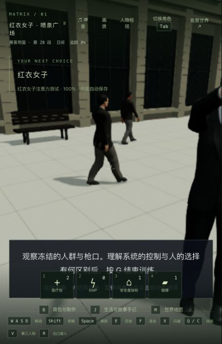

# 红衣女子广场：共享步行与帧率

2026-10-24，基于 af24a8d，当前正式本机入口 http://localhost:5173/。这是人群制作与性能改进，不是电影质量验收；42组完成数仍为0，Render未接回。

## 实际改动

20名背景行人从各自骨骼/133个网格改为两种身体、12个实例化网格。使用现有CC0人体及同一来源的商务西装，保留全部头部/手指顶点和头发，精简衣裤/鞋/眼睛；新增15,561,746字节素材，无新运行依赖。固定20个步行采样加独立站姿，保存时钟驱动位置、步态、冻结和重连；按身高修正步频，按真实腿长校准撑地脚。低模不是人物近景完成版，仍缺裙装、包、更多发型和独立人群路线。

## 验证与失败

- 原版现有两项人物回归通过；新增绘制预算先失败：133个独立表面。第一次共享版脚底在撑地阶段滑动0.1854单位；校准实际腿长后，男女各101个采样的脚底高度、撑地滑动小于0.07及腰部重叠通过。这个有限采样/AABB检查不等于所有衣服都无穿模。
- 浏览器发现两份GLB引用不存在的grey_eye.png；新增依赖检查先失败，再改用已交付brown_eye.png，通过后冷加载无warning/error。完整原失败日志保留；没有把离线去纹理测试当成贴图检查。
- 场景/人群/裁剪相关18/18，主要角色8/8，部署75/75，三包类型检查及客户端生产构建通过。生产构建仍有既有大包提示。没有重跑全库；上一单元的三项历史剧情失败没有宣称已修复。
- 实机早期一次开发页操作被构建热重载打断，不算完成；最终使用正式构建正常W/D走入广场、启动训练、漏看重试、回头冻结、暂停、实际停止和重新启动后端（8369→16681）。tick12527冻结完整世界响应和7份记忆逐项相同。冷加载后V/鼠标检查并按G完成，到m1_red_dress/step2、tick12608、生命100暂停。未手改剧情字段。未录新视频。

## 性能测量

原生同一镜头、CSS431×670/DPR1.5，3秒预热后15秒采样；不录制、不插GPU查询、采样时无构建/测试，但没有隔离全部系统后台。四次相机和视口JSON完全相同。第一份旧版采样先于制作，其余为新版/旧版/新版复测。

| 样本 | 平均FPS | P95帧间隔 | 绘制提交/帧 |
| --- | ---: | ---: | ---: |
| 旧1 | 39.93 | 37.8ms | 689 |
| 新1 | 43.98 | 34.1ms | 446 |
| 旧2 | 39.02 | 37.3ms | 689 |
| 新2 | 44.31 | 32.2ms | 446 |

约12%的局部平均FPS改善，仍有明显慢帧。不是1080p数据，不是运行中完整关卡，更不是稳定60FPS。不能和上一单元1920×1080的23.06FPS直接相减。渲染CPU计时包含驱动等待，不代表独立GPU耗时。原始采样及比较JSON在本目录。

## 本机交付

index-BAv0jLkr.js，SHA256 02f265e5d464ab78d49e9c2b4336e8038c380933ba53072b753cfb32a3d370c6。只更新客户端源码/素材/JS，旧JS保留，index原子切换。主PID83388未重启，280份后端及根目录520份共享输出、11份旧实验逐项保持。主世界自然tick44233→44234运行，85份主记忆保留，发布脚本没有写主存档。临时5200/5201均已停。本单元候选、源缓存、中间rig和完整QA存档只留本机，不进入游戏或本次提交。

