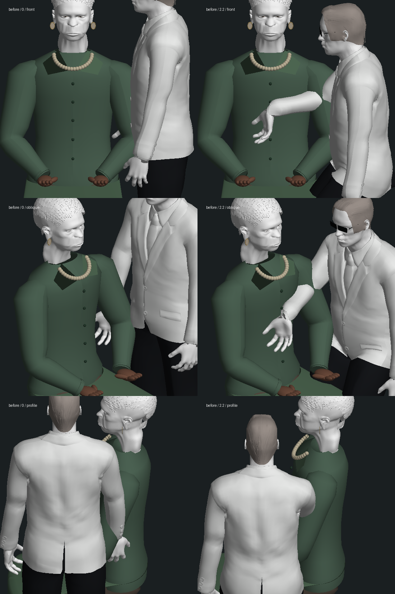
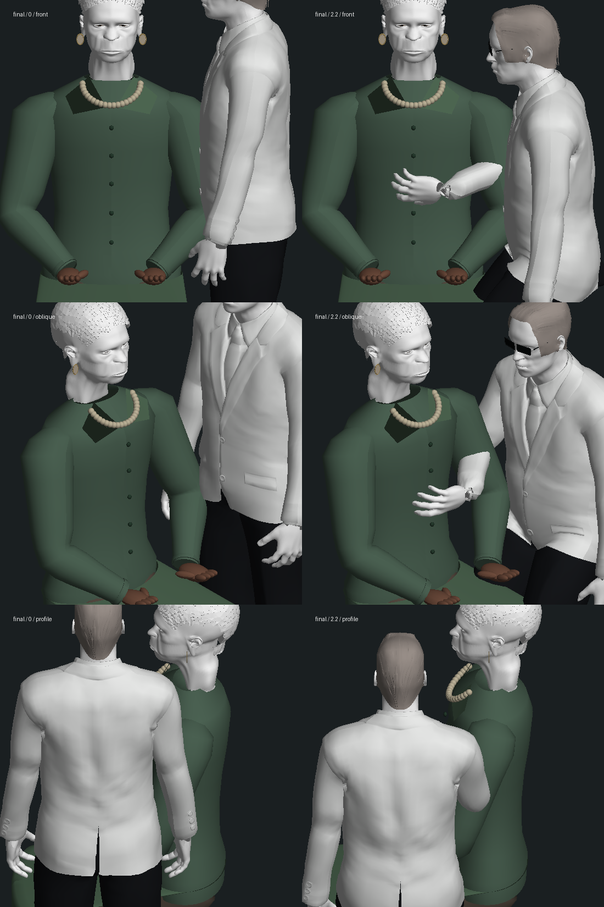

# Smith 同化先知：手部接触与腕部动作修复

2026-10-14，起始版本 `a5dc4cf25c2ee4acc63f42307898e15cf7a62f5d`。本轮处理上一轮已复现的 Smith 手指穿衣失败，没有新增剧情完成项。连续 Neo 验收副本仍停在 `m1_sentinels` 第 0 步 ready / tick 9134；公园尾声、3-03 整组和三部曲均不标完成。

## 改动与真实几何

原动作仅把固定的虚拟掌点送到胸前；真实皮肤会穿入上衣，且阶段开始直接改变手腕朝向和手肘平面。现在按保存时钟混合手臂、伸手弧线和转掌，先抬手再转掌，收手沿相同过程返回。用实际手部蒙皮的 6673 个顶点建立腕部局部表面，按已有上衣旋转曲面的轮廓把接触限制在衣物外。沿用原骨长、手指姿态、剧情时间线和身体站位，没有修改 GLB、服务器或增加依赖。

复看了已有的[电影举手前参考帧](../../gameplay/trilogy-oracle-absorption-2026-10-09/reference-smith-hand-5s7.png)。这张帧不含实际接触或完整同化，本轮不声称逐帧还原了整段电影。当前站位仍在先知同侧，与电影隔桌站位有差异。

以下为实际 Smith 蒙皮、先知身体/服装及现有第三部头部模型的离线正交几何检查，**不是游戏实机截图**。纹理被剥离，白色人物不代表游戏材质。前后使用同一模型和两种姿势，从正面、斜面与侧面检查；头部没有在本轮重做。





手腕不再垂折，掌面朝向接触对象。衣袖与腕部的自然形变、手指表演、人物外形和真实游戏材质仍需制作。早期诊断未开启先知第三部头部，后已按实际角色输入重新导出前后两组；早期文件以 `geometry-earlier` 等名称留在本地，不作为最终人物画面。

## 测试与失败过程

- 原有相关基线 **10/11**，唯一失败为 Smith 皮肤穿衣 `0.020154264249867992` 个模型单位，见 `baseline.log`。
- 新阶段交接测试先在旧代码失败，见 `red-boundaries.log`；单独修阶段跳变后，该项通过但穿衣仍失败，见 `boundary-fix.log`。
- 扩大到接近、接触及收手时刻，中间版本最大穿入约 `0.11365`，见 `red-skin-path.log`。没有仅移动最终定格画面来隐藏中途问题。
- 第一轮衣物约束消除了采样穿入，但腕部仍折约 89°，新增动作检查先失败，见 `skin-fix.log`、`red-wrist-bend.log`。初次调整只改变了最终朝向；随后掌面朝内的直接四元数插值又使中途折腕，见 `wrist-fix.log`、`palm-facing.log`。最终改为分阶段抬臂和转掌，见 `pronation-fix.log`。
- 旧测试的虚拟掌点并不位于实际掌面，转掌后不能用它证明皮肤接触。删除该点的距离断言，保留完整皮肤射线检查，并把实际皮肤接触间隙要求从 `< 0.08` 收紧至 `< 0.015`；穿入上限仍 `< 0.005`，未放宽。用起始提交的接触函数重跑这些测试得到 **3/7**，四项失败保留在 `red-final-baseline.log`，首次临时模块后缀错误单列在 `baseline-module-error.log`。
- 最终相关回归 **114/114**，见 `final-regression.log`，包含先知房间、末次会面、同化剧情/界面/接触、人物恢复、公园衣物/手部/镜头、尾声和动作。之后只强化测试，让 14 个时刻各自新建独立 Smith 模型，专项再次 **7/7**，见 `final-cold-contact.log`；生产代码未再修改。
- 182 个相邻保存时刻的腕部最大折角为 `0.67429` 弧度，约 38.6°；起始代码为 `1.55379` 弧度，约 89.0°。每 40 ms 最大腕部位移约 `0.06332` 个模型单位。14 个接触时刻无采样穿入，稳定接触间隙约 `0.003` 个模型单位。四组阶段边界、暂停、另一动作后的恢复和各时刻新建模型已查。
- 这些是有限时刻和顶点采样；不保证全部三角形、所有动作时刻、全身与衣袖均无穿模。测试直接加载 Smith GLB，先知接触对象是游戏中的实际程序上衣，测试不依赖面部纹理。
- `npm run typecheck`、`npm run build` 三包通过，见 `final-typecheck.log`、`final-build.log`；保留已有客户端大包警告。未跑全库测试。

最终较广回归命令：

```sh
node --import tsx --test tests/oracle-park-tailoring.test.mts tests/oracle-park-clothes.test.mts tests/oracle-garden.test.mts tests/oracle-park-grip.test.mts tests/garden-camera.test.mts tests/oracle-restoration-render.test.mts tests/motion.test.mts tests/trilogy-epilogue.test.mts tests/epilogue-cast.test.mts tests/sunrise-garden.test.mts tests/oracle-room.test.mts tests/oracle-last-render.test.mts tests/oracle-absorption-render.test.mts tests/oracle-absorption-contact.test.mts tests/oracle-absorption.test.mts tests/oracle-absorption-ui.test.mts
```

提交的日志只清理行末空白和末尾多余空行，原始 `.raw.log` 保留本地；失败内容和数值未改。临时 `baseline-contact.mts` 是上述起始提交的 `OracleAbsorptionPerformance.ts`，仅调整导入路径以复用当前其余代码；本轮生产变更全部位于接触函数。临时旧源码、原始几何 JSON 和运行状态不提交。

## 开销、重启与原生检查

40 次预热后各测量 300 次，顺序单独运行，同样加载和更新 Smith 与先知身体。这是 Node 模型 CPU 耗时，**不含 GPU/完整世界，不是浏览器帧率**。

| 姿势 | 原版中位数 / p95 | 当前中位数 / p95 |
| --- | --- | --- |
| 同一接触姿势 | 0.589 / 0.750 ms | 0.879 / 1.055 ms |
| 变化中的接近姿势 | 0.554 / 0.585 ms | 0.744 / 0.869 ms |

见 `cpu-baseline.json`、`cpu-final.json` 和 `bench.mts`。约 0.19–0.29 ms 的增加来自手部表面与衣物轮廓求解，保留代价，未通过浏览器性能验收。`bench.mts current` 可在当前版本重测；`baseline` 参数需要按上述方法恢复未提交的临时原版函数。

完整复制既有 `trilogy-oracle-absorption-2026-10-09/coating-final-state` 至隔离 `runtime-state`，世界暂停于 tick 7883，使用独立 3190/5390。服务器与页面 HTTP 200，但侧边栏同一标签先导航、后聚焦均 20 秒超时，最终标题“无法访问此站点”；未操作内部错误页，**没有取得新原生截图或游玩录像**，见 `native-attempt.json`。

隔离服务器实际停止、确认退出后重新启动；八项完整 API 快照分组（人物、区块、地点、阶段、事件、模拟、沙盒、时刻）全部一致，15 份记忆哈希一致，见 `restart-result.json`。这是后台重启检查，不代替浏览器冷读、第一/第三人称或真实画面验收。结束后仅停止本轮两个服务，端口均释放。

213 个主存档、人物资产及原始同化存档文件未变，见 `protected-before.json`、`protected-result.json`。没有把测试副本进度写回玩家存档。

待完成：电影隔桌站位/厨房比例、自然抬臂和身体表演、人物相似度、袖口/腕部形变、完整接触检查、原生镜头/声音、稳定帧率和整段连续人工验收。本轮修复此前穿衣回归，但不将局部绿色测试计为整组或三部曲完成。
