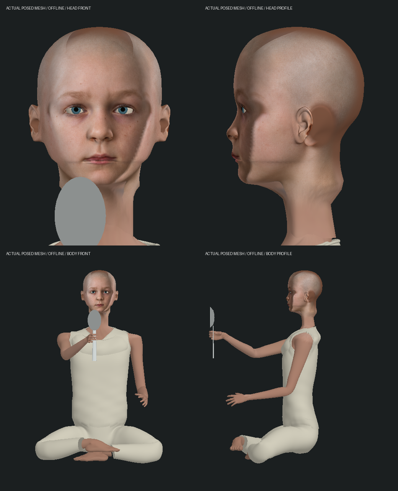

# 勺子男孩完整人物与上段握勺 · 2026-10-15

第一部 1-10 先知候客厅的局部人物制作，起点 `2794207`。新增实际头部、身体和服装，纠正上一版下端两指夹持；不等于整组或三部曲高质量完成。本轮没有新的原生实机画面，也没有推进连续 Neo 试玩档。

## 原片依据与资产

实际查看 [电影握勺静帧](https://www.imdb.com/title/tt0133093/mediaviewer/rm3951329281/) 与 [人物近景](https://www.imdb.com/title/tt0133093/characters/nm0936894/)：孩子剃发、蓝眼、浅肤色、窄脸，肩颈披浅色布料、手臂裸露，右手五指握住靠近勺头的上段。Movieclips 的 `XO0pcWxcROI` 是检索线索，本轮网页打开失败；所下载缩略图是 Neo，未用于孩子外形拟合。本轮没有完整看过该视频或三部电影。

内置 **imagegen** 工具以两张静帧为参考，生成 1254 × 1254 的正面/侧面头像图谱，未经后续图片编辑。完整提示词见 [face-generation-prompt.txt](face-generation-prompt.txt)。它是近似生成外形，不是演员扫描或已证明的精确相似度。电影照片只留在忽略的本地 `reference/`，没有导入游戏或推送；运行时只使用生成的图谱。

沿用项目的 CC0 MakeHuman 管线，固定 revision `a8bc2d54ff0ac92e78ff71431b1023eda42bf482`，新增孩子形态 `macrodetails/caucasian-male-child.target`。三份新运行资源如下；准确哈希和来源见 [sources.json](sources.json)。

| 运行资源 | 字节 | 三角面 |
| --- | ---: | ---: |
| spoon_boy-head.glb | 1,386,300 | 34,512 |
| spoon_boy-body.glb | 2,665,568 | 60,132 |
| spoon_boy-face-reference.png | 2,220,236 | — |

新增共 **6,272,104 字节**。五指手继续复用既有 `oracle-park-hands.glb`，没有新增手部 GLB、游戏依赖或存档格式。连同两手，这个人物的三角面约 **119,588**，另有运行时眼球/腕部连接/勺子；不能把较小的 CPU 增量当作 GPU 与整场景性能达标。

头部有真实耳朵、连续颈部、眼球和闭眼形变；按图谱单独拟合前后深度，修过大的鼻部/后脑、颈部采到白衣、画像边列重复造成的脸部横纹和侧耳重复。身体按原表演骨架拟合，隐藏旧球头/圆柱脖子、块状身体、深色袖口、腰带与靴子；补裸臂、浅色上衣/裤子、绕肩颈的连续披布及卷边。下半身/赤脚是游戏解释，裁切静帧没有证明原片完整服装和鞋履。

作者命令使用项目既有 Python/numpy；这些只在制作时需要：

```sh
python3 scripts/build-epilogue-heads.py --source output/characters/spoon-boy-cast-2026-10-15/source --output output/characters/spoon-boy-cast-2026-10-15/staging --roles spoon_boy
python3 scripts/build-digger-bodies.py --source output/characters/spoon-boy-cast-2026-10-15/source --output output/characters/spoon-boy-cast-2026-10-15/staging --roles spoon_boy
```

## 手与保存动作

上一版下端两指夹持是原型，未符合上述静帧。本版孩子五指环握道具 Y≈.44 的上段，Neo 保持 Y=.08 的下段夹持。握姿沿实际弯曲中心线和切线重建，孩子的弯曲朝掌外，交出前回直；真实指骨长度、唯一持有者、勺子尺寸和既有交接世界接触保持。

裸臂检查发现旧袖内连接与真实前臂切口最多相隔 **.090005 世界单位**。连接面改为结束在实际蒙皮边界段上，在有限关键姿势检查中最大缝隙约 **2.16e-8**；这证明测试中的位置接合，不证明所有动作的自然法线/布料或全身零穿模。

冷创建到 receiving / 1.1 秒时，孩子手部曾与连续播放相隔 **.08095 世界单位**：新人物没有创建已交给 Neo 的勺子，因此跳过收手解算。修复为该阶段也建立隐藏的道具姿势引导，显示权仍只属于 Neo。实际皮肤逐 10 ms 连续检查、多个冷创建时刻、走动后重建与离场移动均保留。

## 实际网格图



图从最终 GLB、CharacterModels 和保存动作导出实际已蒙皮网格；头像按注册 UV/图谱逐像素着色。它是**离线模型检查，不是游戏截图**，没有验证原生 PBR、反射、阴影、玩家相机或 FPS。眼球、布料和下颌/颈部等表面仍显机械，演员相似度与自然演出继续列为未达标。

```sh
node --import tsx output/characters/spoon-boy-cast-2026-10-15/inspect.mts
python3 output/characters/spoon-boy-cast-2026-10-15/render.py
```

原始姿势 JSON、源缓存和旧模块副本本地忽略；小脚本和最终图随记录保存。

## 验证范围与失败

本轮起点四个相关文件基线 **47/47**。新人物缺失时先 **0/2**；原片上段握法、弯曲柄接触、轮廓/裸腕/包边、投影横纹和收手冷重建均先有失败再修复。日志保留 `red.log`、`red-grip.log`、`red-contact.log`、`red-anatomy.log`、`red-projection.log`、`red-cold-arm.log` 和 `red-fixture.log`。

最终模型相关 **105/105**，无失败/取消/跳过（`related-final.log`），仅覆盖：

- spoon-boy-cast、spoon-grip、oracle-room、epilogue-cast、digger-bodies
- oracle-park-grip、oracle-park-tailoring、oracle-park-clothes
- hand-pose、forearm-twist、pills、oracle-absorption-contact

房间/握持测试现加载真实孩子头、身体、手与 Neo 的三份衣装，避免错误使用 Neo GLB 代替孩子。旧下端两指/直柄原型检查改为上段五指检查，完整穿柄检查移到实际弯曲柄：六个时刻共 **36,510** 个近柄顶点/三角面中心采样，最差归一化裕量约 **.00187**；五指均与实际金属三角面接近。有限采样不等于任意面、所有时刻与整个勺碗零相交。

剧情/界面/相机/验收存档的相关子集 **13/13**（`flow-final.log`），命令：

```sh
node --import tsx --test --test-name-pattern='spoon|Oracle reception|old Oracle|Neo sits' tests/film-review-fixture.test.mts tests/film-story.test.mts tests/camera.test.mts tests/film-journey-ui.test.mts
```

包含主动接勺/专注/起身、暂停、断线、孩子被占用、重试、保存状态、视角和新的 `spoon-withdrawal` 1.3 秒检查点。后者由原有实际动作命令/帧推进生成，只是独立视觉验收档，不能算自然 Neo 主线通关。

最终类型检查和共享/服务器/客户端构建通过（`typecheck-final.log`、`build-final.log`）。没有重跑或声称全库通过；保留入口包超过 500 kB 的既有警告。

## 重启、保护、性能与原生边界

独立 `spoon-withdrawal` 验收档以 paused / receiving 1.3 秒启动隔离后台 3193，真正停止后按相同配置启动：八组公开状态均一致，两个角色动作和所有权保持，见 [restart-result.json](restart-result.json)。该档没有记忆文件（0 个），不是既有玩家档。只读取/修改本目录忽略的 `runtime-state/`；后台最终停止。它不替代人工游戏/原生恢复验收。

`protected-result.json`：304 个既有资源/主存档/来源档保护文件中 **303** 未改，只更新角色资产说明。三份孩子资源是新增项；旧角色 GLB/纹理、电影音乐和玩家存档没有改动。

所有测试、构建和绘图停止后，同机顺序测量起始 `2794207` 与最终 Neo/孩子动画和世界矩阵，每种预热 100 次、采样 750 次：

| 双人模型 CPU，ms | 起始中位数 / p95 | 最终中位数 / p95 |
| --- | ---: | ---: |
| 保存时间不变 | 1.489 / 1.685 | 1.589 / 1.782 |
| 保存时间变化 | 1.660 / 1.811 | 1.842 / 2.069 |

运动中位数约增加 **.182 ms**。不含 GPU、材质上传、阴影、整个场景、录像或浏览器帧率。`prepare-before.py` 从起始 Git 对象重建旧表演模块，`benchmark.mts` 和两个 CPU JSON 保留方法/结果；没有以墙钟超时重启未知工作。

本轮 CUA 库存实际报告 **Mac 锁定且自动解锁失败**；browser 2 / tab 1 仍为 `http://127.0.0.1:5197/` 的“无法访问此站点”。已请求手动解锁，尚未收到答复。没有新实机图/视频、玩家操作、浏览器错误日志或 FPS 验收，没有换用其他 UI 控制方式冒充原生检查，见 [native.json](native.json)。

## 保留的完整目标

人物的精确相似度、自然皮肤/法线/衣物、表情/口型/呼吸；完整手手/身体/勺碗/披布/家具接触；候客厅其他演员、准确空间/光照、声音和完整接待/厨房路线；原生稳定性能及成功/失败/读档后的连续人工体验仍缺。当前人物更完整，但仍是局部制作与验证；42 组剧情、现有 126 节点 / 367 步骤 / 70 场景和三部曲均未高质量完成。
