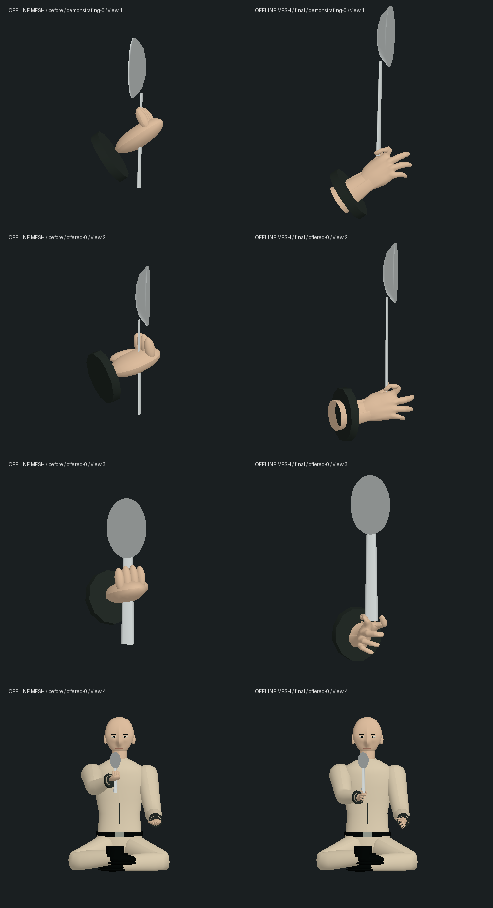

# 勺子男孩五指与交接 · 2026-10-14 / 15

第一部 1-10 先知候客厅的局部人物制作。起点为 `ffb5726`；10 月 14 日开始，15 日完成最终验证。不是整组或三部曲完成，也没有推进连续 Neo 试玩存档。

## 实际改动

- 两只手复用已经交付的 `oracle-park-hands.glb`：CC0 MakeHuman 解剖皮肤、每手十五指骨和一个腕骨。只用手部，不复制 Trinity 的脸或演员纹理。本地缩放为 75%，沿用孩子肤色/材质；角色整体尺度仍为 .73。现有资源共 1,055,676 字节 / 24,944 三角面，不新增 GLB、纹理、上游素材下载或运行依赖；孩子加载器会请求这份现有手部 GLB。
- 从已有 Oracle 加载器提取真实指腹与手口边界，给孩子连接袖内前臂。公园的持包动作/换装保持原接口，由原有实际模型回归继续检查。
- 孩子握勺柄下端（道具局部 Y=.025），Neo 接上段（Y=.08）。孩子从对面伸手，手掌绕勺轴转半圈，道具作相反转动；原交接世界位置、朝向、尺寸及唯一所有权保持。手指按真实骨长和指腹求解，空闲三指轻收，交出后逐渐松开。
- 孩子的身体使用保存的勺子动作时间，避免旧行走速度、转身和时间残留；动作之后更新实际腕口，离开候客厅动作再移动也不留下旧弯腕连接。慢加载在 offered 时保留已创建的勺子，释放模型后迟到的网格会清理。

## 前后网格



同一资产、同一保存输入和两种观察方向；最后一行保留完整孩子身体，能看见脸、身体与服装仍为早期简化造型。图是实际已蒙皮网格的离线着色检查，**不是游戏截图**。没有模拟电影灯光、PBR/纹理细节、阴影、玩家相机或浏览器性能。

`prepare-before.py` 从 `ffb5726` 重建三个起始表演模块，仅改离线导入路径；`inspect.mts` 使用真实 GLB、运行时 CharacterModels 与保存输入导出几何。原始 JSON/模块缓存本地忽略，图、日志和小结果随本次提交保存。

```sh
python3 output/characters/spoon-boy-hands-2026-10-14/prepare-before.py
node --import tsx output/characters/spoon-boy-hands-2026-10-14/inspect.mts before
node --import tsx output/characters/spoon-boy-hands-2026-10-14/inspect.mts final
python3 output/characters/spoon-boy-hands-2026-10-14/render.py
```

Python 绘图需要项目既有 numpy/Pillow，不是新增游戏依赖。

## 验证和失败记录

基线四文件 **25/25**。新增握持和双手冷重建先 **0/2**（`red.log`）。第一次接入还有四项失败：旧隐藏球手被采样、孩子手腕被其他角色的公共手部重置、朝向反向、真实指腹穿柄与身体旧动作残留（`initial.log`）。改为可见网格采样，并分别修正实际动作；不是删除失败测试。

单纯指尖通过后，更严格全手检查发现拇指关节/虎口仍穿柄（`contact.log`、`thumb-path.log`、`web-clear.log`、`lower-grip.log`）。用不同握点和实际皮肤间隙修复，最后直柄测试扩到 Y=0..0.17，包含每个顶点及三角面中心；六个持勺时刻共 **9,443** 个近柄采样，最差多边形归一化裕量约 **-0.001256**，阈值 **-0.005**，在有限采样数值容差内，不能宣称任意面/时刻零相交。

离场后腕口仍保持旧姿势的新增回归也先失败（`red-exit.log`），改为在全部人物动作之后更新连接。最终孩子示范/交出、10 ms 逐帧可见右臂检测含 **2,366** 个顶点探针，最大相邻皮肤位移约 **0.01898** 世界单位、前臂转角约 **0.01856 rad**；冷创建检查多个保存时刻。Neo 的接勺手部路径仍通过原握持/交接回归。

最终相关 **81/81**，无失败/取消/跳过；范围仅为：

- `tests/spoon-grip.test.mts`（13 项，新增 6 项）
- `tests/oracle-room.test.mts`
- `tests/oracle-park-grip.test.mts`
- `tests/oracle-park-tailoring.test.mts`
- `tests/oracle-park-clothes.test.mts`
- `tests/forearm-twist.test.mts`
- `tests/pill-glass.test.mts`
- `tests/hand-pose.test.mts`
- `tests/motion.test.mts`

旧房间测试的加载替身曾不支持新手资源，引发回退警告。最终修正：腿部测试明确保留未加载外观，交接测试读取真正手 GLB 并等待孩子加载，而不是把 Neo GLB 传给手部加载器。最终结果以 `final-verified.log` 为准。没有全库通过结论；较早其他单位记录的资产预算/救援垫等缺口没有由本轮解决。

最终 `npm run typecheck`、共享/服务器/客户端三包构建通过（`typecheck-final.log`、`build-final.log`）。入口 JS 3,536.47 kB，保留既有大包警告。

## 保存和资产保护

`protected-result.json`：304 个资产/主存档/来源档保护文件中 **303** 未改，只有角色资产说明 README 有意更新；所有角色 GLB/纹理、音乐与主存档保持。

只复制既有真正的红药取药中途档 `drink-before-restart-state` 到本目录忽略的 `runtime-state/`。后台在 tick 5232 载入且暂停，真正停止并按相同配置重新启动：**8/8** 公开状态分组、**7/7** 记忆一致，见 `restart-result.json`。这是保存保护，不是勺子段实玩；勺子动作恢复的证据来自实际模型回归，没有把旧取药档改写成新剧情进度。

## 性能与实机边界

在测试/构建已终止后顺序测量同一双人模型的动画与世界矩阵更新，每种 100 次预热、750 次采样：

| 模型 CPU，ms | 原版中位数 / p95 | 本版中位数 / p95 |
| --- | --- | --- |
| 保存时间静止 | 1.440 / 1.692 | 1.497 / 1.702 |
| 保存时间变化 | 1.462 / 1.625 | 1.673 / 1.887 |

运动中位数增加约 **0.21 ms**。这是一次本机 CPU 采样，包含 Neo/孩子及骨架界限更新；不含材质上传、GPU、反射、整个城市、录制或浏览器帧率。`cpu-before.json` / `cpu-final.json` 是本次数据。

隔离后台 3191、游戏 5197 和实际手 GLB 独立 HTTP 请求均正常。Codex 侧边栏 CUA browser 2 / tab 29 的实际游戏导航约 20.22 秒超时，随后同标签库存变成浏览器生成的“无法访问此站点”错误文档；见 `native.log`。没有新的实机截图、视频、玩家流程、控制台或 FPS 验收，没有换用其他控制方式冒充原生检查。

## 仍待制作

孩子完整脸/身体/服装与电影相似度；自然皮肤/布料、关节/表情和完整连续表演；全部手手/身体/弯曲柄/勺碗/家具接触；影片候客厅、其他孩子、接待者和厨房路线；声音和稳定帧率；成功/失败/读档后的连续人工体验。有限手部检查不能证明这些已达标，42 组和三部曲目标保持未完成。
