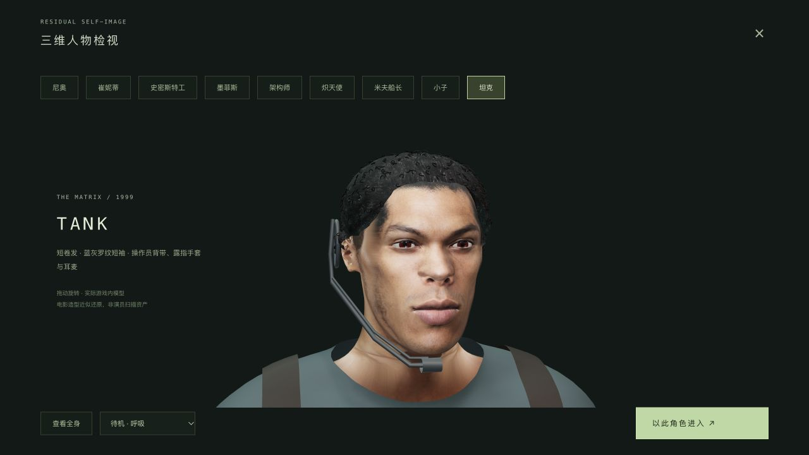
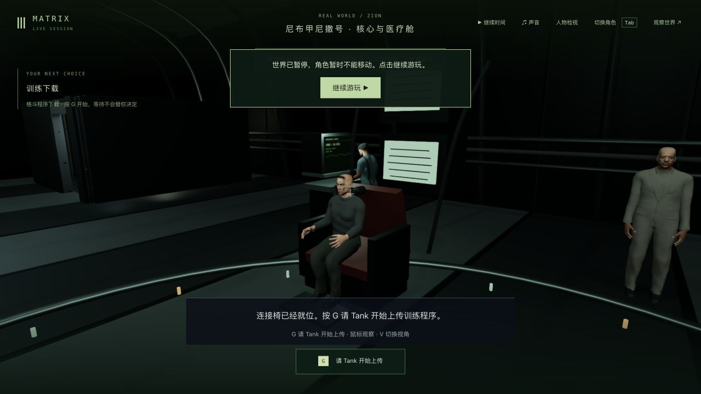

# Tank 独立人物与连接椅站位

2026-10-23，基线 `7dbdf8b347ab579a057797b6b1d6da5053336b0a`。本轮已同步 <http://localhost:5173/>，正式包 `index-Cc1Cn1oL.js`。这是人物和流程修正，**没有新增帧率成绩，42组电影质量完成数仍为0**。

## 实际修改与素材

Tank 改用独立46关节角色，保留现有动作接口；短卷发、蓝灰短袖、背带、露指手套与耳麦代替通用 Choi/灰色外套。检视器与实际世界共用该模型，第一人称隐藏头部附件，不添加墨镜。餐桌姿态只对 Tank 调整髋膝配对角度，保留靴底落地。

参考 [训练下载片段](https://clip.cafe/the-matrix-1999/were-supposed-start-with-these-operation-programs-first/) 中实际抽看的面部和服装。使用内置 imagegen 编辑模式，以两个片段截图生成正面/侧面参考；完整[生成提示](generation-prompt.txt)保留。交付纹理位于 `packages/client/public/assets/characters/tank-face-reference.png`，不是演员扫描或原片逐像素贴图。模型使用 MakeHuman CC0 基体、权重和衣物，固定源码版本 `a8bc2d54ff0ac92e78ff71431b1023eda42bf482`，见[源文件及哈希](source-preparation.json)和[最终模型记录](asset-v6/tank-build.json)。系统素材包来自 <https://files2.makehumancommunity.org/asset_packs/makehuman_system_assets/makehuman_system_assets_cc0.zip>；原片截图、原始下载包及制作缓存没有加入提交。

复现入口为 `scripts/build-tank-operator.py --source <已准备的CC0源目录> --output <新输出目录> --portrait <生成的1254×1254参考图>`，沿用项目现有 Python 制作依赖。人物面部仍是近似拟合；侧面轮廓、眼睛、耳部、颈口、布料与整体写实度没有达到电影质量。

头发改为局部三向采样，避免侧面横向拖伸。面部在身体UV接缝处保留每个三角形角点的独立UV，同时保留共享位置、法线和蒙皮；旧方案把最后一个角点的UV写给整个顶点，颈部三角形因此跨越皮肤图集。正面/侧面混合中过度依赖法线曾产生重复眉眼与嘴唇，最终撤回该分支并保留失败截图。

独立 GLB 为 **5,794,496 字节、125,086 三角形**，另有皮肤和面部纹理。相对于原 Choi 资产增加几何；这不是免费提升画质，也没有证明提帧。420簇卷发为烘焙几何，无逐帧头发物理或新增游戏运行依赖。后续仍需根据可见尺寸降低远景人物成本。

## 真实失败与测试

既有相关基线41/41；最早三项新模型测试在旧版0/3。V1相关44/45暴露餐桌坐姿间隙；V2的16/17暴露手套延伸到指骨后过度拉长，最终改回短露指边界。颈部UV回归先0/1、再1/1，最大单三角形UV跨度1.03085→0.03421。耳麦靠近实际耳面、手指独立权重、手套边界、餐碗接触及餐桌坐姿均覆盖有限姿态。已有完整手面/餐碗检查最深约0.00643游戏单位，不称零穿透。

实机还发现 Trinity 与 Tank 完全同点，造成衣物互相穿出；根因是前一拔接头剧情的站位未清理。新增两项先1失败1通过，修正后训练准备11/11：进入下载片段及恢复旧存档时，把工作区内无人控制且存活的 Trinity/Dozer 移到背景空位，不移动玩家控制、死亡或远处角色。

最终相关 **49/49**、部署 **75/75**，类型检查和三包生产构建通过。保持正式服务既有两份共享编译产物后，再跑相关49/49，避免把无关构建漂移混入发布。1194份源码/资源输入冻结；当前单元为4份修改、6份新增。生产构建仍有大包提示；不是全仓测试或整体帧率验收。

## 原生游玩与重启

从真实床边检查点正常选择 care、G 起身、WASD/鼠标穿门跟随 Tank，走到连接椅前 G 接入。途中实际碰到椅子边缘，绕到正前标记后成功交互，没有传送或修改剧情JSON。站位修正后原生画面显示两名船员分离。

连接就绪 `ready/tick8847` 真正重启后端。按正式服务的共享编译产物再次冷启动、原生冷加载并重新接管后，**完整世界响应逐字节一致、7份记忆哈希一致**；再通过G开始上传并进入道场，最终 `m1_dojo/step0/tick8928` 暂停、生命100。道场战斗未玩，人物检视器只检查了有限连招画面。没有新长视频。

第一次站位迁移重启检查器只排除了临时controller，没有排除按既有恢复逻辑清除的玩家idle动作，因此报失败；保存的前后快照确认其余差异仅为两名船员站位。该次记忆比较未在继续游玩前完成，不称记忆验收通过。最终就绪重启的完整比对独立完成。

QA生产页 warning/error 为0。主5173的人物检视实际加载新包、模型和材质，但出现 **4条“Texture marked for update but no image data found”警告、0 error**；来源尚未隔离，保留日志，不宣称主页面全程无警告。QA5200/5201已核对进程和端口后停止。

## 本机同步与后续

主服务 PID9294→43571，新增客户端包/模型，后端仅更新剧情JS及两份映射文件，其他277份后端文件、所有既有共享编译产物保留。发布与原生重载后，主世界完整响应、85份记忆、tick3757/暂停保持。原有11份实验中10份逐字节不变；FilmStorySystem 仅叠加本轮12行站位修正，原实验差异块完整保留，提交只包含该修正。旧客户端JS保留，Render没有接回。

人物自然度、手与全身任意姿态接触、船舱材料和镜头仍需逐段制作。正式检视的四条贴图警告待隔离。用户本轮反馈低帧率：已核实机器为M3/10核GPU/24GB；[既有同机固定视角对照](../awakening-frame-budget-2026-10-23/README.md)世界运行约31fps，非本轮新测量或连续战斗结论。后续应先定位光照/阴影/人物更新成本，再建立指定分辨率的60fps画质档位；当前没有建议增加存储或内存的证据。
