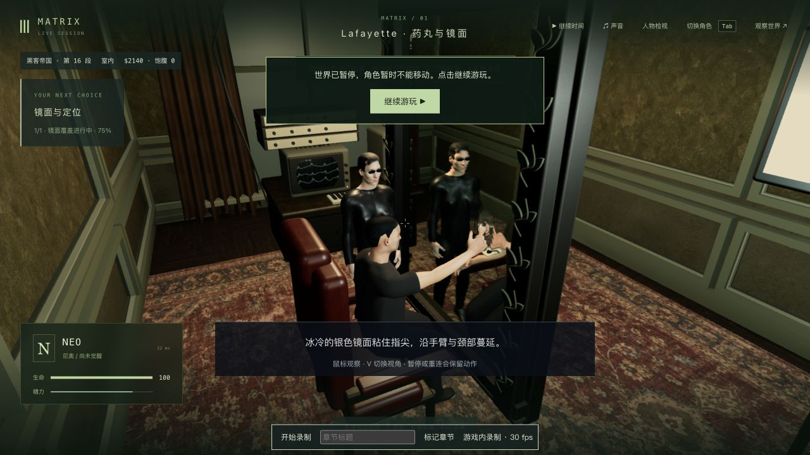

# 追踪室眼点与触镜手面 · 2026-10-22

固定试玩入口已更新为 <http://localhost:5173/>，侧栏实际读取 `index-BvGeBp9t.js`。本轮修正第一人称入椅相机的时序、近裁剪和未加载人物的备用视点，并修正 Neo 触镜时的实际手指皮肤。**这是局部操作与接触修复，42组电影质量验收仍为0；人物、材料、表演和帧率仍未达标。**

## 实际改动与失败

基线 `6ff0425c3b96d2ee7afeabd7f4e7b886e53491b8` 的1,149份包/测试/脚本已核对。704份包文件中只改五份客户端源码，其余699份、所有模型/贴图/音乐、依赖和后端保持；扩展一份原测试，新增两份测试文件。11份未完成脱衣实验保持原哈希，未进入构建或提交。[源码核对](source-audit.json)

原第一人称在人物当前帧动画前读取头部位置。现在在实际玩家渲染更新后重新读取已标定的 `head.userData.cameraEye`，保留鼠标观察及身体转向，触镜期间近裁剪为0.06。诊断中曾试用病床的外置眼点，它在脸前多出约0.0943单位，反而让入座镜头靠进镜框，已否决；这里本体在本地隐藏、在镜面显示，应使用本来的眼点。

完整相关回归首轮273/274，唯一失败为原有“未加载头部时按V仍沿身体朝向观察”检查。新方法在无头骨时提前返回，确实遗漏了异步加载阶段的备用镜头；恢复原来的随入座高度变化的备用眼点后，该项1/1、受影响的全部240/240通过。没有把加载中的占位人物排除出要求。

真实布景两条接近路线、横/窄屏、每0.22秒及三个坐姿样本共384个旧/新视图对照：旧版192帧出现230次近裁剪射线碰到实体布景，距当前解剖眼点最大0.688单位；新版192帧两项均为0。检查从489,490个可见不透明三角形中精确保留1,916个与射线区域相关的面；未修改场景几何。正式回归另直接查询完整 `FilmSetRenderer`。这是有限路线和视角，未覆盖任意鼠标角度、NPC遮挡或其他地图。[对照数据](lens-eye-final.json)

原来的触镜检查只验证指骨端点，完整手面没有自交也仍可能穿过玻璃；实际皮肤在3.1秒曾越过镜面约0.085单位。现在食指先探索，其余三指适度收拢，按实际食指末端皮肤校准手臂目标，再在收手观察时连续放松。沿用原拓扑、UV和手部曲线蒙皮，不改变演员脸或素材。首轮直接弯指产生18次自交；接入已有连续指面后解决；第一次手臂校准又暴露冷加载首帧逆绑定未刷新、之后环指比食指先碰镜，均由失败记录定位后修正。

最终每0.05秒补查触碰/收手，连同入座和覆银共58个有限时刻、116份完整手面，每只6,673点/12,472面，自交均为0；30个触镜区间样本的最小镜面间隙为正，接触时食指约0.007987单位，其余三指在后方。另检查原UV缝、法线/权重、关节限度、动作边界连续性、冷/热恢复、原手臂长度，以及真实 `AgentRenderer` 的两种玩家视角。实际人体皮肤也加入原有入椅家具/镜框接触检查。[密集补查](mirror-hand-scan.json)

参考[原镜面特效制作人员访谈及配图](https://beforesandafters.com/2019/03/29/making-the-magic-mirror-moment-in-the-matrix/)，用于核对探索、收手和银液观察的演出方向；未下载电影素材。电影中刻意的银色手指拉伸不能直接当作骨骼错误。本轮不是逐镜头还原，银丝仍跟随原指骨目标，并非液体模拟。[参考与限制](reference-scope.json)

## 验证范围

| 检查 | 结果 |
| --- | ---: |
| 修改前相关原检查 | 267/267 |
| 新版首轮完整相关 | 273/274；加载阶段备用镜头失败 |
| 备用眼点修正后定向复现 | 1/1 |
| 最终全部受影响镜头/旧楼/药丸/触镜 | 240/240 |
| 新增完整手面/接触/连续性/恢复 | 4/4，包含于首轮通过项 |
| 最终真实玩家渲染/眼点/近裁剪 | 3/3，包含于最终240项 |
| 部署、存档与网络 | 75/75 |
| 类型与三包生产构建 | 退出0 |

首轮其余34项手部/镜面检查不导入本次最后改动的 `PlayerControls`，没有重复整批运行。没有跑全库。密集手面是额外有限采样，不能当作任意动作的数学证明。完整命令、真实失败和数量见[验证记录](validation.json)；日志以同名 `.gz` 无损入库。早期 `hand-first-failure` / `skin-entry-first-failure` 文件名虽如此，对应检查实际通过，未将它们当作失败证据。构建仍有既有大JS分块提示。

## 正常操作、保存与冷加载

两遍均从上轮实际游玩保存的 `m1_mirror/tick5885` 独立验收检查点开始，未编辑剧情、位置或动作秒数。旧运行目录已推进到tick6005，七份记忆不再匹配原tick5885哈希，因此没有将未来记忆混入；本次只复用历史世界文件，并关闭LLM。[起点范围](native-seed.json)

首遍原生V第一人称、G入椅，连续完成触镜/收手/覆银并进入培养舱；没有截住中途暂停，停于 `m1_pod/step0/tick5972`。第二遍明确重置为同一独立历史检查点，用正常暂停按钮分别停在10.606秒和13.205秒；后者对应触镜演出3.675秒，原生V检查第三人称手指和镜中倒影。两遍是独立重放，不能拼作一条连续P0游玩。

在第二遍13.205秒/tick5911真正关闭并重启验收后端，PID59669→64310，五组公开状态、Neo六项关键字段及本轮四份角色记忆保持。随后刷新网页，重新接入Neo，当前触镜姿态直接恢复；V第一人称与鼠标拖动可继续观察。正常继续后完成收手/覆银，最后暂停于 `m1_pod/step0/tick5925`，生命100、已觉醒。[重启核对](restart-verification.json)与[实机范围](native-verification.json)

第二遍重启前、冷加载并继续后的页面控制台warning/error均为空；首遍未单独采集控制台。初次准备页面曾导航超时，接回已有标签后加载完成，没有因此重建存档。两项临时验收服务现已停止。

原始三份WebM与元数据均留在本项目本目录的 `native-recording/`，时长64.036、119.326、68.791秒，含暂停、导航和检查等待，仅原始视频不入库。录制平均渲染14.41–16.52fps，P95帧间隔187–261ms，含录制开销和静止等待，没有同条件性能对照；不能当作流畅性验收。两段入库连续节选保持原捕获时间和间隔，没有插帧或加速：

- [第一人称入椅到培养舱，24秒](native-recording/first-person-entry.mp4)：原首遍18–42秒，约1.94MB，180个捕获帧。
- [冷加载后继续覆银，16秒](native-recording/cold-resume.mp4)：原冷加载录制28–44秒，约0.76MB，139个捕获帧。

节选捕获平均分别7.5和8.69帧/秒，同样不是未录制的渲染基准；动作阶段的卡顿依然明显。[原视频元数据](native-recording/recordings.json)与[节选探测](native-recording/excerpt-probes.json)

## 固定入口与未完成项

侧栏实际加载 `index-BvGeBp9t.js`，3,737,826字节，完整构建摘要见[本机发布核对](local-update-verification.json)。只新增JS并原子替换入口，旧JS保留；704份运行文件与候选逐个字节相同。发布脚本首轮从临时目录查询Git包清单，得到空列表，初次报告如实为0；发现后指定仓库根目录并强制检查704项，再完整补查通过，保留[初次结果](local-update-first-check.json)，没有把空清单作为有效证据。

280份后端文件、PID82106及更新/原生打开前后的完整主世界响应保持，tick3757/暂停和Neo进度未改；11份脱衣实验保持。新版入口无warning/error，保持未接管的暂停起点。[原生加载](local-native-observation.json)

Render继续永久撤下，Supabase保留。人物相似度、服装/材料、第一人称本地前景手臂、银液与镜头表演、任意角度的全身接触、视角偏好保存、低帧率，以及蓝分支/失败重试和完整P0/三部曲实机验收仍未完成；本轮不提高42组电影质量完成数。
