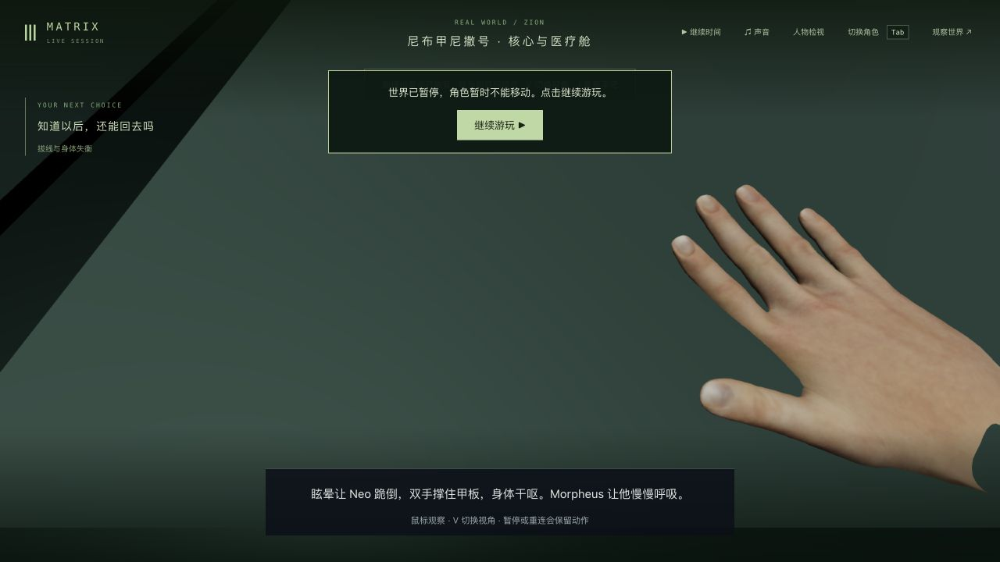
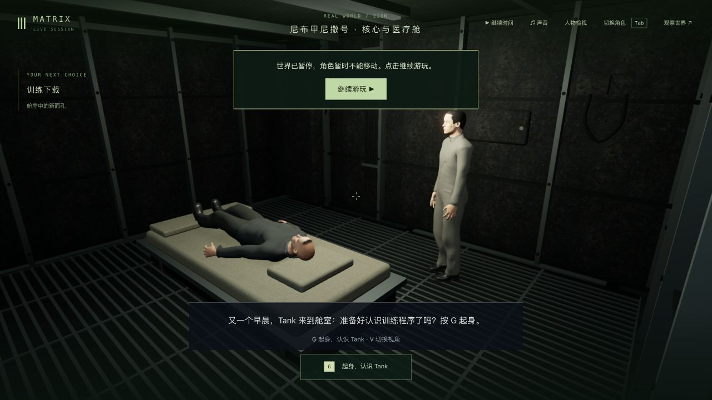

# Neo 退出构造体后的撑地与袖口

2026-10-23，基线 `0a3f252f114560b80e8358ce46589981aa53f8da`。修正 `m1_truth_return` 的撤接头、下跪撑地过程中实际掌面和针织袖口接触，已同步 <http://localhost:5173/>，正式构建 `index-DvGgbrfa.js`。**本轮不是全场景电影质量验收，也没有达到稳定60帧的结论；42组高质量完成仍为0。**

## 采用的修改

只改 `TruthPerformance.ts`、`ForearmTwist.ts`，新增 `truth-ground-contact.test.mts` 及其夹具。没有新素材、依赖、服务端或剧情状态修改。

Neo 沿原身体演出下跪，以交付模型的实际掌心皮肤中心求腕部位置，掌面朝下、指尖朝前；肘部平面连续过渡，腕部弯曲限制为60°。展开手指的目标由真实绑定轴和末节皮肤求出并缓存，拇指另作外展；没有逐帧改写手部顶点。保留原鞋底接地计算，只在站姿与跪姿交界补上实际鞋底修正，删除候选中重复的逐帧鞋底扫描。

仅 `neo-logos-sweater` 的腕口在已有几何准备阶段收回至前臂，并把原来错误跟随手指的袖口权重归到前臂扭转骨。原闭合边、索引、UV和拓扑保留，法线只在准备阶段重算；没有删除穿模衣面或放宽检查门槛。

## 原片观察与限度

实际观察 [What is The Matrix? / Open Matte](https://www.youtube.com/watch?v=O5b0ZxUWNf0) 的七个解码时刻，约268.13–295.13秒。上传者是 **Flashback FM，非片方官方账号**。可确认黑衣白场、回船后灰色针织上衣、挣开并下沉、暗金属与管线、眩晕视图等顺序；这些画面不能确认精确指尖位置，也不能确认由哪位船员拔出接头。原片画面没有作为游戏素材导入，没有观看或下载完整三部曲。

本轮保留已观察到的身体顺序，修正游戏中的支撑接触；撑地手指位置仍是游戏演绎，不能称逐镜复刻。逐时刻记录见 `film-reference-observations.json`。

## 先失败再修正

最终六项回归在基线为 **1通过、5失败**，候选最终 **6/6**：

| 检查 | 基线 | 最终 |
| --- | ---: | ---: |
| 14秒中每10ms采样的最大腕弯曲 | 132.036° | 60.000° |
| 相邻10ms最大肘/腕位移，世界单位 | 0.157040 | 0.023290 |
| 完成支撑后的实际掌心离地 | 0.163595，掌面近竖直 | 0.037845，掌面向下 |
| 单独转动手指导致的最大袖口位移 | 0.090079 | 0 |

最后完整手面最低点约0.001919世界单位，高于甲板。测试采用原地板容差0.003，掌心中心离地允许0–0.04；掌面中心并非整只手的最低点。完整双手在10个有限姿态与所有可见蒙皮身体、服装及另一只手检查相交；六个有限跪姿检查全部可见身体/服装最低点；四个支撑时刻检查掌面、完整手指和手面自交。另有841帧按60Hz正常输入推进，并在八个时刻与冷加载/第一人称的37个关节比较。这些是有限采样，不能证明任意时刻全身无穿模。

中间真实失败没有丢弃：第一次掌向修正使手指穿地约0.144；五指全平的候选产生拇指虎口自交；袖口重新绑定后仍过长，继续与手面和地板相交。最后保留拇指外展、收回原袖口，六项才全部通过。准备脚本的相对路径错误、探针和各轮日志保留在实验归档。

最终相关八个测试文件 **450/461**，11项失败的名称、错误正文和错误码与基线相同，没有新增失败，但不能称相关测试全过。旧失败涉及镜面前臂、漂浮救援、枕头接触、旧核心插头检查、公寓电话、Neo/Morpheus网格预算、船损换装恢复，以及猫/伏击/整条路线三项服务端检查。部署回归 **75/75**、三包类型检查及生产构建通过；1,185份冻结输入保持，280份服务端产物保持，共享编译产物没有变化。详见 `validation.json` 和压缩原日志。

## 实机、读档与继续剧情

起点来自上一轮真实 `m1_truth_exit/step0/ready/tick7652` 检查点，没有手工改世界字段。第一次正常操作已到床边问题，错过预定跪姿暂停；完整分支仅保留本机后，明确从同一真实起点重放。此次重放是为了取得动作中途存档，不是因观察超时而重启。

第二次通过原生继续/G及受剧情锁定的输入，在 `unplug/11.815秒/tick7689` 暂停，检查第三人称、V切换第一人称和鼠标观察。真正重启隔离后端 `21212→25456` 后，完整API响应逐字节相同，七份记忆保持。生产页面冷加载新构建后再次检查双视角、鼠标、完整剧情对象及Neo实际六字段（位置、朝向、生命、地点、矩阵/觉醒状态）。初次记录误比较不存在的 `orientation` 键，已经改为真实 `rotation` 并断言所有字段存在；错误元数据保留，未重复重放掩盖问题。

随后正常继续至床边谈话，选择“预言不替我决定，我会亲自验证”，保存 `agency` 回应，进入 `m1_download/step0/tick7799` 后暂停，生命100。开发与生产控制台均无警告/错误。W在本轮演出中受锁定，不能把按住W算成实际步行。没有HTTP写入剧情、引擎注入或新录像。隔离5200/5201均核实停止。

## 性能与本地发布

离线同一Neo在11.815秒固定姿态，完整人物动画及根矩阵计算，预热后A/B/B/A各240次：原版中位0.371292/0.339792ms，新版0.365125/0.347167ms，整体接近。测量不含浏览器、GPU、渲染、世界模拟或录制，不能换算成游戏FPS，也不能推导最低内存。

已有[飞船实际帧率记录](../awakening-frame-budget-2026-10-23/README.md)在M3、24GB内存、1280×720、DPR1.5条件下，正常时间流逝固定视点约31fps；[渲染瓶颈记录](../frame-bottleneck-2026-10-23/performance-audit.json)中的消融对照说明绘制路径值得优先优化，未唯一证明GPU饱和。稳定60fps仍须按固定分辨率/画质，测量真实走跑、转向、多人战斗的帧时间及慢帧，不能靠单人物离线耗时或一次峰值验收。

发布仅同步两份客户端源码、两份测试和新JS/入口，711份运行包文件匹配候选。全部共享运行产物（含此前 `awakening.js/.map` 差异）、280份后端、主PID9294、完整主世界及85份记忆、tick3757/暂停和原11份实验保持，正式服务未重启，旧JS/CSS保留。原生5173页面已读取新构建且无警告/错误。组合刷新/观察调用超时后，重新读取同一标签页确认新包已经加载，没有因此重启页面或服务。`local-update-verification.json` 保存核对结果。

本机原始世界、记忆、数据库、隔离源码、node_modules和构建副本不入库。Render继续撤除。船员脸型、衣料和飞船仍粗糙；Morpheus针织上衣实际可见，却读成紧贴皮肤的肌肉躯干，属于形体/材料问题，不能写成衣服缺失。本轮没有完成其他船员的拔接头手势、Morpheus电池握持、床边全部接触或整场电影演出，继续列为未完成。
