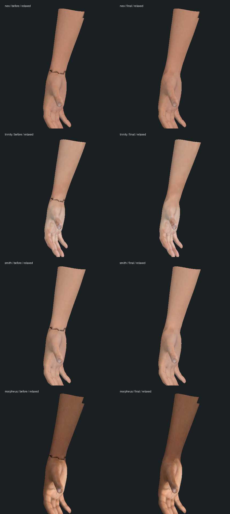
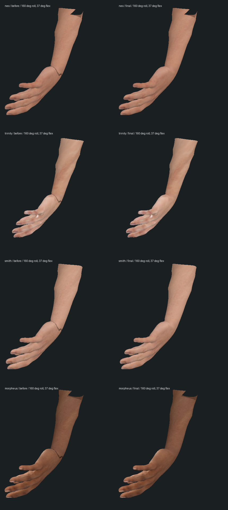

# 腕部黑色折线修复 — 2026-10-14

起始提交：`9a7727b`。本轮继续检查四名主要人物的腕部，确认上一轮离线画面中的锯齿黑线来自新贴图混入原烘焙图的空白区域。它在中立姿势也存在；去掉贴图后，有限采样姿势的表面连续。手部与补件的 96 条实际开口边均相接，不能把这条黑线当作已证明的骨骼折叠。

原来的接缝顶点检查没有覆盖三角面内部。新增行为回归直接解码运行 PNG，在双腕接缝附近的三角面、边和 UV 接缝采样 448,740 次；先在原资产上得到 0/4，再修复。

| 人物 | 采样数 | 原最小相对反射亮度 | 修复后 |
| --- | ---: | ---: | ---: |
| Neo | 109,836 | 0.001880 | 0.753518 |
| Trinity | 121,500 | 0.001592 | 0.662225 |
| Smith | 113,238 | 0.001894 | 0.859297 |
| Morpheus | 104,166 | 0.002084 | 0.651413 |

这里比较的是线性颜色亮度与各人物原手部开口的中位肤色，不是灯光、相似度、FPS 或所有姿势的质量评分。测试同时覆盖三角形内部，避免只靠共用顶点的正确颜色掩盖黑色带。

`scripts/build-wrist-skin.py` 按原手部三角面建立已绘制的 UV 区域；在该区域外，沿实际连续开口边延伸肤色，再过渡到同版 CC0 完整人体皮肤。袖内不连接手口的独立 UV 小片使用完整人体皮肤。首次制作断言误以为每个 UV 小片都连接手口，失败记录保留于 `authoring.log`；最终输出为 `authoring-final.log`。GLB 元数据升级为 `wristSkinVersion: 2`。

四份 GLB 的**整个二进制块**与起始资产相同，整个 JSON 文档只有版本数字变化；几何、法线、UV、权重、骨骼、材质及握持目标均保持。原脸部/手部纹理保持。四份新腕图尺寸相同，文件合计减少 20,810 字节；没有新增运行依赖或渲染表面。详见 `asset-preservation.json`。

下面是实际运行网格、蒙皮姿势、法线和颜色贴图的离线栅格对照，左原版、右修复；未使用游戏 PBR、法线图、阴影或浏览器，**不算原生实机截图**。对照脚本为两列分别读取对应版本的腕部 PNG，避免把新版贴图也用于原版一列。




验证范围：

- 起始版现有腕部/转掌 12/12、握拳/电话/枪/勺/饼干/触镜/取药喝水/同化接触 61/61；新增贴图回归 0/4（`reproduced.log`）。
- 临时读入制作目录的新资产，腕部/转掌 16/16；正式接入后上述全部相关回归 **77/77**（`final-tests.log`）。含双手开口、换装/冷重建、后置接触更新和 820 处 Trinity 袖内皮肤检查。没有跑全库，也没有宣称旧预算/救援道具问题已修复。
- 三包类型检查及生产构建通过；原有客户端大包警告保留（`typecheck.log`、`build.log`）。
- 隔离开发服务返回的四份 GLB 和四份腕图均为 200，响应字节与正式资源相同（`asset-http.json`）。
- 隔离旧同化存档真正停止/重启服务后，八组公开快照与 15 份记忆保持（`restart-result.json`）；没有改正式存档，也没有新增剧情完成项。
- 217 个保护文件中 208 个未改，仅四份目标 GLB、四份腕图和资产说明有意更新（`protected-result.json`）。
- 同一 Codex 侧边栏浏览器的隔离页面导航在约 20 秒后超时，随后 tab 27 的清单确认是“无法访问此站点”的网络错误页。未继续读取或操作该错误文档，无新原生截图、录像或性能样本（`native-attempt.json`）。

重跑正式回归：

```sh
node --import tsx --test tests/wrist-skin.test.mts tests/forearm-twist.test.mts tests/hand-pose.test.mts tests/oracle-absorption-contact.test.mts tests/office-phone-grip.test.mts tests/pistol-grip.test.mts tests/spoon-grip.test.mts tests/cookie-grip.test.mts tests/mirror-contact.test.mts tests/pill-view.test.mts
npm run typecheck
npm run build
```

制作仍使用上一轮同版 CC0 源缓存 `output/characters/wrist-skin-2026-10-14/source` 和未加补件的 `original/*.glb`，每名角色写入新的制作目录，再一起接入 GLB/对应 PNG。原文件可从 `c0c9c6f` 对应资产恢复；本轮对照原腕图可从 `9a7727b` 恢复。大体积源缓存、运行存档、原/最终几何导出 JSON 和重复 GLB 留在本地忽略目录，提交本轮脚本、小型证据、对照图与实际运行资源。

还原电影人物、完整动作范围中的自然形变/布料、所有剧情的全身/道具接触、声音和稳定实机性能仍未完成。这里仅修复已复现的人工黑色带，未验收任意转角或大幅动作。连续 Neo 副本仍停在 `m1_sentinels` 入口，三部曲完整人工游玩及 42 组高质量场景验收继续保留。
