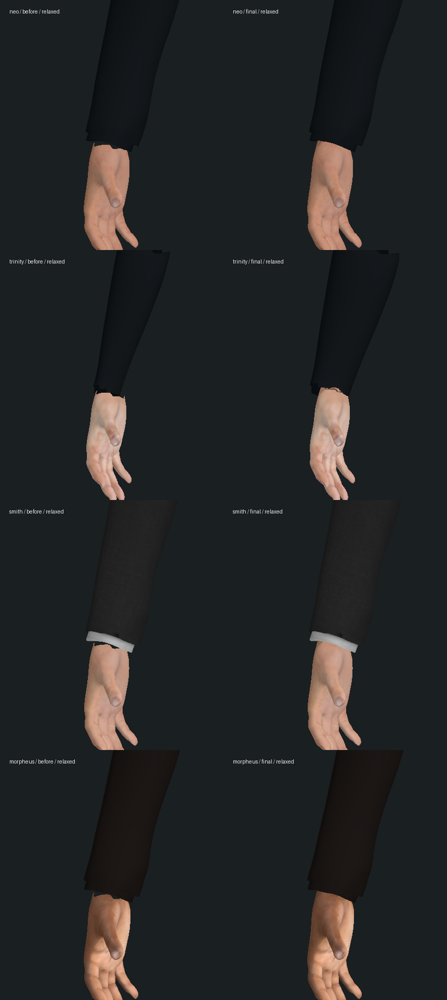
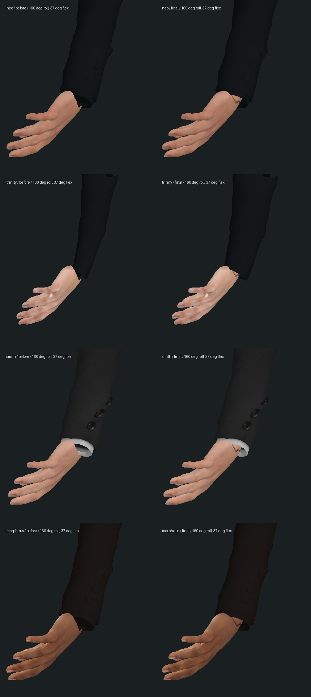

# 四名主要人物：袖内皮肤与腕部连接

2026-10-14，起始提交 `c0c9c6f55c19b5801f1c172f75111ef6ae3d8283`。本轮补 Neo、Trinity、Smith、Morpheus 常服中缺失的腕部皮肤，没有新增剧情完成项。连续 Neo 副本仍在 `m1_sentinels` 第 0 步 ready / tick 9134；42 组与三部曲保持未完成。

## 原因与实际改动

四个完成模型的手部被裁在腕骨下方，原先靠袖口遮住；转掌、弯腕后会露出空洞。Neo 的家居/病人身体与 Trinity 的夜店身体已有相接的完整前臂，普通衣物下没有这段皮肤。

新增 `scripts/build-wrist-skin.py`，使用每名角色自己的同版 CC0 MakeHuman 人体、形变和原始权重补回腕部；按原来的先细分、后摆姿顺序制作，让每只手的 48 点开口与新表面相接。含 UV 重复点，每角色有 98 个共用顶点；位置、权重和法线接住原手。沿用已提交的 `ForearmTwist`，没有改指骨、握持目标或面部。小贴图来自同一 CC0 皮肤，在接缝处保留原手部烘焙像素，内部按线性颜色匹配并分岛打包。有限顶点采样的最大法线差约 1.05e-6，最大线性 RGB 差约 2.28e-6，见 `asset-preservation-final.json`；这不是整幅材质或实机光照验收。

第一次人体筛选遗漏了靠近手腕的少量指骨影响，作者脚本的开口断言发现只连接一半边界；纳入同一手部骨骼族后重建。实际带贴图几何又发现 Trinity 的原紧身袖子比前臂窄，新增碰撞回归先失败，最大穿出约 0.01866 世界单位。最终只扩出其下段袖子，最大 0.025 世界单位，改动 2424 个位置顶点及相邻法线，保留衣身其余位置/法线、UV、权重和拓扑。最后 820 个两侧/转掌采样通过；不代表任意动作无穿模。

四个原 GLB 的完整二进制前缀、面部/手部、46 根原始骨骼、旧材质和旧贴图保持。除了 Trinity 袖子改指向新增 POSITION/NORMAL 数据，其余旧网格定义也保持。新补件使用一个独立皮肤材质；Neo 家居/患者与 Trinity 夜店身体可见时隐藏，换回普通衣物时恢复，复用 Trinity 身体的 Niobe 也接住原肤色调整。所有原始人体资源仍用项目既有的 CC0 授权，不增加运行依赖。

| 角色 | 补件三角形 | GLB 增量 | 新贴图大小 | 贴图分辨率 |
| --- | ---: | ---: | ---: | --- |
| Neo | 2992 | 135372 B | 111118 B | 723 × 210 |
| Trinity | 3184 | 352588 B | 148546 B | 752 × 227 |
| Smith | 3024 | 136512 B | 111431 B | 723 × 219 |
| Morpheus | 2980 | 134376 B | 106771 B | 723 × 210 |

合计增加 **1,236,714 字节**，每个可见补件增加一个蒙皮表面。Trinity 增量包含保留下来的旧袖子数据和新的替换数据。最终可重复的制作输出见 `authoring-shipped.log`；在没有 `wristSkinVersion` 的原 GLB 上运行，不能将补件重复应用。

## 离线真实模型检查

以下是实际蒙皮几何、实际法线和原贴图的离线正交图，**不是游戏截图**，不包含游戏灯光、PBR 高光、阴影、法线贴图或帧率。上方人为截取前臂；左为本轮原 GLB，右为最终资产，两者均保留上一轮前臂旋转修复。




`inspect.mts before` 从本地 `original/` 读取四份起始 GLB，`final` 读正式资产；其余换装模型读当前资源。`render.py` 只栅格化这些实际表面。要在另一检出中复跑对比，需从上述起始提交取出四份 GLB 放入 `original/`。原始导出 JSON、中间候选和首次穿袖对照保留本地，未作为运行资源提交。

大幅弯腕时仍有不自然的折线/褶皱，Trinity 的袖口轮廓也仍需细化。这轮没有提高演员相似度、制作自然布料或证明所有接触无穿模。

## 验证及失败

- 原有前臂/握拳/同化接触基线 **22/22**，见 `baseline-current.log`。
- 新增开口与换装检查在原资产先 **0/5**，见 `red.log`；第一次装配后 **5/5**。随后 Trinity 袖内检查先失败，见 `red-sleeve.log`，修正袖子后 **6/6**。最终更严格的接缝法线检查也通过。
- 最终较广相关 **179/183**，包括六项新检查：四人双手 5 个转掌角 × 3 个弯腕角、同一几何接缝/法线、Neo/Trinity 换装与新模型恢复、Trinity 袖内 820 个采样，以及既有手持道具、同化、镜面、医疗舱、Logos、告别和决战等回归。见 `regression-final.log`。未跑全库。
- 四项失败是既有救援垫对象缺失、枕头对象缺失、Neo 与 Morpheus 的原 GLB 面数预算；`original-assets.mjs` 仅在独立测试进程将四个 GLB 读取重定向到起始文件，四项均以同类错误重新失败，见 `original-failures.log`。没有放宽或删除断言，正式文件未被基线过程覆盖。增加皮肤会继续增加面数，这不是预算问题已解决。
- `npm run typecheck`、`npm run build` 三包通过；客户端保留既有大包警告，见最终日志。八个新 GLB/贴图入口 HTTP 200，见 `asset-http.json`。

最终回归命令：

```sh
node --import tsx --test tests/wrist-skin.test.mts tests/forearm-twist.test.mts tests/character-asset.test.mts tests/character-detail.test.mts tests/hand-pose.test.mts tests/oracle-absorption-contact.test.mts tests/office-phone-grip.test.mts tests/pistol-grip.test.mts tests/spoon-grip.test.mts tests/cookie-grip.test.mts tests/mobil-refusal-model.test.mts tests/smith-ending.test.mts tests/mirror-contact.test.mts tests/smith-crater.test.mts tests/logos-bane-model.test.mts tests/farewell-renderer.test.mts tests/hammer-medical-model.test.mts tests/pill-glass.test.mts
```

提交日志只清理行末空白，原始版本保留为本地 `.raw.log`。`green-fitted.log` 是最后一版元数据和袖子局部法线保护前的专项结果；最终六项均在 `regression-final.log` 中重新通过。早期 178/182 不当作最终版本结论。

## 保存、运行开销与实机边界

从原同化 `coating-final-state` 完整复制隔离存档，用 3191/5391 端口检查，保持暂停 tick 7883。服务端真正退出再启动后，八组 API 快照与 15 份记忆一致，见 `restart-result.json`。原生浏览器导航 20 秒超时，同一标签之后成为网络错误页，对该错误页的读取又被浏览器 URL 策略拒绝；未绕过，也未取得新的实机截图、原生冷读或剧情进度，见 `native-attempt.json`。本轮自建服务已经停止。

213 个保护文件中仅四份目标 GLB 与人物资产说明有意改变，另外 208 个（包括主世界存档和原参考存档）不变，见 `protected-result.json`。

`bench.mts` 对同一 Smith/先知模型计算预热 40 次，再采样 300 次；原版用 `original-assets.mjs`，两者均保留原前臂旋转修复。冻结/变化姿势的 CPU 中位数分别为 **0.943 → 0.955 ms**、**0.788 → 0.802 ms**；p95 分别为 1.337 → 1.151 ms、1.068 → 0.982 ms。一次顺序测量存在波动，不据此声称性能提升；这是 Node 模型与接触计算，**不包含完整场景、GPU、加载或浏览器 FPS**。

仍未完成：演员相似度与其他人体缺口、自然手腕/袖口/衣物变形、全部动作与家具/道具接触、真实浏览器双视角和稳定帧率、声音及三部曲连续人工验收。
