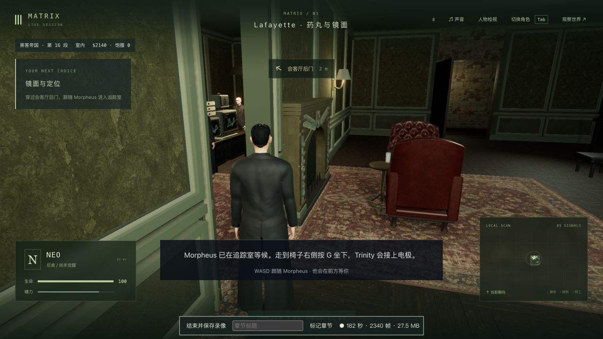
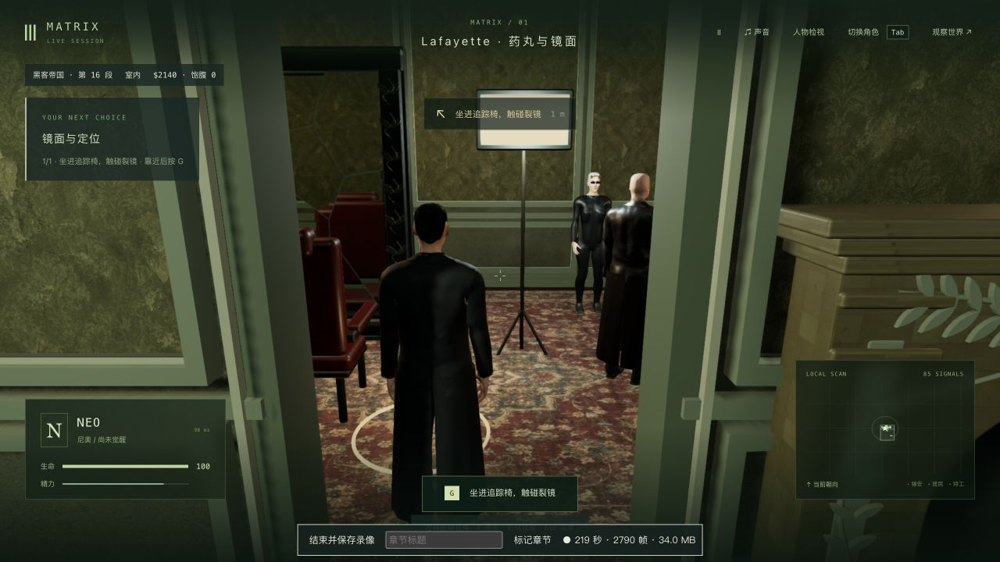

# 旧楼滑墙与近墙镜头 · 2026-10-22

已更新固定入口 <http://localhost:5173/>。普通行走按玩家请求的方向转身，墙壁消掉某个速度分量时不再带偏第一、第三人称视角；旧楼采用较近的室内跟随机位，狭窄处抬高、内缩镜头并检查平滑移动的中途位置。**这是镜头与操作修复，人物、场景和42组电影质量验收仍未完成，完成数仍为0。**

## 改动与真实失败

基线 `2e6590bc56c81a0b31a5322a93752327d25ef529` 的1,149份包/测试/脚本逐个核对Git对象。704份包文件仅改 `PlayerControls.ts`，其余703份、全部模型/纹理/音乐、依赖和后端保持；另扩展现有 `camera.test.mts` 六项。11份未完成脱衣实验保持原哈希，未进入构建或提交。[源码范围](source-audit.json)

原版用碰撞后的位移计算朝向，沿追踪室隔墙斜向走时会转向滑动切线。真实共享碰撞下，第一/第三人称各30/60fps的四项回归先全部失败。现复用已锁定的输入方向，松键减速时保留朝向；鼠标观察、键盘换向、V切换、攻击、载具和专用剧情仍经过原有分支。原方向跟随、角度边界、鼠标优先和V测试也包含在最终回归中。

近墙原版强制镜头至少离人物两单位，实际隔墙可能位于这段距离内。最初直接用`playerBlocked(camera.position)`检查高机位，但该接口按脚点检查地面支撑，不能作为镜头高度的几何真值；改用真实布景后，原版仍出现隔墙挡住镜头的失败。现允许缩到更近的位置，旧楼高机位的支撑查询限制在人物附近，并在压缩时抬高机位，留下前方路线。专用药丸对白/触镜机位没有改动。

补测门洞转向时，第一版把头部到所有近裁剪角之间的整个区域都要求无物体，会将远处灯架进入画角也算作穿镜头。这一断言纠正为头部到镜心的可见性、以及镜心到四个近裁剪角的实际体积检查。纠正后的中间候选仍在镜框附近的近裁剪面、窄屏下的灯架遮挡处失败。随后补上平滑移动后的内缩检查、近距离裁剪面，并将旧楼普通室内跟随设为六单位。宽/窄屏、门洞两侧各60个转向帧、每帧五条检查最终通过。它是有限路径检查，不能证明任意位置、前景物体和全部地图都没有遮挡。

原始失败、诊断和TAP以同名 `.log.gz` 无损保留；未压缩原件也留在本机。构建仍提示大JS分块，没有新增依赖。

| 检查 | 结果 |
| --- | ---: |
| 修改前原镜头/旧楼 | 202/202 |
| 新增滑墙首次 | 0/4，确认失败 |
| 真实布景近墙首次 | 0/1，确认失败 |
| 最终新增回归 | 6/6 |
| 原镜头、旧楼、药丸视角、触镜 | 237/237 |
| 部署、存档与网络 | 75/75 |
| 类型与三包生产构建 | 退出0 |

没有跑全库。完整命令及数量见[验证记录](validation.json)。

## 普通操作、录像与重启

在独立历史P0检查点，用原生界面完成哲学对白和自主决定的选择。录制从红药选择开始，覆盖接药/吞药/喝水、起身，第三人称持W接近并沿隔墙滑动、V第一人称继续滑墙、鼠标转向、切回第三人称、穿过实际门洞、暂停和真正重启验收后端；重连后继续W移动/V切换、按G入椅和触镜，最终暂停于 `m1_pod / step0 / tick6005`，Neo生命100、已觉醒。没有注入剧情阶段或改正式试玩存档。[实机范围](native-verification.json)

两个滑墙公开快照的朝向都为 `-2.438385444841507`；位置从 `(4727.211,85,4407.078)` 变为 `(4723.383,85,4406.244)`，实际发生了沿墙移动。渲染视角及松键/重新W由前述回归进一步检查。实机截图显示近墙时仍可看到门洞和人物，没有用自动化断言代替画面观察。

追踪室真正重启前后，tick5885/暂停、五组公开世界/剧情状态、六项Neo字段和七份记忆文件保持；页面原生重连后可继续走动和触镜。[重启核对](restart-verification.json) 本次重启前后使用第三人称，未修复或重新验收第一人称偏好的持久化。

完整原录像 `native-recording/neo-2026-10-22T07-06-32-228Z.webm` 为394.251秒、58,749,347字节，只留在本地。保留音频和5,171个捕获帧；录制期间5,733个渲染帧、14.54fps、P95帧间隔169.6ms，包含录制开销和导航/检查等待。没有同条件性能对照，卡顿仍未解决。入库的[100秒连续片段](native-recording/wall-and-doorway.mp4)取原145–245秒，5,439,257字节，保持原时间及捕获间隔，展示第一人称沿墙、鼠标转向、第三人称近墙及穿门。完整录制路径与帧/音轨信息保留在对应JSON及[转码检查](native-recording/excerpt-probe.json)。

原生控制台warning/error均为空。录像前的开发热更新会重载页面，发生一次旧对白按钮定位超时及输入后的延迟显示，随后通过正常界面重新接入同一检查点；没有把这些尝试描述为流畅体验。两项临时验收服务均已停止。

## 固定试玩与剩余项

固定入口实际加载 `index-CBViBJOR.js`，3,736,014字节，SHA256 `df19fe68892ced0adf763f64c913691a3cdc9ae158fde8e6c9ba699c52815e1b`；原JS保留，仅新增JS并原子替换入口。704份包文件与候选一致，280份后端文件、PID82106及更新/原生加载前后完整世界响应均保持；tick3757/暂停和原Neo进度不变。原生侧栏入口无warning/error，没有接管主存档。[发布核对](local-update-verification.json)

Render继续永久撤下，Supabase未删除。人物相似度、衣物/手部和材料、第一人称入椅掠过几何、低帧率、视角偏好保存，以及蓝分支/失败恢复和完整P0/三部曲实机验收继续未完成。接下来应处理入椅镜头与真实人物接触，继续逐段验收；不能凭本次镜头回归提高42组完成数。
