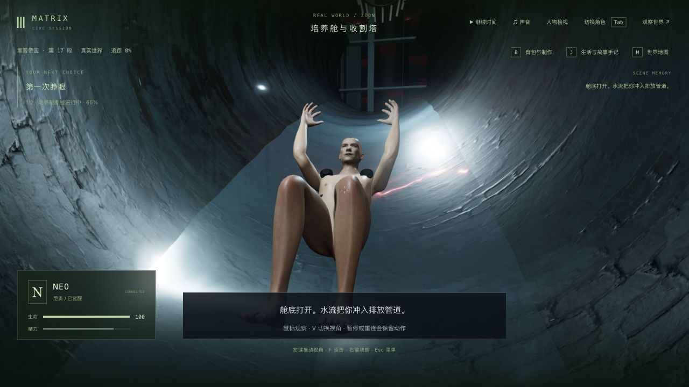
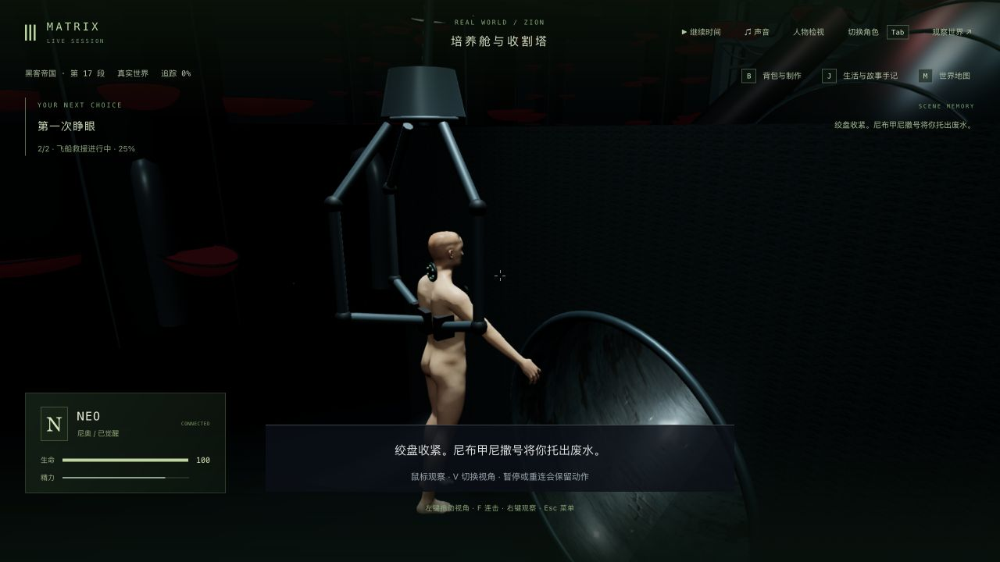
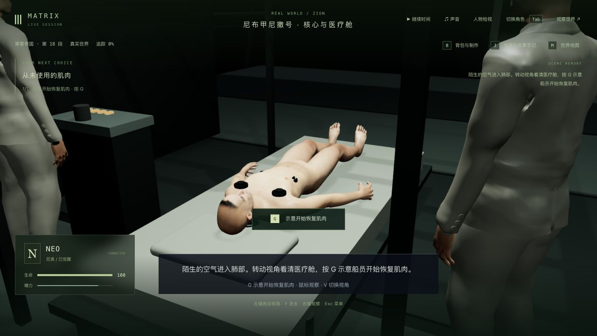

# 觉醒片段的启动恢复与旧圆管存档验证

2026-10-12。当前仍是三部曲主线框架接通后的逐段制作与验收，42 组、125 节点、365 步骤、70 场景定义均不代表高质量完成数。本轮只修复服务启动恢复，并验证上一轮圆管的真实旧存档迁移；没有重做人物或场景。

## 修改与回归

- 启动仍清除旧页面控制权及临时移动/攻击。觉醒系统根据保存的演出时钟以 `dt = 0` 重建身体和参与者姿态，不接管玩家、不推进时间、不提前完成任务。
- 只恢复仍锁定在演出的阶段；已结束的舱室起身动作不能在暂停读档时自动完成走到核心区的下一步。这个边界[先失败](cabin-walk-before.log)，收紧条件后通过。
- 对没有车流状态的旧存档/新世界，在发布首个状态前初始化静态车辆与碰撞。已有车流仍沿用原恢复顺序。此前两项暂停重试失败发生在首个状态与即时存盘之间，不是重启丢车。
- 修改前启动测试 **13/15**，已有两项失败见[摘要](baseline-startup.log)；新增的 11 个姿态用例先失败，父测试计入后 **0/12**，见[复现](awakening-before.log)。首轮修复另暴露测试对象 `undefined` 属性与 JSON 省略属性的区别，修正测试构造后不影响生产逻辑。
- 最终[启动回归](startup-final.log) **28/28**，覆盖入口、挣脱/拔管及边界、滑落/浮水、救援、触镜、医疗等待和舱室；保留生命与既有死亡，拒绝恢复旧攻击。相关[剧情回归](story-final.log) **14/14**（含旧五秒救援兼容），[三包类型](typecheck.log)与[三包构建](build.log)通过；最后收紧恢复边界后另补[服务端构建](final-server-build.log)通过。客户端已有的大包告警保留；没有运行最终全库，也未新增依赖。提交日志只去除行尾空白；完整原始日志保留本地。

## 完整真实存档与原生操作

使用独立完整副本和本轮专用端口 3162 / 5362。比较没有过滤字段；六组是人物、区块、地点、事件、沙盒、模拟状态，另核对时间和记忆字节。副本、完整公开状态和记忆哈希保留本地，未改正式试玩档。

| 检查 | 真实状态 | 严格比较与范围 |
| --- | --- | --- |
| 当前圆管冷启动 | 上一轮 `verified-cold-reviewed-state`，tick 5618，滑落 5.861 秒 | 初次立即/原生检查均 6/6；最后收紧恢复边界后再次冷启动[6/6](pipe-final-comparison.json)，原生接入/V 双视角/释放后[仍 6/6](pipe-final-reviewed-comparison.json)，时间和 7 份记忆保持 |
| 旧露天槽存档迁移 | 身体制作轮 `before-cold-state`，tick 5424，滑落 5.868 秒 | [4/6](legacy-migration-comparison.json)：Neo 位置按相同时钟映射到新版圆管，模型服务 degraded→ready；剧情、时间及 7 份记忆保持。新位置与共享几何的标准位置[完全一致](legacy-migration-details.json)，不报旧坐标不变 |
| 真实救援中途重启 | 旧副本自然落水，G 抓装置，普通暂停于 3.497 秒 / tick 5498，释放角色后停止并重启后台 | [5/6](rescue-cold-comparison.json)：仅模型服务 degraded→ready；全部人物（含演出动作）、剧情、时间与 7 份记忆保持；原生双视角/退出后[6/6](rescue-reviewed-comparison.json) |
| 正常继续救援 | 重启后原生接入并继续时间，进入医疗床等待，最终暂停 tick 5629 | `m1_recovery` 第 0 步，elapsed 0 / started false，未按 G 开始康复；不是完整 1-07 或三部曲通关 |

救援/旧槽的实机检查先于最后舱室自由行走边界的收紧；最终版本另补完整启动/相关剧情回归和上述圆管冷读双视角检查。

另一次 45 秒辅助观察尝试因在重新接管/视角检查前启动而超时，未算通过；之后真实界面及普通后端读取均确认已进入医疗等待，再原生暂停。保留[失败与后续状态](medical-observer-timeout.json)，没有用改存档跳过救援。

## 验证边界

本轮检查的是 1280×720 的局部双视角冷读与正常交接，未重新检查窄窗口、所有动画帧接触或完整连续人工流程。未录新视频，未做无录制性能采样；上一轮录像及性能限制仍见[圆管记录](../trilogy-pod-pipe-2026-10-12/README.md)。人物相似度、自然受力/表情、精密机器/船体/流体、声音和稳定帧率仍未达到电影级。三部曲继续制作，目标未完成。

正式 `data/` 与前七轮目录共 **1287 文件**的添加/删除/内容比较均保持，见[保护检查](protected-comparison.json)。本轮后台、客户端和四个检查页已关闭；未操作用户已有试玩页。
